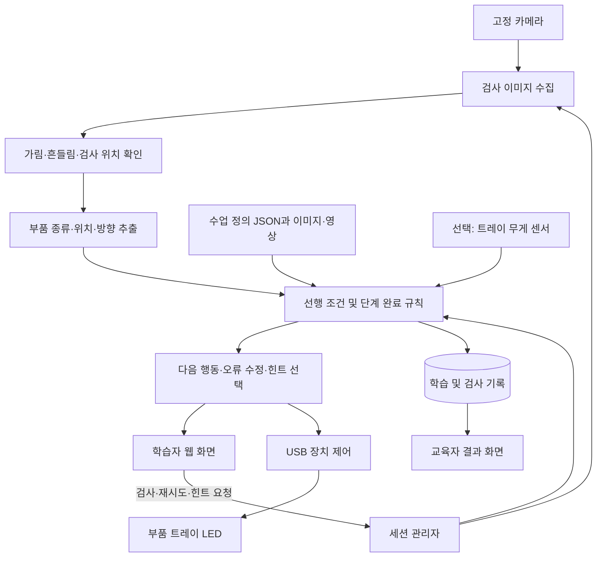
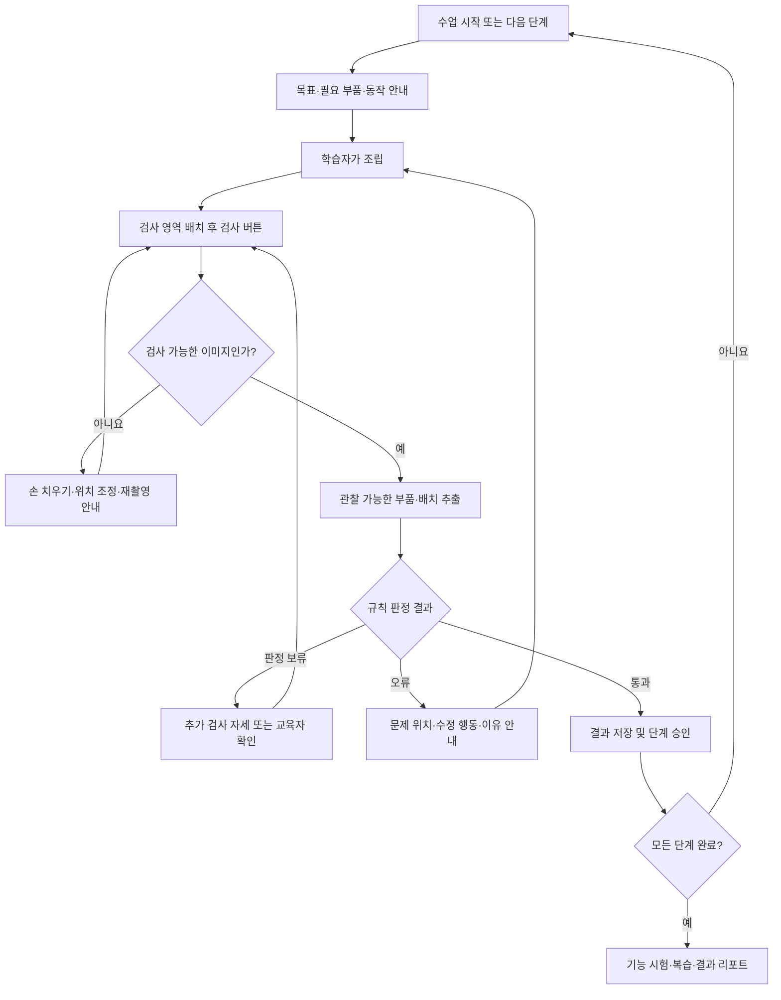

# 상태 인식 기반 교육용 자동차 조립 튜터 작업대

작성일: 2026-09-16  
출발 주제: 「캡스톤_프로젝트_주제_구체화.md」의 ‘교육용 자동차 조립 키트의 부품 누락·순서 오류를 알려주는 작업대’  
문서 성격: 주제 선정과 개발 착수를 위한 계획안. 아래 성능·예산·일정은 실측 결과가 아닌 초기 목표와 가정이다.

## 1. 프로젝트 제안과 수행 가능성 결론

**종이 매뉴얼을 보며 따라 하는 조립 실습을, 실제 조립 상태를 확인하고 다음 행동과 원리를 알려주는 대화형 실습으로 바꾼다.**

학습자가 화면의 안내에 따라 자동차를 조립하고 ‘검사’를 누르면, 작업대가 부품의 위치와 조립 상태를 확인한다. 정상일 때는 다음 단계로 이동하고, 오류가 있으면 수정 위치와 이유를 설명한다. 완료 후에는 어느 단계에서 어려움을 겪었는지와 이해 확인 결과를 보여준다.

이 프로젝트에서 ‘매뉴얼 대체’는 **선정한 키트 한 종류를 별도 종이 설명서 없이 처음부터 끝까지 실습할 수 있도록 만드는 것**이다. 모든 제품의 매뉴얼을 자동으로 읽어 가르치는 범용 시스템은 후속 확장으로 남긴다. 조립 절차와 교육 콘텐츠는 팀이 사전에 작성하고 검증한다.

**권고: 4인 팀·12주 개발을 가정하면 조건부로 수행 가능하다.** 웹 화면·규칙 엔진·기록 기능보다, 카메라에서 정상과 오류를 구분할 수 있는 키트를 선정하는 일이 가장 큰 불확실성이다. 따라서 첫 2주에 키트와 인식 가능성을 검증한 뒤 최종 범위를 확정한다. 실제 팀 숙련도, 투입 시간, 보유 장비와 학사 일정은 아직 확인하지 않았으므로 확정적인 완성 보장은 하지 않는다.

| 판단 항목 | 초기 판단 | 수행 조건 |
|---|---|---|
| 교육용 결과물의 명확성 | 높음 | 안내 → 조립 → 검사 → 피드백 → 복습까지 연결 |
| 기본 소프트웨어 구현 | 중간 난도 | 로컬 웹 화면, 규칙 기반 단계 관리, 데이터 저장 |
| 실물 상태 인식 | 가장 높은 위험 | 고정 조명·검사 위치, 큰 부품, 제한된 검사 자세 |
| 하드웨어 제작 | 중간 난도 | 카메라 거치대와 트레이 LED까지만 필수 |
| 교육 효과 입증 | 소규모 탐색 실험 가능 | 조립 성공과 원리 이해를 별도로 평가 |
| 한 학기 완성 | 조건부 가능 | 한 키트·6~8개 부품·5~6단계로 제한 |

## 2. 대상 사용자와 해결할 문제

대상은 메이커 교육·기초 공학 실습에서 자동차 키트를 처음 조립하는 학습자와 실습을 지도하는 교육자다. 최초 사용성 평가는 모집과 진행이 쉬운 성인 초보자 대상으로 실시한다. 실제 아동 대상 교육 적합성은 별도 검증 과제로 둔다.

| 현재 문제 | 시스템이 제공할 경험 | 확인할 효과 |
|---|---|---|
| 설명서 그림과 실제 부품을 연결하기 어려움 | 필요한 부품 사진·수량과 트레이 위치 표시 | 부품 탐색 시간과 도움 요청 감소 |
| 오류를 완료 후에야 발견함 | 단계별 검사와 수정 위치 표시 | 최종 오류 및 되돌아가는 단계 감소 |
| 다음 행동을 알아도 이유를 모름 | 차축·바퀴 역할과 순서의 이유 설명 | 원리 이해 문항의 정답률 |
| 강사가 같은 질문에 반복 대응함 | 단계별 힌트·시범 영상·재검사 | 강사 개입 횟수 |
| 따라 만들었지만 혼자 다시 하기 어려움 | 안내를 줄인 연습과 마지막 복습 | 도움 없는 재수행 결과 |

성공적인 조립과 학습은 같은 지표가 아니다. 완성 시간이 줄어들어도 이해도가 개선되지 않을 수 있으므로 두 결과를 구분해 보고한다.

## 3. 실습 시나리오와 키트 선정

### 3.1 권장 키트 조건

- 차체 1개, 차축 2개, 바퀴 4개, 덮개 1개로 구성된 **8개 주요 부품**을 기준으로 검토한다.
- 처음에는 모터·배터리 없이 굴러가는 수동 자동차를 선택한다.
- 부품을 반복 탈착할 수 있고, 결합 전후의 외관 차이가 카메라에 드러나야 한다.
- 작은 나사·와셔·접착제 중심 키트는 피한다. 마커를 붙일 평면과 색상 구분이 있으면 유리하다.
- 검사 중 차체 방향을 고정할 수 있는 받침과 앞·뒤 기준 표시를 준비한다.
- 실제 키트의 결합 구조에 따라 순서를 바꾼다. 아래 순서는 키트 구매 전의 예시이며 실제 조립 가능성을 먼저 확인한다.

### 3.2 예시 수업 구성

| 단계 | 학습자 행동 | 안내 내용 | 완료 확인 |
|---|---|---|---|
| 준비 | 부품을 트레이에 분류하고 차체 방향 확인 | 부품 이름·수량·검사 방법 | 부품 목록 확인, 카메라 연결 확인 |
| 1 | 차체를 기준 위치에 놓기 | 자동차 기준 앞·뒤·좌·우 | 차체 위치·방향 자동 확인 |
| 2 | 앞·뒤 차축 장착 | 차축이 바퀴를 지지하는 역할 | 노출된 차축 끝 또는 마커 위치 검사 |
| 3 | 앞바퀴 2개 장착 | 좌우 짝과 결합 위치 | 앞바퀴 두 위치의 부품 존재 확인 |
| 4 | 뒷바퀴 2개 장착 | 네 바퀴가 필요한 이유 | 뒷바퀴 두 위치와 기존 부품 재확인 |
| 5 | 덮개 장착 | 내부 부품 확인 후 덮는 이유 | 선행 단계 통과 기록과 덮개 위치 확인 |
| 6 | 자동차를 굴려 보고 복습 | 회전·정렬·마찰의 기초 | 외관 자동 확인 + 기능 시험 자기 확인 |

상단에서 차축이나 바퀴가 보이지 않으면 지정된 옆면·바닥면 검사 자세를 추가한다. 그래도 구분이 안 되면 키트를 바꾼다. 카메라 수를 늘리기 전에 관찰 가능한 조립 구조를 확보한다.

앞바퀴와 뒷바퀴의 조립 순서처럼 기능상 바뀌어도 되는 순서는 허용한다. **‘순서 오류’는 단순히 예시 순서와 다른 행동이 아니라, 필수 선행 조건을 만족하지 못한 상태**로 정의한다. 덮개를 씌우기 전에 차축 상태를 확인해야 하는 경우는 교육상 검사 선행 조건으로 명시한다.

## 4. 교육 도구로의 고도화

### 4.1 매뉴얼을 대체하는 기본 화면

한 화면에서 ‘지금 할 일’을 중심으로 다음 내용을 제공한다.

- 상단: 현재 단계, 진행률, 이번 단계의 학습 목표.
- 왼쪽: 필요한 부품 사진·수량, 짧은 동작 영상 또는 연속 사진.
- 오른쪽: 검사 이미지와 수정할 위치 표시.
- 하단: ‘검사’, ‘힌트’, ‘이전 단계로’, ‘도움 요청’ 버튼.

오류 문장은 **관찰 결과 → 수정 행동 → 이유** 순서로 작성한다.

> “자동차 기준 왼쪽 앞바퀴 위치에서 바퀴가 확인되지 않습니다. 표시된 차축 끝에 바퀴를 끼우고 다시 검사하세요. 양쪽 바퀴가 있어야 차체를 고르게 지지할 수 있습니다.”

화면에서의 좌우와 자동차의 좌우가 혼동되지 않도록, 차체에 앞쪽 화살표를 표시하고 화면에서도 같은 기준을 쓴다.

### 4.2 도움을 점차 줄이는 교육 방식

| 모드 | 제공하는 도움 | 목적 | 개발 우선순위 |
|---|---|---|---|
| 따라 하기 | 모든 단계의 사진·설명·오류 위치 | 종이 매뉴얼 없이 첫 조립 완료 | 필수 |
| 연습하기 | 목표 상태 우선 제공, 요청할 때 힌트 | 스스로 다음 행동 선택 | 기본 완성 후 |
| 확인하기 | 안내를 최소화하고 결과·오류 기록 | 도움 없이 수행 가능한지 확인 | 기본 완성 후 |

힌트는 ‘필요한 부품’ → ‘장착 위치’ → ‘동작 시범’ 순서로 상세해진다. 재시도 2회 이상이면 상세 힌트를 제안하되 사용자가 직접 선택할 수 있게 한다. 이 횟수는 초기 설계값이며 사용성 평가 후 조정한다.

### 4.3 이해 확인과 피드백

- 조립 중 2~3개의 짧은 질문을 배치한다. 예: “덮개를 씌우기 전에 차축을 확인하는 이유는 무엇인가요?”
- 문항에는 정답뿐 아니라 선택지별 설명을 제공한다.
- 완료 화면에는 소요 시간, 재시도 단계, 사용한 힌트, 이해 확인 결과를 표시한다.
- “손이 느리다”와 같은 능력 단정 대신 “차축 단계에서 힌트를 두 번 확인했습니다”처럼 관찰 사실을 제시한다.
- 교육자 화면에는 세션별 진행 상태와 자주 발생한 오류를 보여준다. 최초 구현은 작업대 한 대의 기록 조회로 제한한다.

음성 안내와 자유 질의응답은 선택 기능이다. 핵심 교육 콘텐츠는 사전 작성한 설명과 영상으로 제공하므로 생성형 AI가 없어도 수업을 완료할 수 있다.

## 5. 시스템 구성

### 5.1 물리 구성

```text
            [고정 USB 카메라 + 확산 조명]
                         ↓ 촬영
 [부품 트레이 + 칸별 LED] [방향 표시가 있는 검사 받침]
            ↑                         │
       [마이크로컨트롤러]           [자동차 키트]
            │ USB                     │ 영상
            └──────── [노트북 / PC] ───┘
                           │
                    [학습자 안내 화면]
```

카메라 영상 처리와 수업 로직은 PC가 담당한다. 마이크로컨트롤러는 트레이 LED와 선택 센서만 제어한다. 클라우드 연결 없이 로컬에서 시연하도록 구성한다.

### 5.2 소프트웨어 및 데이터 흐름



그림의 센서 입력은 보조 정보다. 부품을 트레이에서 꺼냈다는 사실만으로 장착 완료를 판정하지 않는다.

| 모듈 | 역할 | 구현안 |
|---|---|---|
| 인식 모듈 | 검사 이미지에서 부품과 위치 추출 | Python·OpenCV, 필요할 때 경량 탐지 모델 |
| 수업·규칙 엔진 | 필수 선행 단계와 현재 상태 비교 | Python 규칙 함수 + 수업 JSON |
| 서버 | 검사 요청, 세션·결과 전달 | Python 기반 로컬 API 서버 |
| 안내 화면 | 단계 설명, 이미지 표시, 피드백 | 팀이 익숙한 웹 프레임워크 |
| 기록 저장 | 검사 이력·힌트·시간·정답 저장 | SQLite와 로컬 미디어 폴더 |
| 장치 제어 | 트레이 LED와 선택 센서 통신 | ESP32 또는 Arduino 계열 + USB 직렬 통신 |

프레임워크 종류보다 모듈 사이의 데이터 형식과 오류 처리를 먼저 확정한다. 첫 통합은 LED 없이 카메라·화면·규칙 엔진으로 만들고, 그다음 실물 안내를 연결한다.

## 6. 작동 흐름과 판정 원칙

### 6.1 한 단계의 처리 과정



### 6.2 판정은 세 가지로 분리한다

1. **통과:** 필요한 부품과 관찰 가능한 위치 조건이 충족되고, 필수 선행 검사가 완료됨.
2. **오류:** 해당 영역을 충분히 관찰했으며 필요한 부품 누락·잘못된 배치 등의 근거가 있음.
3. **판정 보류:** 손이나 덮개에 가려짐, 이미지 흔들림, 방향 불일치, 인식 불확실 등으로 판단 근거가 부족함.

‘검출하지 못함’을 즉시 ‘부품 누락’으로 처리하지 않는다. 검사 품질을 먼저 확인하고 짧은 연속 이미지에서 결과가 일관적인지 확인한다. 연속 이미지의 구체적인 개수와 신뢰도 임계값은 검증 데이터로 조정한다.

### 6.3 순서 오류를 알 수 있는 범위

현재 이미지 한 장으로 과거의 실제 작업 순서를 모두 복원할 수는 없다. 따라서 **단계별 통과 기록과 현재 관찰 결과를 함께 사용**한다.

- 차축 검사를 통과하지 않았는데 덮개가 보이면 “덮개를 열고 차축을 먼저 확인하세요”라고 안내한다.
- 차축이 보이지 않는다는 이유만으로 “차축을 조립하지 않았다”고 단정하지 않는다.
- 이전에 승인된 부품도 다시 보이는 범위에서는 재검사한다. 통과 후 부품을 제거했을 가능성을 고려한다.
- 이전 단계로 돌아가 결합 상태를 바꾸면 영향을 받는 후속 단계의 승인을 무효화한다.
- 교육자 수동 승인은 별도 상태로 기록하고 자동 통과율 계산에서 제외한다.

핵심은 완벽한 행동 감시가 아니라, **학습자가 확인을 건너뛰지 않고 관찰 가능한 상태를 완성하도록 안내하는 것**이다.

## 7. 부품 인식 전략과 기술적 한계

### 7.1 권장 개발 순서

**1차: 통제된 환경에서 기준선을 만든다.** 고정 카메라, 단색 매트, 확산 조명, 지정 검사 자세를 사용한다. 차체·받침의 ArUco 마커로 방향과 기준 좌표를 얻고, 부품별 색상·형상·영역 조건을 조합한다. OpenCV는 마커 식별과 모서리 검출 기능을 제공하지만, 이것이 조립 상태 인식을 보장하는 것은 아니다. [OpenCV 공식 ArUco 문서](https://docs.opencv.org/4.11.0/d5/dae/tutorial_aruco_detection.html)

카메라 왜곡이 위치 판정에 영향을 주면 캘리브레이션을 적용한다. [OpenCV 공식 카메라 보정 문서](https://docs.opencv.org/4.13.0/d4/d94/tutorial_camera_calibration.html)

**2차: 기준선으로 부족한 항목에 학습 기반 인식을 적용한다.** 예를 들어 마커를 부착하기 어려운 바퀴를 객체 탐지로 찾고, 차체 기준 상대 위치로 장착 영역을 판단한다. 탐지 모델은 관찰값을 만들고, 순서와 교육 판단은 규칙 엔진이 담당한다.

**3차: 기준선과 학습 모델을 동일한 시험 데이터로 비교한다.** 학습 모델이 더 안정적이지 않으면 기준선을 유지한다. 마커 방식만 사용한 경우 ‘학습 기반 AI 인식’이라고 표현하지 않는다. AI 모델 구현이 평가상 필수인지도 착수 시 확인한다.

### 7.2 자동 검사가 가능한 것과 어려운 것

| 항목 | 최초 범위 | 제한과 대응 |
|---|---|---|
| 바퀴의 존재·수량·장착 영역 | 자동 검사 | 차체 옆에 놓인 바퀴를 장착으로 오인하는지 별도 시험 |
| 차체 방향·덮개 존재 | 자동 검사 | 기준 마커 또는 방향 표시 필요 |
| 노출된 차축 끝 위치 | 조건부 자동 검사 | 가려지면 바닥면 검사 자세 사용 |
| 선행 검사 없이 덮개 장착 | 기록 기반 안내 | 실제 과거 행동 순서까지 확정할 수는 없음 |
| 실제 결합 강도·나사 토크 | 자동 검사 제외 | 학습자·교육자 확인 항목으로 표시 |
| 덮개 내부 결합 상태 | 직접 판정 불가 | 덮개 전 검사와 필요 시 분해 재확인 |
| 바퀴가 원활히 굴러가는지 | 초기에는 자기 확인 | 별도 기능 시험으로 기록 |

마커가 붙은 부품이 보인다는 사실은 실제로 단단히 결합되었다는 증거가 아니다. 최소한 차체 기준 위치·방향을 함께 확인한다. 옆에 놓기·가볍게 걸치기와 실제 결합을 영상으로 구분할 수 없다면 판정 이름을 ‘외관 배치 확인’으로 제한하고 별도 손 확인 절차를 둔다.

## 8. 수업 콘텐츠와 저장 데이터 설계

### 8.1 수업을 코드와 분리한다

수업 정의 파일에는 다음 정보를 저장한다. 초기에 교사용 편집기를 만들기보다 JSON을 수정해 콘텐츠를 추가하도록 한다.

| 필드 | 예시·용도 |
|---|---|
| `lesson_id`, `version` | `car_basic`, 수업 및 판정 기준 버전 |
| `step_id`, `prerequisites` | 단계 식별자, 필수 선행 단계 |
| `required_parts` | 바퀴 2개 등 단계별 필요 부품 |
| `instruction`, `media` | 작업 설명과 시범 이미지·영상 |
| `inspection_pose` | 상단·옆면·바닥면 중 검사 자세 |
| `expected_state` | 기준 좌표에서 필요한 부품과 배치 |
| `error_feedback` | 오류 코드별 수정 행동·설명 |
| `hints`, `quiz` | 점진적 힌트와 이해 확인 문항 |
| `manual_checks` | 회전 확인 등 자동 검사 외 확인 항목 |

새 키트로 확장할 때 화면과 세션 관리는 재사용할 수 있지만, 부품 인식·위치 조건·교수 콘텐츠는 다시 만들고 검증해야 한다. 파일 교체만으로 모든 키트를 지원한다고 주장하지 않는다.

### 8.2 검사 결과 예시

```json
{
  "session_id": "demo-001",
  "inspection_id": "inspect-012",
  "step_id": "front_wheels",
  "result": "error",
  "error_code": "MISSING_FRONT_LEFT_WHEEL",
  "observed_parts": ["body", "front_right_wheel"],
  "view_quality": "valid",
  "evidence_image": "captures/inspect-012.jpg",
  "rule_version": "car-basic-v1"
}
```

검사 요청마다 고유 번호를 부여해 중복 클릭으로 단계가 두 번 넘어가지 않게 한다. 이미지와 결과는 같은 검사 번호로 연결한다. 서버는 현재 단계와 요청 단계가 일치하는지 확인하고 오래된 결과를 다음 단계에 적용하지 않는다.

저장 항목은 세션 식별자, 단계 시작·종료 시각, 검사 결과, 재시도, 힌트 사용, 문항 응답, 수동 승인 여부다. 기본 영상은 작업대만 촬영하며, 평가용 이미지는 참가자 동의와 보관 기간을 정한 뒤 필요한 검사 장면만 저장한다.

## 9. 개발 범위와 완료 기준

### 9.1 반드시 완성할 범위

- 키트 한 종류, 주요 부품 6~8개, 조립 단계 5~6개.
- 단계별 작업 설명·부품 사진·시범 자료와 검사 버튼.
- 바퀴 누락, 관찰 가능한 배치 오류, 선행 검사 미완료 상태에서 덮개 장착의 세 범주 처리.
- 오류 위치 및 수정 행동 안내, 판정 보류와 재촬영 흐름.
- 단계 상태 관리, 재시도, 이전 단계 복귀와 후속 승인 무효화.
- 이해 확인 문항과 개인 결과 리포트.
- 다음에 사용할 부품 트레이의 LED 안내.
- 카메라 실패 시 진행을 멈추고 재연결·재검사를 안내하는 처리.

**최소 완료 조건:** 초보자가 별도 종이 설명서 없이 한 차례 수업을 마치고, 의도적으로 삽입한 오류를 안내에 따라 수정하며, 결과 기록을 조회할 수 있어야 한다. 수동 확인 항목은 화면에서 명확히 구분한다.

### 9.2 기본 완성 뒤 추가할 범위

우선순위는 연습·확인 모드 → 교육자 오류 통계 → 학습 기반 인식 개선 → 무게 센서 → 음성 안내 순으로 둔다. 학습 기반 AI 구현이 과제 필수 요건이면 인식 모델을 기본 범위로 올리고 다른 확장 기능을 줄인다.

이번 학기 범위에서는 실시간 손동작 전체 추적, AR 안경, 로봇 자동 조립, 다중 키트 자동 지원, 매뉴얼 PDF 자동 변환, 범용 AI 교사, 다수 작업대 실시간 운영을 제외한다. 각각 독립적인 난도가 있어 핵심 수업의 완성을 지연시킬 수 있다.

## 10. 검증 계획

### 10.1 기술 검증 데이터

최초에는 정상·바퀴 누락·잘못된 배치·선행 검사 누락·가림/불확실 상태를 포함한 100~200개의 **독립 검사 장면**을 목표로 수집한다. 같은 장면의 연속 프레임을 서로 독립적인 표본으로 세지 않는다. 이 수량은 초기 가능성 확인용이며 모델 학습에 충분하다는 뜻은 아니다.

수집 날짜·사용자·조립 세션 단위로 학습/개발/최종 시험 데이터를 분리한다. 모델이나 임계값은 최종 시험 데이터를 보면서 조정하지 않는다. 유효한 순서 변경, 차체 옆에 놓인 바퀴, 손으로 가린 부품, 정상 조립 후 부품 제거도 시험에 포함한다.

| 지표 | 계산·측정 방식 | 초기 목표 |
|---|---|---|
| 오류 검출 재현율 | 실제 오류 중 오류로 검출한 비율, 종류별 제시 | 각 핵심 오류 90% 이상 |
| 정상 오경보율 | 정상 장면 중 오류 판정한 비율 | 10% 이하 |
| 자동 판정률 | 유효 검사 중 보류 없이 통과/오류로 판정한 비율 | 90% 이상 |
| 오류의 잘못된 통과율 | 실제 오류 중 통과한 비율 | 5% 이하 |
| 검사 응답 시간 | 검사 클릭부터 결과 표시까지 | 95백분위 2초 이내 |
| 통합 안정성 | 정상·오류·복구를 포함한 반복 수업 | 10회 연속 완료 |

표본 수와 실제 건수를 함께 보고한다. 실제 오류에 대한 보류는 재현율 계산에서 성공으로 세지 않으며, 높은 보류율로 잘못된 통과율만 낮춘 결과를 좋은 성능으로 해석하지 않는다. 유효 입력과 의도적인 가림 등 무효 입력의 결과도 구분한다.

### 10.2 교육·사용성 검증

성인 초보자 12~20명을 목표로 모집하고, 사전 경험을 확인한 뒤 정적 매뉴얼 집단과 튜터 집단으로 배정한다. 같은 사람이 같은 키트를 두 번 조립하는 비교는 반복 학습 효과가 크므로 초기에는 집단 간 비교를 우선한다.

- 두 집단에 같은 키트, 같은 작업 환경, 동일한 핵심 설명 내용을 제공한다.
- 정적 매뉴얼에는 동일한 사진·설명을 제공하고, 튜터에는 상태 검사와 상황별 피드백을 추가한다.
- 최종 조립 오류, 완성 시간, 강사 개입, 원리 문항 정답률, 사용 편의성을 측정한다.
- 조립 후 두 집단 모두 안내 없이 간단한 오류 수정 과제를 수행하도록 한다.
- 최종 조립 상태는 시스템 판정과 별개로 사전 작성한 체크리스트에 따라 사람이 확인한다.
- 소규모 탐색 실험으로 결과를 해석하며, 표본이 작으면 일반적인 교육 효과를 입증했다고 주장하지 않는다.

이 비교에서 얻은 차이는 전체 튜터 기능의 효과다. LED·자동 검사·힌트 각각의 효과를 분리해 주장하려면 별도 실험이 필요하다.

## 11. 12주 개발 일정과 역할

4인 팀이 각자 주 8~12시간을 투입한다고 가정하면 총 384~576인시다. 이는 프로젝트 계획용 가정이며 수업·시험·다른 과제에 따라 조정해야 한다.

| 기간 | 주요 작업 | 산출물·완료 조건 |
|---|---|---|
| 1~2주 | 키트 확보, 조립 구조 분석, 촬영·인식 실험 | 핵심 정상/오류 구분과 진행 여부 결정 |
| 3~4주 | 수업 정의, 규칙 엔진, 화면, 카메라 연결 | LED 없이 한 단계의 안내→검사→수정 통합 |
| 5~6주 | 전체 단계 확장, 트레이 LED, 오류 피드백 | 한 차례 수업을 처음부터 끝까지 수행 |
| 7~8주 | 인식 개선, 보류·복귀 처리, 기록·문항 | 핵심 범위 기능 고정, 시험 데이터 확보 |
| 9~10주 | 기술 평가·사용자 실험·주요 결함 수정 | 정량 지표와 사용성 결과 |
| 11~12주 | 반복 시연, 보고서·발표·복구 절차 정리 | 5분 시연과 최종 산출물 |

| 역할 | 담당 범위 | 다른 역할과의 연결 |
|---|---|---|
| A: 비전·데이터 | 촬영 환경, 인식, 데이터 라벨링·평가 | 관찰값 형식을 B에게 전달 |
| B: 백엔드·규칙 | 수업 상태, 검사 API, 저장·복구 | A의 결과를 C의 피드백으로 변환 |
| C: 화면·교육 콘텐츠 | 실습 UI, 시범 자료, 힌트·문항 | B와 단계·오류 코드 공동 정의 |
| D: 장치·통합 검증 | 거치대, LED, USB 통신, 통합 시험 | 전체 수업의 실물 동작 검증 |

역할은 개인의 실제 경험을 확인한 뒤 배정한다. A의 인식이 완성될 때까지 기다리지 않도록 1주차에 모의 검사 결과를 정의해 B·C가 화면과 규칙을 먼저 개발한다. 매주 적어도 한 번 실제 키트로 통합 시연한다.

## 12. 장비와 예산 가정

아래 금액은 제품 조사나 견적이 아닌 **예산 배분용 추정 범위**이며, 구매 전 실제 가격·보유 장비·키트 호환성을 확인한다. PC와 모니터는 기존 장비를 사용한다고 가정한다.

| 항목 | 용도 | 배정액 |
|---|---|---:|
| 자동차 키트 및 예비 부품 | 반복 조립·파손 대비 | 3~8만 원 |
| USB 카메라 | 고정 검사 영상 | 3~8만 원 |
| 거치대·조명·매트·검사 받침 | 촬영 조건 유지 | 4~10만 원 |
| 마이크로컨트롤러·LED·배선 | 부품 트레이 안내 | 2~5만 원 |
| 트레이·출력물·마커·제작 재료 | 작업대 구성 | 2~5만 원 |
| 예비비 | 소모품·재제작 | 3~6만 원 |
| **기본 합계** | PC·모니터 제외 | **17~42만 원** |
| 선택 센서·추가 카메라 | 기본 구현 후 필요 시 | 별도 3~10만 원 |

노트북 대여가 불가능하거나 GPU가 필요한 모델을 선택하면 예산과 개발 방식을 다시 검토한다. 처음부터 별도 GPU·엣지 컴퓨터를 구매하는 것은 전제로 두지 않는다.

## 13. 첫 2주의 착수 판단 기준

### 13.1 반드시 확인할 질문

1. 선택한 키트에서 차축·바퀴·덮개의 정상과 오류를 촬영으로 구분할 수 있는가?
2. 마커·검사 받침을 추가해도 조립 학습을 방해하지 않는가?
3. 사용자가 매 단계 지정 자세로 놓는 과정이 지나치게 번거롭지 않은가?
4. 실제 PC에서 검사와 안내를 지연 없이 연결할 수 있는가?
5. 학습자가 화면의 사진·설명만 보고 첫 단계를 수행할 수 있는가?

### 13.2 진행·축소·전환 기준

| 결정 | 관찰 기준 | 다음 행동 |
|---|---|---|
| 진행 | 별도 수집한 검사 장면에서 핵심 정상/오류가 대부분 구분되고, 주요 오류의 검출률이 각각 약 80% 이상 | 키트 고정, 최종 목표 90%로 개선 |
| 범위 축소 | 바퀴·덮개는 구분되지만 차축은 불확실 | 차축 별도 자세 또는 수동 확인으로 제한하고 관찰 범위 명시 |
| 인식 방식 변경 | 마커 방식은 안정적이나 학습 모델은 불안정 | 마커 기준선으로 수업 완성, AI 필수 요건 별도 확인 |
| 키트 변경 | 지정 자세·조명에서도 정상/오류가 시각적으로 거의 동일 | 노출 구조·큰 부품의 키트로 교체 |
| 주제 재검토 | 키트 변경 뒤에도 주요 상태를 구분할 수 없거나 투입 시간이 부족 | 자동 상태 검사 목표를 낮출지, 다른 후보로 갈지 팀에서 결정 |

초기 80%는 최종 품질 기준이 아닌 착수 판단 기준이다. 소수 장면의 성공률만 보지 말고 서로 다른 사람·촬영일의 결과와 오류 사례를 함께 확인한다. 핵심 오류별 최소 20개의 별도 검사 장면 확보를 초기 목표로 삼는다.

### 13.3 주요 위험과 대응

| 위험 | 영향 | 우선 대응 |
|---|---|---|
| 손·그림자·빛 반사 | 잘못된 오류·통과 | 검사 버튼 방식, 확산 조명, 판정 보류 |
| 미결합 부품을 장착으로 오인 | 실습 결과 신뢰 저하 | 상대 위치 검사, 옆에 놓기 시험, 수동 기능 확인 |
| 센서·카메라 기능 확장 과다 | 수업 기능 완성 지연 | LED까지만 필수, 추가 센서는 후순위 |
| 촬영 데이터가 한 환경에 편중 | 시연 외 환경에서 실패 | 날짜·사용자 단위 분리, 환경 범위 명시 |
| 설명 콘텐츠 제작 누락 | 인식 데모에 그침 | 3~4주차부터 실제 안내·힌트·문항 작성 |
| 참가자 모집 지연 | 교육 효과 평가 부족 | 초기에 모집 일정 확보, 실패 시 기술 검증과 내부 사용성 결과만 보고 |
| USB·카메라 연결 실패 | 수업 중단 | 상태 표시, 재연결 후 재검사, 세션 복구 |

## 14. 발표 시연과 최종 산출물

### 14.1 5분 시연안

| 시간 | 보여줄 내용 |
|---|---|
| 0:00~0:40 | 초보자가 설명서만으로 오류를 찾기 어려운 문제와 프로젝트 목적 |
| 0:40~1:30 | 현재 단계 안내, 필요한 부품의 LED, 정상 단계 통과 |
| 1:30~2:30 | 앞바퀴 하나 누락 → 오류 위치·이유 안내 → 수정 후 통과 |
| 2:30~3:20 | 차축 확인 전에 덮개 장착 → 선행 검사 안내, 손 가림 시 판정 보류 |
| 3:20~4:10 | 이해 확인 문항과 학습 결과 화면 |
| 4:10~5:00 | 시스템 구성, 실제 측정 결과, 자동 검사 범위와 한계 |

시연을 위해 미리 저장한 영상을 사용할 경우 녹화임을 표시한다. 다른 오류 시나리오로 전환할 때는 시연 세션을 초기화해 실제 단계 기록과 화면이 맞도록 한다.

### 14.2 최종 제출물

1. 카메라·조명·검사 받침·LED 트레이가 결합된 작업대.
2. 로컬에서 실행되는 교육용 웹 앱과 설치·실행 안내.
3. 한 키트의 완전한 수업 정의, 시범 자료, 힌트, 이해 확인 문항.
4. 데이터 수집·분리 기준과 오류별 시험 결과.
5. 소규모 사용자 실험 결과 또는 미실시 사유와 대체 검증 결과.
6. 시연 영상, 시스템 구성도, 한계와 확장 계획을 포함한 최종 보고서.

## 15. 주제 차별성과 최종 권고

이 프로젝트의 차별점은 ‘카메라로 자동차 부품을 찾는다’가 아니라 **관찰된 조립 상태에 맞춰 수업을 진행하고, 오류 수정과 원리 이해를 연결한다는 점**이다. 비교 기준은 단순 객체 탐지 데모뿐 아니라 동일한 내용의 정적 매뉴얼이다.

원문은 제공된 교내 세 자료집에서 직접 대응하는 작품을 찾지 못했다고 정리한다. 이는 원문 검토 결과의 인용이며, 본 계획서에서 교내 자료집 전체나 외부 제품·논문을 다시 조사한 결과는 아니다. 최종 제안 단계에서는 ‘세계 최초’와 같은 표현을 피하고, 상태 기반 안내·교육 기능·검증 방법의 차이를 구체적으로 제시한다.

**팀의 첫 목표는 ‘AI 교사 완성’이 아니라 ‘한 종류의 자동차를 종이 매뉴얼 없이 배우고, 오류를 고쳐 완성하는 한 차례 수업’으로 정한다.** 2주 내 관찰 가능한 키트와 검사 방식을 확보하면, 이후에는 화면·규칙·교육 콘텐츠를 병렬로 개발할 수 있다. 이 조건을 충족할 때 캡스톤 주제로 채택하는 것을 권고한다.

## 참고 자료

- [기존 주제 구체화 문서](캡스톤_프로젝트_주제_구체화.md): 주제 배경, 기존 범위, 교내 선행작 검토 결과.
- [OpenCV: Detection of ArUco Markers](https://docs.opencv.org/4.11.0/d5/dae/tutorial_aruco_detection.html): 기준 마커 검출 구현 참고.
- [OpenCV: Camera calibration With OpenCV](https://docs.opencv.org/4.13.0/d4/d94/tutorial_camera_calibration.html): 카메라 왜곡 보정 구현 참고.

공식 문서는 구현 수단의 참고 자료이며 본 프로젝트의 성능·교육 효과를 입증하는 자료가 아니다. 해당 효과는 위 실험 계획에 따라 직접 검증한다.
