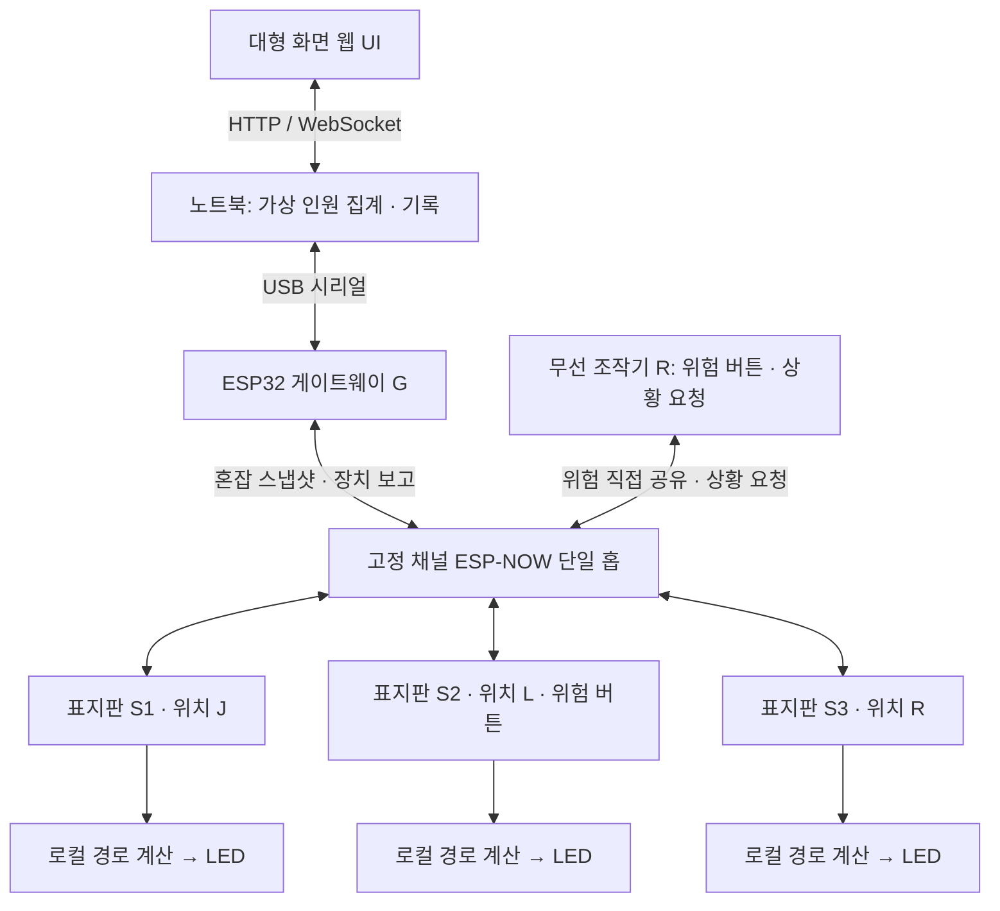
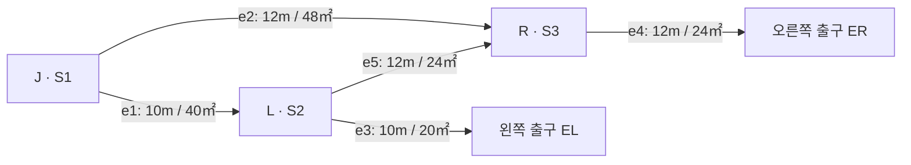
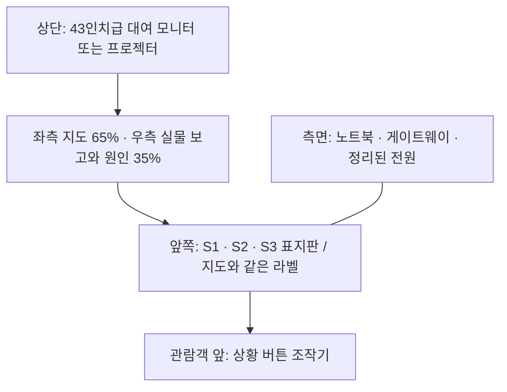
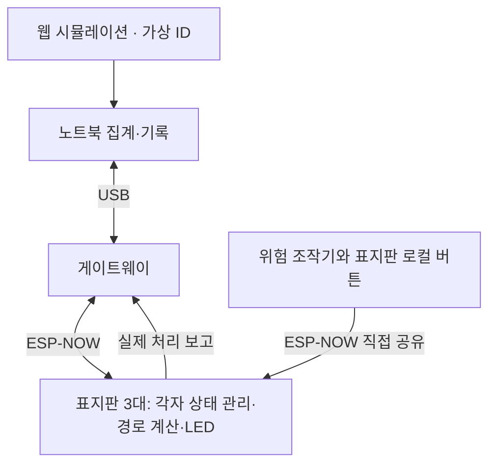
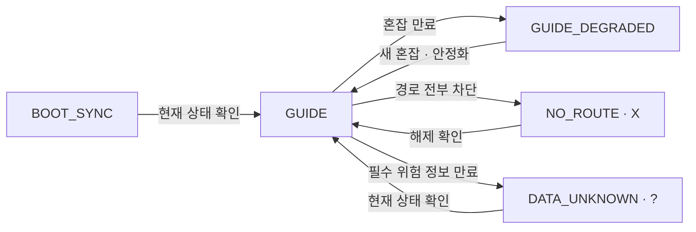

# 혼잡도를 반영하는 분산형 스마트 대피 안내 시스템 계획서

작성일: 2026년 9월 23일  
문서 버전: 1.0 · 설계 및 수행 계획  
과목명: 컴퓨터공학 종합설계  
팀명 / 팀원 / 지도교수 / 제출일: 제출 시 기입

영화관을 단순화한 실험용 공간에서 위험 복도를 제외하고, 혼잡을 반영하여 대피 방향을 바꾸는 시제품을 개발한다. **ESP32 표지판 3대가 각각 경로를 계산하고, 대형 화면의 가상 인원과 실제 무선 표지판을 연결하여 시연한다.** 핵심 성과는 상황 입력 → 무선 정보 공유 → 장치별 경로 계산 → 실물 표시 → 결과 기록의 연결이다.

본 계획은 「스마트_대피_안내_시스템_핵심기능.pdf」의 분산 제어·위험 우선·혼잡 반영 원칙을 구체화했다. 참고 착석 프로젝트 계획서의 본문과 별첨 구성을 따랐다. PDF에서 미정이었던 위치 입력과 시연 방식은 아래 기본안으로 제안하며, 기존 문서의 구상을 이미 구현·검증된 결과로 간주하지 않는다. 하단 별첨 A·B·C는 각각 과제 계획서, 요구사항명세서, 상세설계서로 독립 제출할 수 있도록 작성했다.

## 목차

1. 프로젝트 목표와 구현 범위
2. 시스템 구조와 대표 동작
3. 구체적인 수행 계획
4. 현실적인 수행 가능성과 범위 조정
5. 하드웨어 구성과 예산
6. 실험 및 성능 검증 계획
7. 발표 당일 부스와 발표 시간의 시연 계획
8. 위험 대응·완료 기준·산출물
9. 근거 자료와 설계 결정
10. 별첨 A 과제 계획서
11. 별첨 B 요구사항명세서
12. 별첨 C 상세설계서

## 1 프로젝트 목표와 구현 범위

### 1.1 과제의 문제와 목표

고정된 안내 방향만으로는 특정 복도가 차단되거나 한쪽 출구 주변에 인원이 몰리는 상황의 변화를 표현하기 어렵다. 본 과제는 사전에 등록한 복도 구조와 변화하는 위험·혼잡 정보를 결합하여, 갈림길에 설치된 표지판이 다음 이동 방향을 다시 결정하는 과정을 구현한다.

개발 목표는 네 가지다. 첫째, 위험으로 차단된 복도를 경로에서 제외한다. 둘째, 남은 경로 중 이동 거리와 혼잡 비용을 비교한다. 셋째, 상황을 공유받은 각 표지판이 자신의 위치에서 직접 계산한다. 넷째, 경로 없음과 정보 불확실을 구분하여 표시하고, 실제 장치의 처리 결과를 웹에서 확인한다.

연구 질문은 “혼잡 비용을 추가하면 동일한 모의 조건에서 특정 복도의 집중이 줄어드는가?”, “새 위험이 발생하면 세 표지판이 얼마나 빠르고 일관되게 반응하는가?”다. 실제 화재에서의 생존율·현장 안전성·대피 시간 단축을 시제품의 입증된 성과로 주장하지 않는다.

### 1.2 기본 제출 범위

| 구분 | 기본 구현과 완료 조건 |
|---|---|
| 실험 공간 | 갈림길 J·L·R, 출구 EL·ER, 방향이 정해진 복도 5개로 구성한 가상 평면 |
| 실물 장치 | ESP32 표지판 3대, USB 게이트웨이 1대, 무선 상황 조작기 1대. 동일 계열 보드 사용 |
| 위험 입력 | 조작기에서 출구 접근 복도 2개를 각각 차단. 표지판 S2의 버튼으로 별도 복도 1개 차단 |
| 혼잡 입력 | 고유 ID를 갖는 가상 인원 60명의 구역을 집계. 실시간 시나리오와 기록 재생 지원 |
| 경로 계산 | 각 표지판의 C++ 경로 모듈에서 위험 제외 후 Dijkstra 실행. 웹 계산은 검증용 |
| 무선 통신 | 고정 채널 ESP-NOW 단일 홉, 등록된 장치 사이 상황 공유와 응답 확인 |
| 표시 | 초록 화살표, 빨강 X, 노랑 ? 또는 대기 기호. 의미를 문자 범례로 병기 |
| 웹 | 지도·가상 인원·입력 상황·표지판 보고값·버전·지연·장애·기록 내려받기 |
| 시연 | 부스 3분 체험, 발표 90초 시연, 30초 영상 대체안, 같은 초기 상태로 재설정 |
| 검증 | 위험 회피, 혼잡 반영, 통신·장애, 경로 일치, 반복 실행 및 비교 실험 |

**모의 혼잡 입력은 실제 위치 측정의 대체 검증이 아니다.** 기본 범위는 “모의 위치 기반 혼잡 집계와 실제 장치 제어의 통합”이다. 참여 기기의 실제 구역 자동 판별까지 과목 평가에서 필수라면, 1주차에 BLE 확장을 필수로 승격하고 일정·예산을 추가한다. 이 조건을 미확인 상태로 제출할 때는 기본 범위를 과제 목적에 명시한다.

### 1.3 선택 확장과 제외 범위

| 항목 | 계획상의 위치 | 판단 이유 |
|---|---|---|
| Android 1종 + BLE 비콘 3개 | 기본 통합 완료 후 2주·40–70인시 추가 | 구역 보정·권한·휴대폰별 차이와 실측 평가가 별도 필요 |
| 온도 또는 연기 센서 | 별도 입력 노드의 후속 확장 | 실제 감지 성능과 오경보 검증이 필요하므로 초기에는 버튼으로 위험 사건을 재현 |
| UWB 태그·앵커 | 이번 기본안에서 제외 | 장치 수·전원·배치·측위 검증이 늘어남 |
| 다중 홉 중계 | 후속 확장 | 기본 실험은 모든 장치가 직접 통신 가능한 한 공간에 한정 |
| 개인용 카드·진동·배터리 제작 | 제외 | 핵심인 공용 표지판 제어와 무관한 제작 부담을 줄임 |
| 실제 영화관 앱·소방 설비 연동 | 제외 | 외부 기관 협의와 현장 시스템 연동을 전제하지 않음 |
| AI·영상 인식·실제 군중 실험 | 제외 | 핵심 경로 결정은 설명 가능한 그래프 알고리즘으로 검증 가능 |

### 1.4 문서에서 구분하는 세 가지 상태

“기존 자료에 있음”은 참고 PDF에 웹 시뮬레이션 기능이 기술되어 있다는 뜻이다. “계획”은 이 문서에서 새로 정의한 구조·부품·성능 목표다. “완료”는 실제 구현과 수용 시험 증거가 있는 기능만 뜻한다. PDF에 언급된 웹 시뮬레이션 원본의 위치·버전은 착수 시 확인한다. 현재 폴더의 「이음_웹앱_목업.html」은 별도 가상 목업이므로 본 분산형 시스템이 이미 구현되었다는 증거로 사용하지 않는다.

## 2 시스템 구조와 대표 동작

### 2.1 전체 시스템 구조도



그림 1. 조작기의 위험 정보와 표지판 S2의 로컬 위험 정보는 게이트웨이를 경유하지 않고 다른 표지판에 직접 전달한다. 혼잡 정보는 노트북 집계와 게이트웨이를 거친다. 화살표 명령을 전송하는 구조가 아니라, 상황 데이터를 공유하고 표지판이 다음 간선을 결정하는 구조다. 모든 장치는 외부 전원을 사용한다.

### 2.2 실험용 공간과 표지판 배치



그림 2. 모든 수치는 시뮬레이션용 가정이며 실제 건물의 도면·규격이 아니다. e1·e2·e5는 연결 복도, e3·e4는 출구 접근 복도다. 구역과 간선을 일대일 대응시켜 밀도 집계의 중복을 피한다. J→L→R→출구 순서를 따르는 단방향 비순환 그래프로 제한한다. 이 제한은 서로 다른 버전의 방향이 잠시 공존해도 경로가 순환하지 않게 하는 실험 설계다. 실제 양방향·다층 건물에는 그대로 적용할 수 없다.

S1의 e1 방향은 왼쪽, e2 방향은 오른쪽이다. S2의 e3 방향은 왼쪽, e5 방향은 오른쪽이다. S3의 e4 방향은 오른쪽이다. 설치 도면과 장치의 방향 매핑을 일치시킨다. 화면에 배치한 방향과 실물 화살표가 다르면 안내 논리가 맞더라도 시험 실패로 처리한다.

### 2.3 대표 시나리오

| 순서 | 입력 | 관찰할 결과 |
|---|---|---|
| 정상 | 모든 위험 입력 해제·낮은 혼잡 | S1은 가까운 왼쪽 출구 방향, S2는 왼쪽, S3는 오른쪽 |
| 왼쪽 혼잡 | e3의 모의 인원이 증가 | S1·S2가 조건 충족 후 오른쪽 대안을 선택. S3는 유지 |
| 오른쪽 위험 | e4 차단 | S1·S2는 혼잡하더라도 왼쪽 경로 선택. S3는 X |
| 양쪽 출구 접근 차단 | e3도 차단 | S1·S2·S3 모두 X. 혼잡 비용으로 위험 차단을 무시하지 않음 |
| 초기화 | 위험 스위치 해제 후 초기화 요청 | 새 실행 ID·초기 인원·버전 확인 뒤 정상 경로 복귀 |

### 2.4 분산 구조에서의 의존성

| 끊긴 부분 | 유지되는 것 | 중단·제한되는 것 |
|---|---|---|
| 웹 브라우저만 종료 | 서버 집계, ESP-NOW, 장치 계산·표시 | 화면 관찰과 웹 조작 |
| 노트북 서버 종료 / USB 분리 | 표지판 간 직접 위험 공유·자체 경로 계산 | 새 혼잡 입력·기록. 혼잡 만료 뒤 거리 기준 안내로 전환하고 품질 저하 표시 |
| 게이트웨이 전원 차단 | 조작기·S2가 직접 보내는 위험과 각 표지판 계산 | 웹 연결과 혼잡 갱신. 자동으로 전체 0명 처리하지 않음 |
| 조작기 R 전원 차단 | S2의 위험 공유, 남은 장치 동작 | e3·e4의 정상 확인 만료. 해당 간선을 불확실로 제외하므로 안내 제한 발생 |
| 표지판 S2 전원 차단 | S1·S3의 자체 동작 | S2 표시 중단, S2가 담당하는 e1의 정상 확인 만료 |

“분산형”은 경로 계산과 일부 위험 전달이 중앙 서버에 종속되지 않는다는 뜻이다. 혼잡 정보 생성과 모든 위험 입력이 무장애로 유지된다는 뜻은 아니다.

## 3 구체적인 수행 계획

### 3.1 작업 분해와 예상 인시

부품 수령 후 8주, 3인 팀, 기본적인 C/C++·Python·웹 개발 경험을 가정한다. 인시는 팀원의 실제 작업 시간을 합한 추정치이며 배송·교내 장비 예약 대기 시간은 포함하지 않는다.

| 작업 | 수행 내용 | 완료 산출물 | 인시 |
|---|---|---|---:|
| 범위·환경 확정 | 평가 항목 확인, 원본 웹 확인, 그래프·역할·부품 확정 | 요구사항 v1.1, 구성표 | 10–14 |
| 경로 모듈 | 거리·혼잡 비용, 차단, 동일 비용 결정 규칙, 테스트 벡터 | PC 기준 구현과 C++ 모듈 | 18–26 |
| 장치 제작 | 표지판 3대, 버튼, 전원·배선, 화살표 매핑 | 동작 시제품과 배선도 | 18–26 |
| 무선·상태 관리 | 순번·부팅 세대·응답·재시도·만료·복구 | 펌웨어와 장애 시험 도구 | 30–40 |
| 집계·게이트웨이 | 가상 ID·구역 집계, USB, 스냅샷, 실행 제어 | 로컬 서버와 연결 프로토콜 | 18–26 |
| 웹·시뮬레이션 | 지도·표지판 보고·시나리오·혼잡·진행·내보내기 | 발표용 UI와 반복 실행 | 24–34 |
| 통합·검증 | 위험·혼잡·단절·재부팅·비교 실험·결함 수정 | 시험표, CSV, 결과 그래프 | 28–38 |
| 문서·전시 준비 | 별첨 갱신, 설치, 대본, 영상, 리허설 | 제출본과 시연 패키지 | 14–20 |
| **기본 작업량** | | | **160–224** |
| **통합 예비 시간** | 환경 차이·무선 간섭·부품 교환·오류 수정 | | **40–56** |
| **계획 총량** | | | **200–280** |

8주 동안 팀 전체 주당 25–35시간, 3인 기준 1인당 주당 약 8.3–11.7시간이다. 2인 팀이면 1인당 주당 12.5–17.5시간이 필요하므로 10–12주 확보가 더 현실적이다. 처음 배우는 기술의 학습 시간은 별도로 잡는다. 기존 웹 시뮬레이션을 그대로 재사용할 수 있다고 가정하여 시간을 선차감하지 않는다.

### 3.2 주차별 일정과 통과 기준

| 주차 | 수행 내용 | 주말 통과 기준 |
|---|---|---|
| 사전 준비 | 부품 납기, 화면·촬영 장비 대여, 평가 범위 확인 | 구매 목록과 기본/확장 범위 확정 |
| 1주차 | 보드 2대 통신, LED 1대, 고정 그래프 경로 계산 | 버튼 사건을 수신한 보드가 자체 계산 후 방향 변경 |
| 2주차 | 표지판 3대·게이트웨이·조작기, 위험 원천 직접 전송 | 노트북 없이 위험 차단·복구 기본 동작 |
| 3주차 | ID 집계·혼잡 비용·USB·웹 실물 보고 | 가상 인원 변화가 세 표지판 계산에 반영 |
| 4주차 | 만료·중복·재부팅·초기화·품질 상태 | X와 ? 구분, 오래된 이벤트 역전 없음 |
| 5주차 | 방향 안정화·시뮬레이션·로그·비교 모드 | 같은 시드의 두 정책 반복 실행과 결과 저장 |
| 6주차 | 지연·손실·차단·전원 시험, 결함 수정 | 필수 수용 시험 1차 완료, 미달 항목 목록 |
| 7주차 | 화면 가독성·부스 설치·90초 시연·영상 | 연속 10회 시연, 초기화 누락 없이 완료 |
| 8주차 | 회귀 확인·문서 일치·최종 리허설 | 제출 파일·예비 부품·영상·체크리스트 동결 |

핵심 경로는 “보드 간 통신 → 장치별 계산 → 혼잡 입력 연결 → 장애 처리 → 반복 시연”이다. 3주차 이후 UI 장식과 확장 기술보다 이 연결의 결함 해결을 우선한다.

### 3.3 역할과 공동 작업

| 역할 | 주 담당 | 반드시 함께 확인할 것 |
|---|---|---|
| A 장치·통신 | ESP32, LED·전원, 위험 입력, 재전송 | B와 메시지 구조·상태 만료 규칙 |
| B 경로·서버 | C++ 경로, Python 집계·저장, USB | C와 좌표·구역·시나리오·비교 조건 |
| C 웹·검증·시연 | 지도, 실제 보고 표시, 시험 실행, 전시 | A와 실제 LED/화면 일치·촬영 |

매주 1회 통합 시간 2시간을 확보한다. 장치가 도착하기 전에는 동일한 메시지 형식의 가짜 입력으로 각 모듈을 개발한다. 통신 상수·그래프·시험 벡터는 공동 설정 파일로 관리하고 코드와 제출 문서의 버전을 함께 기록한다.

## 4 현실적인 수행 가능성과 범위 조정

### 4.1 판단

**3인·8주·200–280인시를 확보하고 모의 혼잡 입력을 기본으로 삼으면 학부 종합설계로 수행 가능한 범위다.** 가장 어려운 부분은 최단 경로 계산 자체보다 여러 장치의 상태 갱신·오래된 정보 처리·화면과 실물의 일치·시연 재현성이다. 실제 위치 측정, 건물 전체 통신, 인증된 화재 감지까지 한 번에 수행하는 계획은 이 작업량에 포함되지 않는다.

| 수준 | 현실적으로 보여줄 수 있는 결과 | 판단 |
|---|---|---|
| 1–2주 기술 확인 | 보드 2대와 표지판 1대의 위험 반응 | 핵심 가능성 확인용 |
| 4주 축소 시제품 | 2대 표지판, 고정 2경로, 버튼 위험, 수동 가상 인원 | 기능 축소와 시험 범위 변경을 제출 문서에 명시 |
| 8주 기본 제출 | 3대 분산 계산, 혼잡, 만료·복구, 실제 연동, 비교·시연 | 본 계획의 목표 |
| 10주 이상 확장 | 기본 범위 + 제한된 Android/BLE 실측 | 추가 40–70인시 및 장비 확보 후 결정 |

### 4.2 첫 20인시의 진행 판단

1. 보드 2대를 같은 채널에 놓고 버튼 입력 30회를 전송·수신한다.
2. 수신 보드가 고정 그래프에서 차단 간선을 제외해 화살표를 바꾸는지 확인한다.
3. 실제 LED를 부스 거리 2m에서 읽고, 발표 화면에 촬영·확대했을 때 구분 가능한지 확인한다.
4. 노트북 USB를 분리해도 두 보드 사이 위험 입력이 전달되는지 확인한다.
5. 실패 원인을 채널·전원·콜백 처리·배선 순으로 분리한다. 이 단계가 불안정하면 BLE나 센서를 추가하지 않는다.

### 4.3 위치 입력 방식에 대한 결정

기본안은 웹 시뮬레이터가 `(가상 ID, 구역, 갱신 번호)`를 서버로 전달하고 서버가 구역별 유효 ID를 집계한다. 이 방식은 시나리오 반복과 알고리즘 검증에 적합하며 발표자가 실제로 걸어 다니지 않아도 된다.

실제 위치 측정을 추가할 때는 Android 한 기종의 전경 앱과 BLE 비콘 3개로 구역 수준만 평가한다. RSSI의 짧은 변화에 바로 구역을 바꾸지 않고 지속 조건을 둔다. Android의 스캔 권한과 위치 추론에 필요한 권한을 대상 OS에서 확인해야 한다.[R2] QR 선택이나 웹의 수동 구역 버튼은 통신·집계 시험에는 쓸 수 있지만 자동 위치 측정의 성과로 제시하지 않는다.

확장 평가에는 보정과 별개의 세션에서 구역별 20회 총 60회 정지 판별과 경계 통과 20회를 사용한다. 판별 목표 85% 이상, 전환 지연 중앙값 3초 이하를 초기 목표로 두되 미판정을 오류로 포함한다. 1대의 결과를 다인 환경으로 확대하지 않는다. 2대가 확보되면 동일 구역·다른 구역·한 대 단절에서 중복 집계와 미확인 처리를 별도로 확인한다.

## 5 하드웨어 구성과 예산

### 5.1 구매 계획

금액은 **구매 전 편성한 예산 배정액**이며 판매가·견적 확인값이 아니다. 보유 노트북·학교 모니터·촬영용 휴대폰·멀티미터 대여를 가정한다. 아래 목표 예산 43만원은 팀의 계획 상한이며 학교 지원 한도로 확정한 값이 아니다.

| 품목 | 수량 | 용도 | 배정액 |
|---|---:|---|---:|
| 동일 계열 ESP32 개발보드 | 6 | 표지판 3 + 게이트웨이 1 + 조작기 1 + 예비 1 | 72,000원 |
| 5V 8×8 RGB LED 패널 | 3 | 실물 화살표·X·? 표시. 유효 폭 8cm 이상 후보 | 75,000원 |
| 정격 5V 4A 어댑터와 연결 잭 | 3세트 | 패널별 독립 전원 | 45,000원 |
| 74AHCT 계열 단방향 레벨 변환 부품 | 3세트 | ESP32 3.3V 데이터 → LED 5V 신호 | 12,000원 |
| USB 케이블·보드 전원 분배 | 1식 | 보드 전원 및 게이트웨이 연결 | 24,000원 |
| 버튼·토글·표시 LED·조작기 케이스 | 1식 | 시작·혼잡·위험·초기화 입력 | 20,000원 |
| 저항·콘덴서·기판·배선·단자 | 1식 | 데이터 보호·고정 배선 | 25,000원 |
| 표지판 지지대·A3 설명판·고정재 | 1식 | 부스 가시성과 운송 | 30,000원 |
| 촬영 거치대·영상 케이블·젠더 | 1식 | 발표 확대 화면·장비 연결 | 20,000원 |
| **소계** | | | **323,000원** |
| 배송·부품 교체 예비비 | | | **60,000원** |
| **총 계획 예산** | | | **383,000원** |

43만원까지 약 4.7만원의 여유를 둔다. 모니터·노트북·카메라를 구매해야 하면 이 예산으로 성립하지 않으므로 대여 가능 여부를 주문 전에 확인한다. BLE 확장은 비콘·로컬 공유기 대여 여부에 따라 별도 5만–12만원을 계획하며, 실제 기종과 견적 확인 후 기본 예산에 합산한다.

### 5.2 전원과 제작 원칙

패널은 GPIO나 ESP32 보드의 전원 핀에서 직접 공급하지 않는다. 각 패널에 5V 전원을 별도로 연결하고 해당 보드와 GND를 공통으로 한다. USB의 +5V와 패널 어댑터의 +5V는 연결하지 않는다. 구매 패널의 최대 소비전류와 커넥터·배선 정격을 확인한다. 64픽셀을 픽셀당 60mA로 보수적으로 잡으면 3.84A이므로 4A 어댑터 후보를 사용하되, 통상 출력은 밝기 25% 이하로 제한하고 실제 전류를 측정한다.[R3]

3.3V 제어 신호에는 5V 출력 레벨 변환을 사용한다. 데이터 입력 근처의 직렬 저항과 전원 콘덴서는 구매 패널의 회로를 확인하여 배치한다.[R3] 조립 후 전원 재인가·최대 사용 패턴·30분 점등 시험을 수행한다. 전시 배선은 브레드보드 임시 접촉에만 의존하지 않고 기판·단자대로 고정한다.

## 6 실험 및 성능 검증 계획

### 6.1 기능·장치 검증

| 시험 영역 | 방법 | 초기 수용 목표 |
|---|---|---|
| 위험 회피 | e1·e3·e4 차단의 8개 조합 × 표지판 3대 | 차단·미확인 간선을 포함한 안내 0건 |
| 경로 정확성 | 8개 위험 조합 × 3개 혼잡 분포 × 3개 출발점 = 72개 벡터 | PC 기준 구현과 ESP32 결과 72/72 일치 |
| 혼잡 대응 | 고정 입력 정상/왼쪽 혼잡을 각각 반복 | 지정 시나리오에서 예상 대안 선택, 작은 변동에는 방향 유지 |
| 새 위험 응답 | 사건 30회 × 표지판 3대, 실제 LED 동영상 분석 | 입력부터 표시 완료까지 95백분위 1.5초 이하 |
| 혼잡 응답 | 충분한 비용 차이를 유지한 입력 30회 | 5초 안정화·최소 유지 조건을 포함해 95백분위 7초 이하 |
| 만료·복구 | R·S2·G·USB·서버를 각각 끊었다 복구 | 위험 3초/혼잡 5초 만료 규칙과 복구 확인 충족 |
| 기록·표시 | 표지판 보고를 강제로 지연·유실 | 웹 예측과 실제 보고를 구분, 미응답을 성공으로 표시하지 않음 |
| 연속 시연 | 30분 동작과 전체 시나리오 10회 반복 | 예기치 않은 재부팅·수동 코드 수정 없이 완료 |

목표치는 설계값이며 아직 측정한 성능이 아니다. 지연은 한 카메라 프레임에 조작기 입력 확인 LED와 표지판을 함께 담아 측정한다. 서로 동기화되지 않은 장치의 시계를 단순히 빼서 종단 지연을 구하지 않는다. 각 표지판별 결과·최악값·누락을 별도 기록하고, 누락된 사건을 백분위 계산에서 숨기지 않는다.

### 6.2 거리 기준과 혼잡 반영 방식의 비교

두 방식 모두 같은 위험 차단·입력 만료·변경 안정화 규칙을 사용하고, 비용의 혼잡 항만 `α=0`과 `α=2`로 바꾼다. 같은 초기 가상 인원·위치·속도·출구 처리율·난수 시드로 쌍을 맞춘다. 정상, 왼쪽 집중, 오른쪽 차단의 3조건에 10개 시드를 적용하여 **정책별 30회, 총 60회** 실행한다.

측정값은 최대 구역 인원, 최대 밀도, 가상 대피 완료 시간, 미대피 인원, 차단 간선 진입 수, 표지판 방향 변경 횟수다. 180초 안에 완료하지 못하면 미완료로 표시하고 남은 인원과 함께 보고한다. 완료한 실행만 골라 평균을 내지 않는다. 시뮬레이터의 이동·대기 규칙은 두 정책에 동일하게 적용한다.

효과 목표는 사전에 정한 왼쪽 집중 조건에서 최대 구역 인원의 감소 여부를 확인하는 것이다. 시간 단축률이나 개선 비율을 미리 성과로 적지 않는다. 거리 증가나 다른 구역 혼잡 증가가 나타나면 함께 설명한다. 자동 반복은 PC의 같은 경로 규칙으로 실행할 수 있으나, 72개 벡터의 펌웨어 일치 시험과 대표 실제 하드웨어 3회 이상을 함께 남겨야 한다.

### 6.3 시험 기록 양식

시험 ID / 실행일 / 펌웨어·웹 버전 / 지도 해시 / 입력 모드 / 시드 / 초기 상태 / 입력 사건 / 기대 결과 / 실제 결과 / 지연 / 누락 / 통과 여부 / 영상·CSV 경로 / 결함 번호를 기록한다. 모든 수용 시험은 최초 “미실행” 상태로 두고, 실패·미구현·실행 불가를 구분한다.

## 7 발표 당일 부스와 발표 시간의 시연 계획

### 7.1 권장 전시 구성

**작은 건물 모형 대신 대형 지도 화면과 독립된 실물 표지판 3대를 사용한다.** 관람객이 화면에서 변화의 이유를 보고 바로 아래 실물에서 결과를 확인하도록 배치한다. 장소를 어둡게 만들거나 실제 연기·불을 발생시키지 않는다.



그림 3. 표지판은 눈높이 아래의 같은 수평선에 고정하고 관람객 기준 왼쪽·오른쪽을 통일한다. A3 안내판에는 “인원은 모의 데이터 / 무선 전달·경로 계산·LED는 실제 장치”를 표기한다. 패널 폭 8cm는 부스 근거리용이며 발표장 뒷자리에서는 카메라 확대가 필요하다.

### 7.2 부스 체험: 1회 약 3분

| 시간 | 운영자·관람객 행동 | 화면과 실물에서 확인할 것 |
|---|---|---|
| 0:00–0:20 | “가장 가까운 출구와 덜 붐비는 출구가 다르면?” 설명 | 지도 J·L·R와 표지판 이름 연결 |
| 0:20–0:45 | 정상 시작 | 초기 방향과 가상 인원 이동 |
| 0:45–1:15 | 관람객이 ‘왼쪽 혼잡’ 버튼 | e3 밀도와 비용 증가, 안정화 후 S1·S2 방향 변경 |
| 1:15–1:45 | ‘오른쪽 위험’ 스위치 | 혼잡보다 위험 차단 우선, S3 X |
| 1:45–2:10 | ‘왼쪽 위험’도 입력 | 모든 표지판 X, 경로 없음 이유 |
| 2:10–2:40 | 선택 체험: 혼잡 값 변경 또는 게이트웨이 분리 | 버튼 각본 이외의 값에도 재계산, 연결 장애의 영향 |
| 2:40–3:00 | 위험 스위치 해제·초기화 | 새 실행 ID와 세 장치 준비 확인 |

혼잡·위험 효과를 설명하는 구간에는 가상 인원 이동만 일시정지하여 장면을 유지한다. 통신·위험 입력·생존 신호는 계속 동작한다. 모의 입력원은 정지된 동일 위치를 새 순번으로 주기 보고한다. 서버가 실제로 멈춘 경우와 구별한다.

두 명이 운영할 때 한 명은 설명과 관람객 조작을 맡고, 다른 한 명은 장치 응답·초기화·동선을 확인한다. 한 명이면 장애 체험은 생략하고 기본 네 상황만 진행한다. 관람객이 위험 스위치를 켠 채 떠나면 초기화가 거부되는 이유를 화면에 보여주고 운영자가 해제한다.

### 7.3 발표 중 시연: 90초

전체 발표 시간을 아직 알 수 없으므로 7분 발표를 예로 들면 문제 1분, 구조·구현 2분, 시연 1분 30초, 검증 1분 30초, 한계·활용 1분으로 배분한다. 실제 배정 시간이 다르면 설명 분량을 조정하되 시연은 60–90초로 유지한다.

| 구간 | 조작 | 발표 문장과 관찰 지점 |
|---|---|---|
| 0–15초 | 정상 상태 표시 | “화면의 인원은 가상이며, 세 화살표는 각 ESP32가 계산한 결과입니다.” |
| 15–35초 | 왼쪽 혼잡 | “이 복도의 비용이 커져 오른쪽 대안이 선택됩니다.” 밀도 숫자와 S1·S2 확대 |
| 35–55초 | 오른쪽 위험 | “위험 구간은 혼잡과 관계없이 제외됩니다.” 왼쪽 복귀와 S3 X |
| 55–70초 | 양쪽 차단 | “갈 수 있는 경로가 없으면 방향을 만들어 내지 않고 안내 불가를 표시합니다.” |
| 70–90초 | 위험 해제·초기화 | 응답 완료와 새 실행 ID 확인. “장치 보고와 실제 LED를 함께 검증했습니다.” |

발표자는 자리에서 무선 조작기만 사용한다. 동료가 휴대폰을 들고 실내를 돌아다니는 방식은 기본 시연에 포함하지 않는다. 프로젝터에는 지도와 장치 상태를 크게 띄우고, 실물 LED 3대를 담는 유선 카메라 또는 대여 문서 카메라의 영상을 함께 확대한다. 카메라 연결이 불안정하면 준비한 실제 촬영 영상을 별도 재생한다. 웹의 확대 화살표만 보여주면서 실물 동작이 검증되었다고 설명하지 않는다.

발표 시간이 60초 이하이면 ‘정상 → 혼잡 → 오른쪽 차단’만 보여주고 경로 없음은 결과 이미지로 설명한다. 장치 분리·복구 시연은 대기 시간이 발생하므로 부스와 질의응답용으로 남긴다.

### 7.4 관객에게 보여줄 화면

- 지도에는 현재 구역 인원, 위험 차단, S1·S2·S3 위치와 실제 보고 방향을 표시한다.
- 우측에는 “현재 사건 / 변경 이유 / 적용 확인 3대 중 몇 대 / 마지막 수신 경과”를 표시한다.
- 웹 예측 경로와 장치 보고는 다른 선·라벨을 사용한다. 미수신 장치를 예측값으로 채우지 않는다.
- 하단에는 ‘모의 인원 + 실제 하드웨어’, 실행 ID, REALTIME·REPLAY·SIM_ONLY 상태를 항상 표시한다.
- 발표 전 마지막 열에서 글자·화살표·X·? 구분을 확인한다. 로그 전문은 운영자 패널에 접어 둔다.

### 7.5 장애 시 대체 순서

| 장애 | 현장 대응 | 설명할 한계 |
|---|---|---|
| 조작기 버튼 또는 보드 고장 | 버튼만 고장이면 웹에서 원천에 상황 요청. 보드 자체 고장이면 예비 보드 또는 S2 위험 버튼 사용 | 원천 보드가 꺼졌는데 웹에서 위험 해제를 대신 확정하지 않음 |
| 무선 간섭 | 사전 확인한 채널로 모든 장치를 함께 전환 후 재시작 | 장치별 임의 채널 변경 금지 |
| 실물 1대 고장 | 해당 장치 ‘오프라인’ 표시, 나머지 시연 + 사전 영상 | 3대 정상 동작처럼 보이게 하지 않음 |
| 노트북/프로젝터 문제 | USB 저장장치와 별도 노트북의 MP4·PDF 결과 화면 | 현장 실시간 시연을 중단하고 영상 전환 명시 |
| 라이브 10초 이상 무응답 | 한 번 상태 확인 후 30초 핵심 영상으로 전환 | 재생 영상 배너와 촬영 조건 표시 |

예비 영상은 입력 조작과 LED 3대가 한 프레임에 들어가게 촬영하고, 지도 화면을 함께 넣는다. 편집으로 동작 지연을 숨기지 않고 정상 속도 핵심 구간을 보존한다. 영상·실행 파일·설정·로그는 인터넷 없이 열 수 있게 로컬과 USB에 저장한다.

### 7.6 당일 점검표

행사 30분 전 전원·LED·채널·USB 포트·지도 해시·펌웨어 버전을 확인한다. 위험 스위치를 모두 해제하고 세 표지판의 준비 응답을 받은 뒤 정상·혼잡·차단·초기화를 한 번 수행한다. 화면 절전·자동 업데이트·브라우저 확대율·알림 팝업을 확인하고 전원선을 고정한다. 발표 5분 전에는 초기 상태로 고정하고 시나리오·영상 전환 키를 점검한다.

## 8 위험 대응·완료 기준·산출물

| 위험 | 초기 징후 | 대응 |
|---|---|---|
| 장치별 다른 상태 | 버전 불일치·상반된 방향 | 원천별 순번·해시·수신 경과 표시, 위험 우선 무효화, 전체 스냅샷 복구 |
| 방향의 잦은 왕복 | 작은 인원 변화마다 방향 변경 | 전역 혼잡 스냅샷, 비용 개선 기준·5초 안정화·최소 유지 적용 |
| 통신 단절을 정상으로 오인 | 0명 또는 안전으로 자동 복귀 | 혼잡 미확인과 위험 미확인을 별도 관리 |
| 전원 부족 | 밝기 변화 시 재부팅 | 패널 전원 분리·밝기 제한·실측·전원선 고정 |
| 일정 부족 | 3주차까지 전체 연결 미완료 | BLE·센서·장식 중단, 4주 축소안 여부를 지도교수와 확정 |
| 분산 제어가 화면 효과에 그침 | 서버가 방향을 전송 | 상황 메시지와 펌웨어 계산 로그 확인, 서버 분리 시험 |
| 시연 이해 어려움 | 관람객이 지도와 표지판을 못 연결 | 동일 라벨·색·배치, 직전/현재 방향과 변경 이유 표시 |

완료 기준은 필수 요구사항의 구현, 차단 간선 안내 0건, 시험 결과와 한계 공개, 10회 반복 시연, 코드·문서 일치다. 혼잡 알고리즘이 항상 시간을 줄이는 것은 완료 조건으로 두지 않는다. 성능 목표 미달은 미달 수치와 개선 계획을 남기며 임의로 통과 처리하지 않는다.

최종 산출물은 ESP32 펌웨어, 서버·웹 소스, 그래프·설정·시나리오, 부품·배선도, 실행 설명서, 시험표·CSV·비교 그래프, 시연 영상, 본 계획서와 별첨 세 문서다. 팀 정보와 실제 시험 결과는 제출 직전에 채운다.

## 9 근거 자료와 설계 결정

### 9.1 자료

- [D1] 사용자 제공 「스마트_대피_안내_시스템_핵심기능.pdf」, 2026.09.22, 1–4쪽. 핵심 기능·분산 구조·위치 후보·시연 구상의 기준.
- [D2] 사용자 지정 「착석_습관_휴식_코칭_프로젝트_계획서.md / .html」. 실행 계획·작업량·검증·별첨 형식 참고.
- [R1] [Espressif ESP-NOW 공식 문서](https://docs.espressif.com/projects/esp-idf/en/release-v5.5/esp32/api-reference/network/esp_now.html). 동일 채널, 응용 계층 수신 확인, 순번·재전송·콜백 처리의 근거.
- [R2] [Android Bluetooth permissions](https://developer.android.com/develop/connectivity/bluetooth/bt-permissions). BLE 확장 시 권한 설계의 근거.
- [R3] [Adafruit NeoPixel 전원 안내](https://learn.adafruit.com/adafruit-neopixel-uberguide/powering-neopixels), [NeoPixel 가이드](https://learn.adafruit.com/adafruit-neopixel-uberguide?view=all). LED 전원·레벨 변환·보호 부품 검토의 근거.

기술 문서는 2026.09.23 확인했다. 실제 구매 모델의 데이터시트와 설치한 라이브러리 버전을 별도로 고정한다. 1.5초·5초·7초 등 성능과 만료 기준, 비용 가중치, 예산·작업량은 본 과제의 설계 가정이며 외부 자료가 보증하는 값이 아니다.

### 9.2 기본안으로 결정한 사항

분산 계산을 유지하고 단일 홉으로 시작한다. 위험은 버튼으로 재현한다. 혼잡은 가상 ID 집계로 생성한다. 서버와 게이트웨이는 USB로 연결하여 행사장 공유기·인터넷 의존을 줄인다. 노트북의 Wi-Fi는 기본 무선 제어 경로에 사용하지 않는다. 실제 위치 측정은 별도 확장한다. 도면을 비순환 실험 그래프로 한정하고, 실제 시설의 피난 경로 설계로 확대하지 않는다.

<!-- PAGEBREAK -->

# 별첨 A 과제 계획서

과제명: 혼잡도를 반영하는 분산형 스마트 대피 안내 시스템  
과목명: 컴퓨터공학 종합설계  
팀명 / 팀원 / 지도교수 / 제출일: 제출 시 기입  
문서 버전: 1.0

## A1 과제 목적 및 필요성

실내 공간의 대피 안내는 화재 등으로 인한 통로 차단과 특정 출구 주변의 인원 집중을 함께 고려할 필요가 있다. 본 과제는 영화관을 단순화한 가상 평면에서 위험 구간을 제외하고 구역별 혼잡을 반영하여 대피 방향을 갱신하는 시스템을 설계·구현하는 것을 목적으로 한다.

ESP32 기반 표지판들이 위험과 혼잡 정보를 공유하고 각자 출구까지의 경로를 계산하도록 구성한다. 이를 통해 상태 공유, 분산된 의사결정, 임베디드 표시, 웹 시각화를 하나의 시스템으로 통합한다. 고정 거리 기준과 혼잡 반영 기준의 결과를 동일한 모의 조건에서 비교하고, 통신 단절과 정보 만료 상황의 처리까지 평가한다.

개발 범위는 가상 인원에 의한 혼잡 입력과 실제 무선 표지판의 결합이다. 실제 화재 감지·군중 위치 측정·공공시설 적용의 검증은 포함하지 않는다. 따라서 결과물은 교육·실험용 시제품으로 정의한다.

## A2 사용기술 및 설계

### A2.1 사용기술

| 기술 | 사용 목적 |
|---|---|
| ESP32·C/C++ | 위험 버튼 수집, 상태 관리, 각 표지판의 경로 계산과 LED 제어 |
| ESP-NOW | 같은 공간의 5개 장치 사이 단일 홉 상황 공유 |
| 방향 그래프·Dijkstra | 위험·미확인 간선 제외 후 거리와 혼잡 비용을 비교 |
| Python·로컬 HTTP/WebSocket·USB 시리얼 | 가상 ID 집계, 게이트웨이 연결, 기록과 화면 갱신 |
| HTML·CSS·JavaScript·SVG/Canvas | 지도, 가상 인원, 실제 표지판 보고, 시나리오 조작 |
| SQLite·CSV/JSON | 실행 조건·상태·지연·시험 결과의 재현과 내보내기 |
| RGB LED 패널·버튼·외부 전원 | 실물 방향 안내와 위험·혼잡 상황 입력 |

### A2.2 시스템 구조



그림 A1. 상황 데이터의 전송과 표지판의 경로 결정을 분리한다. 웹에 표시하는 실제 장치 상태는 표지판의 보고를 사용한다. 위험 상태와 혼잡 상태에는 갱신 순서와 만료 기준을 적용한다.

### A2.3 설계와 수행 계획

표지판 S1·S2·S3을 가상 갈림길 J·L·R에 대응시킨다. 가상 인원 60명의 최신 구역으로 밀도를 계산하고, 위험이 없으며 상태를 확인할 수 있는 간선에만 이동 비용을 부여한다. 혼잡 변화에는 방향 안정화 조건을 적용하되 새로운 위험은 즉시 기존 경로에서 제외한다. 경로가 없으면 X, 필요한 정보가 불확실하면 ?를 표시한다.

3인 팀이 부품 수령 후 8주 동안 수행하며 총 200–280인시를 계획한다. 1–2주차 장치·위험 통신, 3–4주차 혼잡 연동·예외 처리, 5–6주차 비교 실험·검증, 7–8주차 전시·문서·리허설 순서로 진행한다. 노트북과 대형 화면 대여를 전제로 총 383,000원의 계획 예산을 편성한다. 금액은 견적 확인 전 배정액이다.

### A2.4 평가와 시연

72개 경로 시험 벡터의 기준 구현 일치, 차단·미확인 간선을 포함한 안내 0건, 위험 입력의 실제 LED 반영 지연 95백분위 1.5초 이하를 목표로 한다. 통신 만료·재부팅·초기화와 30분 연속 동작도 확인한다. 거리 기준과 혼잡 반영 방식을 같은 시드로 총 60회 비교하고 최대 구역 인원·가상 완료 시간·미대피 인원·방향 변경 수를 보고한다.

부스에서는 대형 지도 아래 실물 표지판 3대를 설치하고 관람객이 혼잡·위험 버튼을 조작하는 3분 체험을 운영한다. 발표에서는 정상 → 혼잡 → 위험 → 안내 불가를 90초 이내에 보여준다. 실물 LED는 카메라로 확대하고 장애 시 실제 촬영 영상으로 전환한다.

## A3 기대효과 및 활용방안

### A3.1 기대효과

위험과 혼잡이 안내 방향에 미치는 영향을 시각적으로 설명할 수 있으며, 분산 장치가 같은 정보를 받아 각자의 위치에서 의사결정하는 과정을 구현할 수 있다. 임베디드 통신, 그래프 알고리즘, 상태 동기화, 웹 시각화와 시험 설계를 통합하는 교육적 효과를 기대한다.

혼잡 반영의 효과는 모의 실험 결과로 평가한다. 특정 구역의 최대 인원이 줄어드는지와 함께 우회 거리·다른 구역의 혼잡·가상 완료 시간의 변화를 모두 제시한다. 실제 대피 시간 단축이나 안전성 향상을 검증한 것으로 해석하지 않는다.

### A3.2 활용방안

수업·전시에서 조건에 따른 경로 변화와 통신 장애 대응을 설명하는 실습 장치로 활용한다. 이후 BLE 구역 추정이나 실제 센서 입력을 추가할 때 동일한 상황 메시지 구조를 활용할 수 있다. 다층·양방향 구조, 실제 인원 측정, 현장 전원·통신 신뢰성은 후속 연구로 분리한다.

<!-- PAGEBREAK -->

# 별첨 B 요구사항명세서

문서명: 분산형 스마트 대피 안내 시스템 요구사항명세서  
버전: 1.0  
작성자 / 검토자 / 제출일: 제출 시 기입

## B0 목차

1. 서론(개요)
2. 시스템 기능
3. 기능 요구사항
4. 비기능 요구사항과 제약
5. 수용 시험과 추적 관계

## B1 서론(개요)

### B1.1 목적과 범위

본 명세서는 실험용 방향 그래프에서 가상 혼잡과 버튼 위험 입력을 받아 각 ESP32 표지판이 경로를 계산하는 시제품의 구현 및 검증 기준을 정의한다. 기본 대상은 노트북 1대, 게이트웨이 1대, 무선 조작기 1대, 표지판 3대와 가상 인원 60명이다. 실물 장치는 고정 채널 단일 홉 ESP-NOW로 연결한다.

### B1.2 사용자와 운영 환경

운영자는 지도·장치·실행 조건을 준비하고 시연을 초기화한다. 관람객은 제공된 상황 버튼으로 위험·혼잡 변화를 관찰한다. 개발자는 장치 로그와 비교 결과를 확인한다. 기본 서버는 노트북의 localhost에서 사용하며 외부 인터넷·회원가입·개인정보 수집을 요구하지 않는다.

### B1.3 용어

| 용어 | 정의 |
|---|---|
| 간선·구역 | 경로의 복도 연결과 그 복도에 대응하는 집계 공간. 기본안에서는 일대일 대응 |
| 혼잡 밀도 | 유효한 가상 ID 수 / 등록 면적. 실제 현장의 전체 인구 밀도를 의미하지 않음 |
| 위험 원천 | 특정 간선의 차단·해제 상태를 발행할 권한이 있는 장치 |
| 위험 미확인 | 정상 상태의 최신 보고가 만료되었거나 원천 상태를 확인하지 못함 |
| 혼잡 미확인 | 최신 인원 정보가 만료되어 현재 인원을 알 수 없음 |
| 상태 벡터 | 지도 해시, 원천별 부팅 세대·순번, 혼잡 스냅샷 버전의 조합 |
| 실제 보고 | 표지판이 적용한 상태 벡터·다음 간선·표시 상태를 보낸 정보 |
| 실행 ID | 초기화와 반복 시험을 구분하는 식별자. 이전 실행 데이터와 혼합 금지 |
| 준비 상태 | 장치가 지도·위험 원천·현재 실행 상태를 확인한 상태 |

## B2 시스템 기능

| 기능 영역 | 주요 동작 |
|---|---|
| 준비 | 지도 검증, 장치 등록, 방향 매핑, 상태 동기화 |
| 입력 | 위험 스위치·로컬 버튼, 가상 ID와 구역·혼잡 시나리오 |
| 통신 | 상황 공유, 수신 확인, 순번 검사, 중복·만료·복구 |
| 판단 | 위험 우선 제외, 가중 경로 계산, 방향 안정화 |
| 표시 | 화살표, 경로 없음 X, 정보 불확실 ?, 혼잡 품질 저하 |
| 관찰 | 지도·실제 보고·버전·마지막 수신·장애 표시 |
| 운영 | 시작·이동 일시정지·초기화·기록 재생·내보내기 |
| 검증 | 경로 벡터 시험, 실제 LED 반응, 정책 비교와 반복 시연 |

대표 사용 사례: 운영자가 준비 상태를 확인하고 시작한다. 관람객이 왼쪽 혼잡을 입력하면 가상 구역 정보가 갱신되고 표지판들이 재계산한다. 오른쪽 위험이 입력되면 해당 간선을 즉시 제외한다. 양쪽 출구가 막히면 경로 없음으로 표시한다. 원천이 끊겨 상태가 불확실한 경우에는 단순한 경로 없음과 구분한다.

## B3 기능 요구사항

아래 FR은 모두 기본 제출 범위의 필수 항목이다. 선택 확장 EX는 필수 완료율에 포함하지 않는다.

| ID | 요구사항 | 수용 기준 |
|---|---|---|
| FR01 | 지도와 방향 매핑을 검증한다 | 노드·간선 ID 중복, 면적 0 이하, 순환, 없는 다음 간선, 해시 불일치 거부 |
| FR02 | 장치별 상태를 표시한다 | 부팅·준비·정상·만료·오프라인을 구분하고 마지막 수신 경과 표시 |
| FR03 | 위험 원천별 담당 간선을 관리한다 | R은 e3·e4, S2는 e1 담당. 권한 없는 해제 거부 |
| FR04 | 새 위험을 혼잡보다 우선 처리한다 | 받은 차단이 현재 경로에 포함되면 안정화 대기 없이 무효화 |
| FR05 | 위험 해제를 명시적으로 확인한다 | 새 순번의 해제와 현재 원천 상태 확인 전 차단 유지 |
| FR06 | 가상 ID의 최신 구역을 하나만 유지한다 | 중복 메시지·구역 이동으로 한 ID가 두 구역에 집계되지 않음 |
| FR07 | 구역 인원·면적·밀도를 계산한다 | 알려진 ID 목록과 집계값 일치. 미확인을 0명으로 단정하지 않음 |
| FR08 | 각 표지판이 직접 경로를 계산한다 | 상황 메시지에 방향 명령 없음. 72개 벡터의 기준 결과와 일치 |
| FR09 | 혼잡 변화로 인한 잦은 방향 변경을 억제한다 | 비용 개선 15%·5초 지속·5초 최소 유지 조건 적용 |
| FR10 | 경로 없음과 정보 불확실을 구분한다 | 차단만으로 경로 없음이면 X, 미확인 간선을 포함해야만 가능하면 ? |
| FR11 | 상황의 순번과 부팅 세대를 검증한다 | 중복·역순·이전 실행·이전 부팅 이벤트로 상태가 되돌아가지 않음 |
| FR12 | 중요 위험 메시지의 수신을 확인한다 | 장치별 응용 ACK·재전송·미확인 표시. 송신 콜백만으로 완료 판정 금지 |
| FR13 | 위험·혼잡의 만료를 다르게 처리한다 | 위험 정상 보고 3초 만료 시 해당 간선 제외, 혼잡 5초 만료 시 거리 기준과 품질 저하 |
| FR14 | 장치의 실제 표시 결과를 보고한다 | 다음 간선·표시·상태 벡터·원인을 함께 전송 |
| FR15 | 웹 예측과 실제 보고를 분리한다 | 미수신 시 예측 화살표를 실제 보고 영역에 대입하지 않음 |
| FR16 | 시작·가상 이동 일시정지·초기화를 지원한다 | 이동 정지 중 통신·위험 판정은 계속. 초기화 응답 전 준비 완료 표시 금지 |
| FR17 | 입력 모드와 실행 ID를 관리한다 | 모의 실시간·기록 재생·화면 단독을 표시하고 모드 간 입력 혼합 거부 |
| FR18 | 재부팅·재연결 시 현재 상태를 다시 확인한다 | 과거 캐시만으로 안내하지 않고 원천 상태 동기화 뒤 출력 |
| FR19 | 실행 조건과 사건·보고를 저장·내보낸다 | CSV/JSON에 버전·모드·지도 해시·시드·누락·원인이 포함 |
| FR20 | 거리 기준과 혼잡 반영 실험을 같은 조건으로 수행한다 | 혼잡 항 외 조건 고정, 쌍을 이룬 60회 결과 저장 |
| FR21 | 서버·게이트웨이 단절의 제한을 표현한다 | 직접 위험 공유 유지, 혼잡 만료와 기록 중단을 별도 표시 |
| FR22 | 실제 화살표와 지도 방향을 일치시킨다 | S1/S2/S3의 모든 유효 방향·X·? 패턴을 육안·영상 확인 |
| EX01 | Android/BLE 실제 구역을 입력할 수 있다 | 별도 일정의 정지 60회·전환 20회 평가와 원천 표시 |

## B4 비기능 요구사항과 제약

| ID | 요구사항 | 수용 기준 또는 제약 |
|---|---|---|
| NFR01 | 위험 반응 | 30회 × 3대에서 실제 LED 반영 지연 95백분위 1.5초 이하 목표 |
| NFR02 | 혼잡 반응 | 조건을 유지한 30회에서 안정화 포함 95백분위 7초 이하 목표 |
| NFR03 | 연속 동작 | 30분 실행과 전체 시나리오 10회에서 비정상 재부팅 없음 |
| NFR04 | 통신 규모 | 등록 장치 5대, 같은 방의 사전 검증 배치. 건물 전체 도달 보장 없음 |
| NFR05 | 전시 가독성 | 부스 2m에서 3종 기호 구분, 발표 마지막 열에서는 확대 영상 확인 |
| NFR06 | 전원·배선 | 패널 별도 전원, 밝기 제한, 공통 GND, USB +5V 분리, 배선 고정 |
| NFR07 | 재현성 | 설치 버전·핀맵·지도·설정·시드·실행 명령과 시험 증거 보관 |
| NFR08 | 접근 제한 | localhost 서버, 등록 피어·설치별 키·입력 형식 검사. 임의 장치의 해제 요청 거부 |
| NFR09 | 입력 최소화 | 기본 실험에 실제 위치·실명·영상 분석 수집 없음 |
| NFR10 | 오프라인 전시 | 로컬 자원으로 실행, 외부 CDN·인터넷 연결 없이 시연 가능 |
| NFR11 | 예산·일정 | 대여 장비 전제 기본 계획 383,000원·8주·200–280인시 |
| NFR12 | 표현의 정확성 | 모의 인원과 실제 하드웨어 구분, 미측정 효과·안전성 보장 표현 금지 |

## B5 수용 시험과 추적 관계

| 시험 ID | 방법·기대 결과 | 요구사항 |
|---|---|---|
| T01 | 잘못된 그래프·방향 매핑·해시를 주입해 거부 확인 | FR01 FR22 NFR07 |
| T02 | 8개 위험 조합·72개 경로 벡터 실행, PC와 각 장치 비교 | FR03 FR04 FR08 FR10 |
| T03 | e3 혼잡 변화와 경계 흔들림, 안정화·최소 유지 확인 | FR07 FR09 NFR02 |
| T04 | 동일 ID 중복·역순·구역 이동·5초 단절, 이중 집계·0명 오인 없음 | FR06 FR07 FR13 |
| T05 | 위험 입력 30회, 응답 누락과 실제 표시 지연·최악값 기록 | FR04 FR12 FR14 NFR01 |
| T06 | 조작기 R·S2 원천 단절, 차단 유지·정상 만료·X/? 판별 | FR05 FR10 FR13 |
| T07 | 중복·역순·재부팅 전 패킷·ACK 유실·권한 없는 해제 주입 | FR03 FR11 FR12 FR18 NFR08 |
| T08 | 브라우저 종료·서버 종료·USB 분리·G 전원 차단을 각각 시험 | FR13 FR15 FR21 NFR10 |
| T09 | 위험 스위치 ON 상태 초기화 거부, 해제 후 새 실행 준비 | FR05 FR16 FR17 FR18 |
| T10 | 정지 중 위험 입력과 모드 변경, 실제 보고 지연 시 UI 확인 | FR14 FR15 FR16 FR17 |
| T11 | 거리/혼잡 60회 비교, 기록·미완료·누락 내보내기 대조 | FR19 FR20 NFR07 NFR12 |
| T12 | 30분 실행·10회 시연·소비전류·설치 방향·가독성 확인 | FR02 FR22 NFR03 NFR05 NFR06 |
| T13 | 인터넷 차단·영상 대체·5대 통신 범위·예산 실적 확인 | NFR04 NFR09 NFR10 NFR11 |

시험 결과의 초기 상태는 모두 “미실행”이다. 결과표에 실행일, 조건, 실제 결과, 통과 여부, 증거 파일, 결함 번호를 추가한다. FR08의 경로 최적성 시험은 안정화 이력이 없는 계산 모듈을 대상으로 하며, FR09의 상태 유지·전환은 T03에서 따로 평가한다.

<!-- PAGEBREAK -->

# 별첨 C 상세설계서

문서명: 분산형 스마트 대피 안내 시스템 상세설계서  
버전: 1.0  
작성자 / 검토자 / 제출일: 제출 시 기입

## C0 목차

1. 서론(개요)
2. 구성요소와 하드웨어 상세설계
3. 공간·입력·혼잡 집계 설계
4. 경로 계산과 방향 안정화 설계
5. 무선 통신·버전·복구 설계
6. 표시·예외·상태 전이 설계
7. 서버·API·데이터 설계
8. 웹·시뮬레이션·시연 설계
9. 구현 구조와 검증 추적

## C1 서론(개요)

본 상세설계서는 별첨 B의 필수 요구사항을 구현하기 위한 장치 역할, 그래프, 입력 규칙, 계산식, 통신, 저장, 화면과 시험 연결을 정의한다. 기본 운영은 노트북 1대와 ESP32 5대, 표지판 LED 3개, 가상 인원 60명으로 제한한다.

설계 원칙은 위험 우선, 장치별 로컬 계산, 원천별 상태 소유권, 실제 보고와 웹 예측의 분리, 정보 만료의 명시다. 설정 수치는 초기 설계값이며 시험 전 설정 파일에 고정한다. 평가를 본 뒤 값을 바꿨다면 이전 결과와 구별하여 새 버전으로 다시 기록한다.

## C2 구성요소와 하드웨어 상세설계

### C2.1 모듈과 책임

| 모듈 | 입력 | 책임과 출력 |
|---|---|---|
| RiskInput | 버튼·토글 | 디바운스, 담당 간선의 차단·해제·생존 상태 발행 |
| NowTransport | 무선 패킷 | 피어·길이·키 확인, 큐 전달, ACK·재전송 |
| StateStore | 검증된 사건·현재 시각 | 원천별 최신 상태·순번·수신 시각·만료 관리 |
| RouteEngine | 지도·위험·혼잡 | 출구·다음 간선·비용·후보 경로·실패 원인 |
| DirectionPolicy | 새 경로·현재 경로 | 혼잡 안정화, 위험 발생 시 즉시 무효화 |
| LedRenderer | 표시 상태·방향 매핑 | 화살표·X·?·품질 표시, 밝기 제한 |
| DeviceReporter | 적용 상태 | 현재 상태 벡터·방향·원인·장치 상태 보고 |
| Scenario/Aggregator | 가상 ID·위치 | 구역별 인원·유효성·전체 혼잡 스냅샷 |
| SerialGateway | USB·ESP-NOW | 패킷 변환과 전달. 방향 결정은 수행하지 않음 |
| Repository/WebService | 사건·장치 보고 | SQLite 저장, HTTP/WebSocket, 내보내기 |

### C2.2 보드·핀맵

기본 후보는 같은 모델의 ESP32-WROOM 계열 개발보드다. 실제 보드 회로와 핀 노출을 확인한 뒤 아래 핀을 확정한다. ESP-IDF 5.5 계열을 기준으로 빌드 환경을 고정하고, Python 서버는 FastAPI·pyserial·SQLite를 사용한다. 설치 버전은 잠금 파일에 기록한다.

| 장치 | 핀·연결 | 용도 |
|---|---|---|
| S1/S2/S3 | GPIO18 → 레벨 변환 → 직렬 330Ω → 패널 DIN | 8×8 패널 데이터 |
| S2 | GPIO27 ↔ 버튼 ↔ GND, 내부 풀업 | e1 위험 토글 버튼. 30ms 디바운스 후 누를 때 상태 전환 |
| R | GPIO25, GPIO26 ↔ 토글 ↔ GND | e3·e4 위험. LOW가 차단, HIGH가 해제 요청 |
| R | GPIO27, GPIO32, GPIO33 ↔ 버튼 ↔ GND | 시작/이동 정지, 왼쪽 혼잡, 초기화 요청 |
| R | GPIO18 → 저항 → 입력 확인 LED | 버튼 사건을 인지한 순간 표시, 영상 지연 측정 기준 |
| G | USB 데이터 연결 | 노트북 시리얼 통신과 전원 |
| 각 표지판 | USB 보드 전원 + 패널 별도 5V | GND 공통, +5V 전원끼리 연결 금지 |

S2 위험 버튼은 소프트웨어 토글 상태를 영속 저장한다. 재부팅 시 저장된 차단은 유지하고, 저장 상태가 불명확하면 e1을 미확인으로 시작한다. R은 재부팅 직후 물리 스위치를 읽는다. ‘해제’도 원천의 현재 부팅 세대를 확인한 뒤 발행한다. 패널 전원 단자에는 구매 회로에 맞는 콘덴서를 배치하고, 실제 전류와 어댑터 여유를 확인한다.

## C3 공간·입력·혼잡 집계 설계

### C3.1 그래프 데이터

| 간선 | 방향 | 길이 m | 면적 ㎡ | 위험 원천 | 비고 |
|---|---|---:|---:|---|---|
| e1 | J→L | 10 | 40 | S2 | S1 왼쪽 |
| e2 | J→R | 12 | 48 | STATIC_TEST_CLEAR | 실험 설정상 고정 통행 가능 |
| e3 | L→EL | 10 | 20 | R | S2 왼쪽 |
| e4 | R→ER | 12 | 24 | R | S3 오른쪽 |
| e5 | L→R | 12 | 24 | STATIC_TEST_CLEAR | S2 오른쪽 우회 |

STATIC_TEST_CLEAR는 센서가 안전을 확인했다는 뜻이 아니라 위험 시나리오 대상이 아닌 실험 간선이라는 뜻이다. 웹 범례와 로그에 이를 구분한다. e1·e3·e4는 정상 보고가 없으면 처음부터 미확인이다. 지도는 노드·간선·출구·순서·면적·방향 매핑을 포함하는 JSON으로 관리하고 정규화된 파일의 해시를 장치 펌웨어와 서버에 함께 넣는다.

### C3.2 가상 ID와 인원 집계

각 입력은 `run_id, source=SIM, person_id, seq, zone_id, status`를 가진다. 한 실행에서 person_id는 고유하며, 서버는 ID별 최신 seq만 수용한다. zone_id는 e1–e5 또는 WAIT_J·EXITED·UNKNOWN 중 하나다. 구역 이동은 기존 구역 제거와 새 구역 추가를 하나의 트랜잭션으로 적용한다.

간선 인원 `n[e]`는 해당 간선에 존재하는 유효 ID의 수다. `rho[e] = n[e] / area[e]`로 계산한다. WAIT_J는 출발 대기 인원으로 별도 표시하고 간선 밀도에 중복 합산하지 않는다. EXITED만 대피 완료로 센다. ID 수신이 5초 이상 없으면 UNKNOWN으로 이동하고 마지막 구역의 “미확인 인원 수”를 남긴다. 그 구역 밀도는 현재 확정값이 아닌 부분 관측으로 표시한다.

UNKNOWN 발생 구역의 혼잡 품질은 PARTIAL로 둔다. 기본 경로 모듈은 전체 혼잡 스냅샷의 어느 구역이든 PARTIAL/STALE이면 해당 계산 주기에는 모든 간선의 혼잡 항을 끄고 `DISTANCE_ONLY`로 표시한다. 구역마다 제각각 최신·과거 인원을 섞어 비교하지 않는다. 위험 정보가 유효한 간선만 남기는 원칙은 동일하다.

### C3.3 혼잡 스냅샷

서버는 1초마다 모든 간선의 인원·품질을 포함한 스냅샷을 만든다. 버전 `crowd_version`은 실행 안에서 증가하며 수신 장치는 완성된 한 프레임을 원자적으로 적용한다. 서버→G 입력이 멈추면 G는 마지막 값을 새로운 버전으로 재발행하지 않는다. 중복 수신도 최신성 타이머를 연장하지 않는다.

기본 5개 구역의 스냅샷은 프로토콜 헤더와 함께 200바이트 이하로 직렬화한다. 지도 자체는 무선으로 매번 전송하지 않는다. 혼잡이 없다는 0명과 정보가 없다는 UNKNOWN은 서로 다른 값으로 관리한다.

## C4 경로 계산과 방향 안정화 설계

### C4.1 계산식

위험 BLOCKED 또는 UNKNOWN 간선은 제거한다. 나머지 간선의 비용은 다음과 같다.

```text
rho[e] = n[e] / area[e]                         # 모의 인원 / ㎡
q[e] = min(rho[e] / rho_ref, 3)
cost[e] = (length[e] / v_ref) * (1 + alpha * q[e])
초기 설정: v_ref = 1 m/s, rho_ref = 1명/㎡, alpha = 2
거리 기준 비교 및 혼잡 미확인: alpha = 0
```

비용은 실험용 점수이며 검증된 실제 통행 시간을 뜻하지 않는다. rho_ref는 정규화 기준으로, 위험 밀도 또는 법정 기준이 아니다. 위험은 큰 비용으로 벌점을 주는 방식이 아니라 간선을 제거하여 절대 통과하지 않게 한다.

출구에서 역방향 Dijkstra를 실행하여 각 노드의 최소 비용과 다음 간선을 구한다. 비용 동률은 출구 ID, 다음 간선 ID의 사전순으로 고정한다. 비용을 정수 밀리단위로 반올림하여 PC와 C++의 비교를 일치시킨다. 기본 도면이 비순환이더라도 일반적인 비음수 비용 경로 모듈을 사용하여 시험 벡터를 공유한다.

예시: 모든 혼잡이 0이면 J→L→EL 비용은 20, J→R→ER 비용은 24다. e3에 가상 인원 30명이 있고 면적이 20㎡이면 e3 비용은 40이 되어 왼쪽 직행은 50, 오른쪽은 24가 된다. e4가 차단되면 오른쪽 후보는 사라지고 혼잡한 왼쪽이 선택된다. e3도 차단되면 출구 경로가 없다.

### C4.2 방향 안정화

혼잡 갱신 때 기존 전체 경로와 후보 경로를 같은 최신 스냅샷으로 다시 평가한다. `후보 비용 ≤ 기존 비용 × 0.85`가 5초 연속 유지되고 마지막 방향 변경 후 5초가 지나야 다음 간선을 바꾼다. 후보의 다음 간선이 바뀌거나 조건이 깨지면 후보 지속 시간을 초기화한다. 같은 방향의 비용 갱신은 LED를 불필요하게 다시 점멸하지 않는다.

위험 차단·위험 만료·지도 오류로 기존 경로가 무효가 되면 유지 시간과 무관하게 즉시 경로를 제거하고 재계산한다. 혼잡 정보 만료도 즉시 거리 기준으로 재계산한다. 혼잡이 복구되면 안정화 규칙을 다시 적용한다. 차단 해제 후 유효 경로가 없던 상태는 즉시 재계산하고, 이미 유효한 안내 중이면 더 짧은 대안으로의 변경에는 안정화 조건을 적용한다.

기본 방향 그래프에는 역방향 간선이 없으므로 장치별 유지 이력이 달라도 순환은 만들지 않는다. 다만 아직 위험 메시지를 받지 못한 장치가 짧게 과거 방향을 표시할 가능성은 있으며 이를 반응 지연과 누락으로 측정한다. 분산 시스템의 완전한 동시 갱신을 가정하지 않는다.

하나의 공용 표지판은 한 시점에 한 방향만 표시한다. 따라서 같은 갈림길의 사람을 개인별로 두 경로에 정밀 배분하는 기능은 없으며, 시간에 따른 방향 변경으로 흐름이 달라진다. 과도한 동시 이동과 혼잡의 이동 가능성은 방향 변경 횟수·최대 구역 인원과 함께 평가한다.

### C4.3 처리 흐름

```text
유효 상황 프레임 수신 또는 주기 타이머 실행
  원천·실행 ID·부팅 세대·순번·지도 해시를 검사한다
  위험 및 혼잡 상태와 만료 여부를 갱신한다
  위험 BLOCKED/UNKNOWN 간선을 제거한다
  혼잡 품질에 따라 혼잡 비용 또는 거리 비용을 선택한다
  내 위치에서 모든 출구까지 후보 경로를 구한다
  기존 경로 무효면 즉시 대체/안내 불가로 전환한다
  기존 경로 유효면 혼잡 안정화 조건을 적용한다
  LED를 갱신하고 적용 상태 벡터·다음 간선·원인을 보고한다
```

## C5 무선 통신·버전·복구 설계

### C5.1 토폴로지와 메시지

G·R·S1·S2·S3를 등록 피어로 구성하고 같은 고정 Wi-Fi 채널을 사용한다. R과 S2는 위험을 각 표지판 및 G에 개별 유니캐스트로 보낸다. G는 혼잡 스냅샷을 각 표지판에 보낸다. 장치 간 자동 중계는 사용하지 않는다. 등록 피어의 설치별 PMK/LMK를 설정하여 유니캐스트를 보호하고, 소스 ID와 실제 송신 MAC의 매핑을 검사한다.[R1]

| 종류 | 발행자 → 수신자 | 내용 |
|---|---|---|
| HELLO / STATE_REQUEST | 각 장치 ↔ 담당 원천 | 부팅 세대, 임의 challenge, 현재 상태 재요청 |
| RISK_STATE | R 또는 S2 → S1/S2/S3/G 중 본인 제외 | 담당 간선 전체 상태, seq, 부팅 세대 |
| CROWD_SNAPSHOT | G → S1/S2/S3 | 서버 원천 버전, 간선별 인원·품질, 실행 ID |
| SCENARIO_REQUEST | R → G → 서버 | 시작·이동 정지·혼잡·초기화 요청. 방향 필드 없음 |
| APPLIED_REPORT | S1/S2/S3 → G | 상태 벡터, 현재 다음 간선, 출구, 원인, 품질 |
| ACK | 수신자 → 발행자 | 원 메시지 ID, 수용/중복/거부 및 원인 |
| RUN_PREPARE / RUN_COMMIT | G ↔ 전체 장치 | 새 실행 ID 준비·적용 확인. 위험 해제 명령으로 사용하지 않음 |

공통 헤더는 `protocol_version, message_type, source_id, boot_epoch, run_id, seq, map_hash, payload_length`다. 명시적인 바이트 순서와 정수 폭으로 직렬화하고 C 구조체 메모리를 그대로 전송하지 않는다. 프레임 길이·값 범위·원천 권한·해시가 잘못되면 상태 변경 없이 거부 사유를 기록한다.

### C5.2 중복·재전송·최신성

위험 변경은 즉시 전송하고 같은 사건을 150ms·400ms·800ms 경과 시 미확인 수신자에게 재시도한다. 위험 원천은 담당 간선 전체 상태를 1초마다 **새 seq**로 발행한다. 각 수신자는 이벤트 키 `(source_id, boot_epoch, run_id, seq)`로 중복을 제거하고 ACK는 다시 보낼 수 있다. 이전/중복 seq는 상태와 최신 수신 시각을 갱신하지 않는다.

송신 성공 콜백은 상대 프로그램의 수용 또는 LED 표시 완료를 보장하지 않는다. 본 설계에서는 수신 ACK와 APPLIED_REPORT를 구분한다. 무선 콜백에서는 바이트 복사와 큐 적재만 수행하고 계산·저장은 별도 태스크에서 처리한다.[R1]

장치의 단조 시각으로 최신성·유지 시간을 관리한다. 서버 시각은 로그의 공통 관찰 시각으로 사용한다. 위험 정상 보고의 유효기간은 마지막 새 순번 수신부터 3초, 혼잡 스냅샷은 5초다. 위험 BLOCKED는 기간이 지나도 자동 해제하지 않는다.

### C5.3 재부팅과 상태 소유권

boot_epoch는 원천 장치가 부팅할 때 영속 카운터를 증가시킨 값이다. 수신자는 원천별 최근 세대를 유지한다. 새로운 세대를 보거나 자신이 재부팅하면 안내 준비를 해제하고 임의 challenge가 포함된 현재 상태를 요청한다. 응답은 challenge·세대·현재 전체 상태를 포함해야 한다. 과거 패킷만으로 정상 상태를 복구하지 않는다.

R만 e3·e4를 해제하고 S2만 e1을 해제할 수 있다. 서버 초기화는 물리 스위치나 영속 차단을 대신 해제하지 않는다. 영속 카운터가 초기화된 교체 보드는 운영자가 등록 정보를 갱신한 뒤 사용한다. S1·S3은 e1 원천 S2와 e3/e4 원천 R의 유효 상태를 각각 확인한다.

### C5.4 실행 초기화 절차

운영자가 위험 입력을 해제한 뒤 초기화를 요청한다. 서버는 새 run_id와 초기 시나리오를 준비하고 G가 RUN_PREPARE를 보낸다. 장치는 화면을 준비 중으로 바꾸고 후보 지속 시간·혼잡 캐시를 비우되 차단을 임의 삭제하지 않는다. 모든 필수 장치가 최신 위험 해제와 지도 해시를 확인하면 서버가 RUN_COMMIT을 보내고 새 인원 스냅샷을 발행한다.

3초 안에 필요한 준비 응답이 없으면 실행을 시작하지 않고 미응답 장치를 표시한다. 재시도는 같은 요청 ID로 수행한다. 이전 run_id의 혼잡·상황·표시 보고는 새 실행에 반영하지 않는다. 위험 차단 입력은 준비 과정 중에도 계속 수용하며, 발생하면 시작을 보류한다.

## C6 표시·예외·상태 전이 설계

| 상태 | 진입 조건 | 장치 표시와 웹 설명 |
|---|---|---|
| BOOT_SYNC | 부팅·새 실행·지도 불일치 | 노랑 ? 또는 대기 기호, “상태 확인 중” |
| GUIDE | 유효 위험 상태와 통행 가능 경로 | 초록 화살표, 선택 출구와 원인 |
| GUIDE_DEGRADED | 혼잡 만료·부분 관측이지만 위험 기준 경로 존재 | 초록 화살표 + 노랑 모서리 점, “혼잡 미확인·거리 기준” |
| NO_ROUTE | 미확인 간선을 통행 가능으로 가정해도 출구 경로 없음 | 빨강 X, “차단으로 경로 없음” |
| DATA_UNKNOWN | 현재 경로 없음, 미확인 간선을 허용하면 경로 가능 | 노랑 ?, “위험 정보 부족” |
| OFFLINE | G가 장치 보고를 3초 이상 받지 못함 | 웹에 오프라인. 실제 장치 LED 상태는 확인 불가 |

위험 미확인 간선이 있더라도 그것을 사용하지 않는 유효 경로가 있으면 그 경로를 안내하고 웹에 미확인 구간을 따로 표시한다. X와 ?의 구분은 현재 유효 그래프와 미확인 간선만 임시 허용한 그래프를 비교하여 결정한다. 임시 그래프는 원인 분류에만 쓰고 실제 안내에는 쓰지 않는다.

표지판이 자체적으로 알아차리지 못하는 전원 단절을 LED로 표현할 수는 없다. 웹의 OFFLINE과 실제 장치의 꺼짐을 구분하여 설명한다. 다시 전원이 들어오면 BOOT_SYNC부터 시작한다. 위험 만료 판정은 100ms 주기로 검사한다.



그림 C1. 대표 전이도다. 모든 상태에서 지도 오류·초기화·재부팅이 발생하면 BOOT_SYNC로 돌아간다. GUIDE_DEGRADED에서도 위험 변화에 따라 X 또는 ?로 바뀔 수 있다.

## C7 서버·API·데이터 설계

### C7.1 USB와 API

USB는 115200bps, 줄 단위 JSON, 줄당 1,024바이트 제한으로 시작한다. G는 USB 요청 ID를 보존하여 결과를 돌려주고, 서버는 타임아웃을 “적용 미확인”으로 표시한다. 무선 패킷의 소형 바이너리 형식과 USB JSON은 변환 계층으로 분리한다. 자동 포트 선택에 실패하면 운영자가 장치 식별정보를 확인해 지정한다.

| API | 역할 | 주요 검증 |
|---|---|---|
| GET /api/state | 지도·실행·장치 상태 조회 | 실제 보고와 서버 예측 별도 필드 |
| POST /api/run/start | 준비 완료 실행 시작 | run_id·전체 필수 준비 응답 |
| POST /api/run/pause | 가상 이동만 정지/재개 | 통신·위험·집계 작업 종료 금지 |
| POST /api/run/reset | 새 실행 준비 요청 | idempotency_key, 위험 입력 해제 여부 |
| POST /api/scenario | 혼잡/가상 분포 선택 | 허용 시나리오·인원 보존·입력 모드 |
| POST /api/test/risk | 웹 대체 위험 요청 | TEST 모드·원천 확인. 해당 원천이 재발행해야 적용 |
| GET /api/runs/{id}/export | CSV/JSON 내려받기 | 실행 ID·버전·누락 포함 |
| WS /ws/state | 변화와 장치 보고 전달 | 연결 시 전체 스냅샷, 이후 서버 증가 순번 |

기본 서버는 localhost에만 바인딩한다. 변경 요청에는 실행 시 생성한 운영자 토큰과 허용 Origin을 확인한다. 외부 휴대폰 입력 확장을 켜는 경우 로컬망 바인딩·인증·접근 범위를 별도 설정한다. 웹 위험 요청은 실제 담당 원천의 확인 없이 그 원천을 사칭하여 송신하지 않는다. 원천이 고장 났다면 웹 대체 위험 기능도 제한되며, 부스에서는 살아 있는 S2의 e1 위험 버튼 또는 영상으로 전환한다.

### C7.2 저장 모델

| 테이블 | 주요 필드 | 제약 |
|---|---|---|
| runs | run_id, mode, policy, seed, map_hash, config_json, versions, started_at, ended_at | 실행 ID 기본키 |
| person_latest | run_id, person_id, seq, zone_id, quality, received_at | 실행·ID 복합키, 최신 seq만 갱신 |
| input_events | event_id, run_id, source, epoch, seq, kind, payload, received_at | 원천·세대·실행·순번 중복 방지 |
| snapshots | run_id, crowd_version, counts, quality, received_at | 실행·버전 고유 |
| device_reports | report_id, run_id, device_id, state_vector, next_edge, display, reason, received_at | 보고 중복 제거, 수신 공백 보존 |
| measurements | test_id, run_id, trial, device_id, latency_ms, missing, evidence | 누락 플래그와 증거 필수 |
| comparisons | run_id, policy, max_count, max_density, completion_s, remaining, switch_count | 미완료 completion_s는 null |

이벤트는 수신 순서와 원천 순번을 모두 보존한다. SQLite 저장 실패 시 웹에 기록 장애를 표시하고 경로 계산·장치 제어를 중단시키지 않는다. 저장 성공을 확인하지 않은 로그는 보존되었다고 표시하지 않는다. 개인정보를 쓰지 않는 기본 실험은 가상 ID만 저장한다.

## C8 웹·시뮬레이션·시연 설계

### C8.1 화면

화면 상단에는 실행 ID·입력 모드·통신 상태를 둔다. 중앙 지도에는 간선 차단·밀도·가상 인원·표지판을 표시한다. 각 표지판 카드에는 실제 보고 방향, 판단 이유, 상태 벡터, 수신 경과, 품질을 둔다. 하단 조작은 시작·이동 정지·혼잡·위험 요청·초기화로 제한한다. 상세 패킷·시험 로그는 운영자 영역으로 분리한다.

REALTIME은 실행 중인 모의 입력을 실제 하드웨어에 연결한 모드, REPLAY는 저장된 입력을 실제 하드웨어에 재전송하는 모드, SIM_ONLY는 PC 계산과 화면만 사용하는 모드다. 여기서 REALTIME도 실제 사람의 위치를 뜻하지 않는다. 영상 재생은 별도 “사전 촬영 영상” 표시를 사용한다.

### C8.2 가상 이동 모델

가상 이동은 `dt=0.1초`, 자유 이동 속도 1m/s, 구역 밀도에 따른 속도 `v = 1 / (1 + rho / rho_ref)`로 시작한다. 각 출구는 1초당 최대 2명의 완료를 처리하고 초과 인원은 출구 접근 간선의 끝에서 대기한다. 대기자도 해당 구역 밀도에 포함한다. 모든 수치는 비교를 위한 가정이며 보행 실측 모형이 아니다.

사람은 노드에 도착했을 때 그 노드의 현재 표지판 다음 간선을 따른다. 간선 내부에서는 즉시 순간 이동하거나 다른 간선으로 옮기지 않는다. 진행 중인 간선이 차단되면 해당 위치에서 정지시키고 `BLOCKED_IN_TRANSIT`로 기록한다. 이 인원은 대피 완료로 세지 않는다. 실제 위험 구간 내 대피 행동을 모사하는 기능은 범위 밖이다.

발표의 혼잡 버튼은 사전 정의된 가상 ID 분포를 적용하는 시험 입력이다. 장면을 이해하기 위해 인원을 재배치할 경우 “시나리오 재배치” 사건을 남기고 일반 이동과 구별한다. 정책 비교에서는 중간에 임의로 인원을 재배치하지 않고 동일한 초기 조건·사건 시각을 사용한다. 가상 인원 총수는 WAIT_J·간선 인원·EXITED·UNKNOWN을 합해 항상 60명이어야 한다.

### C8.3 시연 장면 유지와 계산의 진실성

시연용 프리셋은 인원 분포와 위험 상태만 정하며 최종 화살표를 하드코딩하지 않는다. 발표 장면을 유지할 때는 이동 일시정지를 사용하여 혼잡 입력을 고정한다. 질의응답에서는 운영자가 인원 수를 임의의 다른 값으로 바꾸고 경로가 비용에 따라 바뀌는 모습을 보여줄 수 있다.

S1·S2·S3의 LED를 한 화면에 촬영하고 지도 ID와 같은 표식을 붙인다. UI의 “적용 확인”은 펌웨어 보고일 뿐 LED 픽셀의 실제 점등까지 자동 측정한 것은 아니다. 실제 출력은 영상·육안 시험으로 보완한다.

## C9 구현 구조와 검증 추적

```text
evacuation/
  config/map.json                 # 도면·면적·위험 원천·방향
  config/demo.json                # 비용·만료·시나리오 설정
  firmware/common/protocol.*      # 직렬화·원천·순번
  firmware/common/route.*         # 비용·Dijkstra·동률 처리
  firmware/common/state.*         # 만료·세대·후보 유지
  firmware/sign/                 # S1/S2/S3와 LED
  firmware/remote/               # R 입력·위험 원천
  firmware/gateway/              # G USB 변환
  server/                        # 집계·API·SQLite·비교 실행
  web/                           # 지도·실제 보고·시연 조작
  tests/vectors/                 # 72개 경로 기대값
  tests/faults/                  # 단절·중복·역순·재부팅
  evidence/                      # 시험 결과·CSV·영상
  docs/                          # 실행·배선·제출 문서
```

| 상세설계 | 관련 요구사항 | 검증 |
|---|---|---|
| C2 하드웨어·모듈 | FR02 FR03 FR22 NFR06 | T01 T12 |
| C3 그래프·집계 | FR01 FR06 FR07 FR13 | T01 T04 |
| C4 경로·안정화 | FR04 FR08 FR09 FR10 NFR01 NFR02 | T02 T03 T05 |
| C5 통신·복구 | FR03 FR05 FR11 FR12 FR16 FR18 FR21 NFR04 NFR08 | T06–T09 T13 |
| C6 표시·예외 | FR02 FR10 FR13 FR14 FR22 | T06 T08 T12 |
| C7 API·저장 | FR15–FR19 NFR07 NFR09 NFR10 | T09–T11 T13 |
| C8 웹·이동·시연 | FR15 FR16 FR17 FR20 NFR03 NFR05 NFR12 | T10–T13 |

최종 제출 시 실제 구매 모델·핀맵·빌드 버전·적용 상수·작업량·시험 결과를 이 문서와 일치시킨다. 구현하지 않은 위치 측정·센서·다중 홉을 완료 기능에 포함하지 않는다. 설계 변경은 요구사항 ID를 유지한 변경 이력으로 남긴다.
