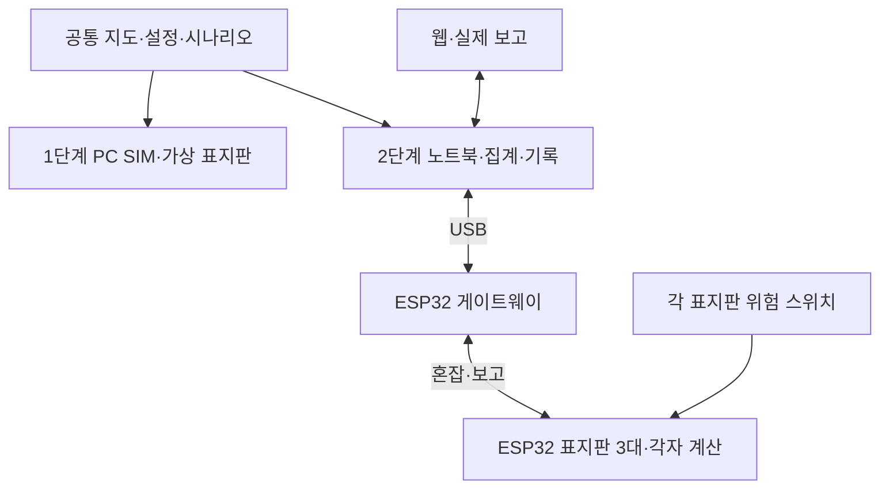
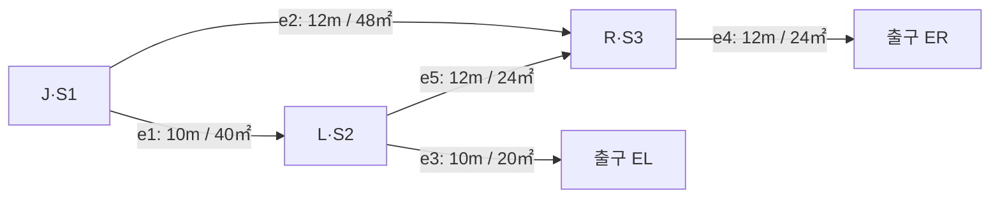
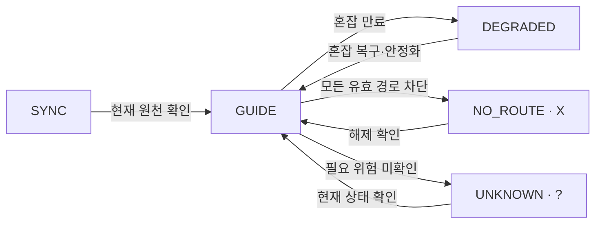

# 혼잡도를 반영하는 분산형 스마트 대피 안내 시스템 계획서 v3

작성일: 2026년 10월 6일  
문서 버전: 3.0 · 컴퓨터 시뮬레이션 선행 시연 및 ESP32 연계 시연 추가  
과목명: 컴퓨터공학 종합설계  
팀명 / 팀원 / 지도교수 / 제출일: 제출 시 기입

**컴퓨터에서 대피 안내 경로의 변화를 먼저 시뮬레이션하고, 같은 상황을 ESP32 표지판 3대로 재현하는 교육용 스마트 대피 안내 시스템**을 개발한다. 관람객은 화면에서 혼잡·위험에 따른 판단 원리를 이해한 뒤, 실제 표지판의 분산 계산과 LED 방향 변화를 확인한다.

v3는 v2의 장치 구성·위험 우선·분산 계산 원칙을 유지하면서 **컴퓨터 시뮬레이션 → 실제 ESP32 표지판 시연**을 정식 발표 순서와 P1 필수 산출물에 추가했다. 본문은 실행 계획이고, 별첨 A·B·C는 과제 계획서·요구사항명세서·상세설계서다. 실제 건물의 대피 안전성이나 대피 시간 개선을 입증하는 계획은 아니다.

## 0 v3의 주요 수정과 문서 이용 방법

| 항목 | v2 | v3 |
|---|---|---|
| 컴퓨터 프로그램의 역할 | 화면·계산 규칙을 검토하는 목업 | 장치 없이 실행하는 정식 사전 시뮬레이션을 P1에 포함 |
| 시연 순서 | 지도와 실제 표지판 중심 | 컴퓨터 시뮬레이션 → 준비 확인 → 동일 시나리오의 ESP32 표지판 재현 |
| 화면 내용 | 지도·조건 조작·장치 보고 | SIM에서 경로·비용·가상 표지판·변경 이유, HIL_TEST에서 실제 보고·LED 확인 |
| 완료 기준 | 실제 장치 중심의 시험 | 시뮬레이터 단독 동작·모드 분리·같은 입력의 결과 비교 시험 추가 |
| 일정·인력 | 총 200–280인시 | 시뮬레이터와 교차 검증 24–32인시 추가, 예비 포함 총 230–320인시 |
| 발표 대본 | 90초 실물 중심 시연 | 3분 기본 시연, 90초 축약 시연 모두 소프트웨어를 먼저 제시 |
| 산출물 | 펌웨어·서버·웹·시험 자료 | 별도 실행 가능한 시뮬레이터·공통 시나리오·비교표·두 단계 시연 영상 추가 |

본 계획에서 **시뮬레이션은 가상 인원·위험 조건에 따라 경로와 가상 표지판 상태가 변하는 2D 프로그램**을 뜻한다. 고정 인원 분포를 조작하는 조건 시뮬레이션을 필수로 구현한다. 사람이 시간에 따라 이동하는 군중 시뮬레이션과 가상 대피 시간 비교는 P2 선택 확장이다.

v2 문서에 언급된 `스마트_대피_안내_시스템_Mockup_v2.html`은 기존 검토용 자료다. 해당 프로그램은 이번 개정의 입력 파일에 포함되지 않았으므로 동작을 확인한 것으로 간주하지 않는다. v3는 계획서 개정본이며, 새로운 시뮬레이터 구현·실물 시험 완료를 의미하지 않는다. 구현 시 기존 목업을 검토·재사용할 수 있으나 C7과 T15–T17 기준을 충족해야 정식 SIM 산출물로 인정한다.

### 목차

1. 과제 목표와 범위
2. 시스템 구조와 대표 동작
3. 수행 계획·인력·완료 단계
4. 실행 가능성·예산·범위 조정
5. 검증 계획과 성과 해석
6. 부스 및 발표 시연 계획
7. 위험 관리·산출물·참고자료
8. 별첨 A 과제 계획서
9. 별첨 B 요구사항명세서
10. 별첨 C 상세설계서

## 1 과제 목표와 범위

### 1.1 문제 정의

고정된 안내 방향은 복도 차단이나 특정 출구 주변의 인원 집중을 반영하기 어렵다. 본 과제는 사전에 등록한 복도 구조와 위험·혼잡 상태를 결합하여, 갈림길의 공용 표지판이 다음 이동 방향을 갱신하는 과정을 구현한다. 상태 수집, 무선 공유, 장치별 계산, 표시와 검증 기록의 연결이 설계의 중심이다.

검증할 질문은 “새 위험을 받은 표지판이 해당 구간을 제외하는가?”, “같은 위험 조건에서 혼잡 비용의 변화가 합리적인 우회로 선택으로 이어지는가?”, “정보가 끊기면 무엇을 유지하고 무엇을 미확인으로 표시하는가?”다. 실제 사람의 행동·화재 확산·시설 피난 성능은 기본 실험의 측정 대상이 아니다.

### 1.2 필수와 선택 범위

| 단계 | 포함 기능 | 완료 근거 |
|---|---|---|
| P0 핵심 연결 | 표지판 2대의 위험 버튼 직접 공유, 로컬 경로 계산, 실제 방향·X 표시 | 입력과 LED가 함께 보이는 영상, 소스·원천 로그 |
| P1 제출 시제품 | 컴퓨터 독립 시뮬레이터, 표지판 3대·G 1대, 고정 인원 분포, 밀도·혼잡 비용, 만료·복구, 실제 보고·기록, 두 단계 시연 | 별첨 B 필수 요구사항과 T01–T17 수용 시험 |
| P2 선택 확장 | 가상 사람 이동과 효과 비교, 입력 기록 재생, 실제 위치 측정, 별도 조작기 | P1 완료 뒤 별도 시험 결과 |

P0는 중간 점검용이며 P1 완료와 같지 않다. P1은 SIM 단독 시연과 HIL_TEST 실물 시연을 모두 포함하며, 어느 한쪽만 완료해서는 P1 통과로 판정하지 않는다. P1이 최종 목표다. 실제 자동 위치 측정이 수업 필수 조건이면 1주차에 지도교수와 확인하여 요구사항·일정·예산을 변경한다. 모의 인원 입력을 실제 구역 측정으로 보고하지 않는다.

기본 공간은 갈림길 J·L·R, 출구 EL·ER, 방향이 있는 복도 5개다. 가상 ID 60명을 구역 또는 출발 대기에 배정한다. 임의의 위험·인원 조합에서도 경로 모듈이 계산하며 시연 버튼에 화살표 결과를 하드코딩하지 않는다.

### 1.3 범위 밖과 기대 결과

실제 화재 감지의 신뢰도, 전 건물 통신, 자동 메시 중계, 양방향·다층 동선, 전체 관객 위치, 개인별 경로 배분, 상용 소방 설비 연동, 배터리 백업, AI 군중 인식은 P1에 포함하지 않는다. 한 표지판은 한 시점에 한 방향만 보여주므로 인원을 개인별로 두 경로에 나누는 기능도 없다.

기대 결과는 컴퓨터에서 위험 우선 판단과 혼잡에 따른 대안 선택을 먼저 관찰하고, 동일 조건의 실물 재현을 통해 분산 장치의 지연·정보 만료·복구를 수치와 영상으로 설명하는 것이다. 대피 시간이 반드시 줄거나 실제 시설의 안전성이 확보되었다고 주장하지 않는다.

## 2 시스템 구조와 대표 동작

### 2.1 전체 구조



그림 1. 공통 조건으로 PC SIM을 먼저 수행한 뒤 실물 모드로 전환한다. 실물 모드에서 각 표지판은 자신이 담당하는 위험 상태를 다른 표지판에 직접 공유한다. G는 노트북과 무선 사이의 변환 장치이며 방향을 결정하지 않는다. 위험 직접 공유는 G·서버가 없어도 가능하지만, 혼잡의 생성·전달과 웹 관찰에는 서버·G가 필요하다. 장치마다 외부 전원을 사용한다.

### 2.1.1 컴퓨터 시뮬레이션과 실물 연계

| 구분 | SIM: 컴퓨터 사전 시연 | HIL_TEST: 실제 표지판 시연 |
|---|---|---|
| 실행 환경 | 노트북 브라우저에서 로컬 HTML·JS 실행, USB·G·ESP32 없이 동작 | 노트북 서버·USB·G·ESP32 표지판 3대 |
| 입력 | 화면에서 가상 인원 배정·위험·단절 조건 조작 | 가상 인원 입력과 실제 위험 스위치 또는 담당 원천의 시험 요청 |
| 방향 계산 | 컴퓨터가 S1·S2·S3의 상태·타이머·경로 계산을 각각 모사 | 각 ESP32가 자신의 수신 상태로 경로 계산 |
| 출력 | 2D 지도·후보 경로·비용·가상 표지판·변경 이유 | 지도·실제 REPORT·실물 LED·입력 반영 상태 |
| 확인 목적 | 왜 경로가 바뀌는지 설명하고 입력별 판단 규칙 확인 | 실제 무선 전달·분산 계산·출력과 지연 확인 |

두 모드는 같은 지도·방향 매핑·비용 계수·상태 규칙·시나리오 정의를 사용한다. 컴퓨터에서 계산한 화살표를 실제 표지판에 명령으로 전송하지 않는다. SIM의 계산 위치가 컴퓨터라는 사실과 HIL_TEST의 계산 위치가 각 ESP32라는 사실을 화면에 명시한다.

모드 전환 시 SIM의 위험·타이머·가상 보고를 실제 장치에 자동 복사하지 않는다. 실물 장치의 현재 위험·지도·연결 상태를 확인하고, 위험 해제 확인 및 인원 초기화 후 같은 시나리오를 처음부터 수행한다. 실제 준비가 확인되지 않으면 ‘실물 시연 준비 중’으로 표시한다.

### 2.2 실험 그래프



그림 2. 실제 건물 도면이 아닌 비순환 방향 그래프다. e1·e3·e4에는 각각 S1·S2·S3의 위험 입력을 연결한다. e2·e5는 실험에서 고정 통행 가능으로 설정한 간선이며 센서가 안전을 검증했다는 뜻은 아니다.

S1에서 e1은 왼쪽, e2는 오른쪽이다. S2에서 e3은 왼쪽, e5는 오른쪽이다. S3에서 e4는 오른쪽이다. 모든 장치가 같은 지도 해시와 방향 매핑을 사용한다. 비순환 제한은 장치별 정보·유지 이력이 달라도 경로 순환이 생기지 않게 하는 실험 조건이다. 실제 양방향 공간에는 추가 설계가 필요하다.

### 2.3 대표 조건과 계산 결과

| 조건 | 입력 | 안정화 후 예상 표시 S1 / S2 / S3 |
|---|---|---|
| 정상 | 간선 인원 0, 출발 대기 60, 위험 해제 | 왼쪽 / 왼쪽 / 오른쪽 |
| 왼쪽 혼잡 | 30개 가상 ID를 e3로 배정, 대기 30 | 오른쪽 / 오른쪽 / 오른쪽 |
| 오른쪽 차단 | 혼잡 유지, e4 차단 | 왼쪽 / 왼쪽 / X |
| 양쪽 출구 접근 차단 | e3·e4 차단 | X / X / X |

‘정상’의 인원 0은 빈 복도 조건이지 건물 전체 0명이 아니다. 시연은 사람의 이동을 기다리지 않고 고정 배정을 변경한다. 각 분포는 총 60개 ID를 유지하며 조건 변경은 로그에 남긴다. 위험 해제와 인원 초기화는 별도 조작이다.

### 2.4 실물 모드의 장애 시 유지 범위

| 장애 | 유지 | 제한 |
|---|---|---|
| 브라우저 종료 | 서버 집계·무선·표지판 계산 | 화면과 웹 조작 |
| 서버 종료·USB 분리·G 차단 | 각 표지판의 물리 위험 입력·직접 공유·계산 | 혼잡 5초 만료 후 거리 기준으로 전환, 품질 저하 표시. 웹의 장치 보고도 갱신 중단 |
| S3 차단 | S1·S2 동작 | e4의 CLEAR 보고가 3초 만료되면 UNKNOWN. 기존 BLOCKED는 유지. S3 LED는 꺼짐 |
| S2 차단 | S1·S3 동작 | e3의 상태가 같은 규칙으로 만료. 해당 표지판의 방향 안내 없음 |
| 지도 불일치·새 장치 부팅 | 이미 동기화된 다른 장치의 독립 동작 | 해당 장치는 상태 확인 전 ? 표시 |

혼잡 미확인 시 거리 기준 안내는 실험용 성능 저하 동작이다. 실제 시설에 적합한 실패 대응 정책으로 검증한 것은 아니다. 웹에서 오프라인이라고 표시하는 것과 해당 장치가 스스로 통신 장애를 감지한 것은 구별한다.

## 3 수행 계획·인력·완료 단계

### 3.1 인시와 일정 가정

3인 팀·부품 수령 후 8주·기초 C/C++와 웹 개발 경험을 가정한다. 인시는 팀 전체 작업량이며 배송 대기와 장비 대여 대기는 별도다. v2의 200–280인시에 시뮬레이터·모드 분리·비교 시험 작업과 해당 예비 시간을 추가하여 **총 230–320인시**를 계획한다.

| 작업 | 구체적 산출물 | 기본 인시 |
|---|---|---:|
| 범위·설계 확정 | 그래프·메시지·완료 기준·부품표 | 16–20 |
| 하드웨어 | 표지판 3대·G·스위치·고정 배선·방향 패턴 | 20–28 |
| 경로·집계 규칙 | C++ 계산 모듈·독립 기준값·ID 집계 | 18–24 |
| 무선·상태 | 원천·순번·ACK·만료·재부팅 동기화 | 30–42 |
| 서버·USB·기록 | 입력 검증·스냅샷·저장·내보내기 | 18–26 |
| 웹·시연 조작 | 지도·보고·조건 변경·발표 화면 | 18–26 |
| 컴퓨터 시뮬레이터·교차 검증 | 독립 SIM·가상 표지판·공통 시나리오·모드 분리·T15–T17 | 24–32 |
| 통합·검증 | 기존 수용 시험·지연 영상·결함 수정 | 26–38 |
| 제출·리허설 | 문서·설치 설명·영상·반복 시연 | 14–20 |
| **기본 합계** | | **184–256** |
| **예비 25%** | 부품 교체·환경 차이·통합 오류 | **46–64** |
| **총량** | | **230–320** |

3명이면 1인당 주당 약 9.6–13.3시간, 2명이면 약 14.4–20시간이다. 2인·주 8시간씩만 가능한 경우 8주 작업량은 128인시이므로 본 계획과 맞지 않는다. 기간을 약 15–20주로 늘리거나 P1 범위를 공식 조정해야 한다. 경험 부족 시 학습 시간을 추가한다.

### 3.2 8주 일정과 단계별 통과 기준

| 주차 | 핵심 작업 | 통과 기준·미달 시 조치 |
|---|---|---|
| 준비 | 부품·장비 대여·실제 위치 필수 여부 확인 | 구매 전 P1 범위 확정 |
| 1주 | 보드 2대 통신·LED·고정 경로, SIM 화면·공통 지도 설계 | 버튼 30회 연결 확인, SIM/HIL 입력·출력 구분 확정 |
| 2주 | 표지판 2대 위험 직접 공유·서버 분리, SIM 정상/혼잡 계산 | P0 통과, USB 없는 SIM 실행. 미달이면 선택 기능 추가 중지 |
| 3주 | 표지판 3대·G·집계, SIM 네 장면·타이머·가상 상태 | 웹 조건의 실물 반영, SIM 네 장면과 독립 기준값 확인 |
| 4주 | 만료·복구·초기화·모드 전환 준비 절차 | 위험 유지와 X/? 구분, SIM→HIL_TEST 첫 통합 시연 |
| 5주 | 실제 보고·기록·경로 벡터·SIM/HIL 비교 | 72벡터의 양쪽 검증, T15–T17과 상태 시험 1차 결과 |
| 6주 | 실제 지연·전원·장애·결함 수정 | 필수 결함 목록 정리. P2 착수 여부 결정 |
| 7주 | 부스·가독성·두 단계 영상·10회 리허설 | SIM 선행과 실물 전환을 포함해 코드 수정 없이 반복 |
| 8주 | 회귀 확인·문서 일치·예비 장비 | 제출본과 실행 환경 동결 |

P2는 P1 필수 시험에 해결되지 않은 실패가 없고 최소 30인시의 여유가 있을 때만 착수한다. 4주차까지 실제 장치 3대 연동이 안 되면 이동 시뮬레이션·BLE·별도 조작기는 추가하지 않는다. 6주차까지 핵심 지연·차단·복구 시험이 실패하면 실패 원인과 범위 조정을 지도교수에게 제시한다.

2주차 종료 시 실제 투입 시간과 남은 결함으로 잔여 인시를 다시 추정한다. 계획 상한을 넘을 전망이면 범위·일정을 조정하고 시험 시간을 마지막 주로 미루지 않는다.

### 3.3 역할

A는 배선·전원·ESP32 통신과 표시, B는 경로·집계·서버, C는 SIM 화면·가상 표지판·시험·시연을 담당한다. A와 B가 메시지·상태 규칙을 함께 검토하고, B와 C가 공통 시나리오·독립 기준값·SIM과 실제 보고의 구분을 맞춘다. SIM 개발은 하드웨어 제작과 병행하며, 24–32인시의 추가 작업은 B·C에 배정한다. 주 1회 2시간 통합 시험은 위 인시에 포함한다. 한 사람이 시험 결과를 작성하면 다른 사람이 영상·로그와 대조한다.

## 4 실행 가능성·예산·범위 조정

### 4.1 실행 가능성 판단

계산량보다 장치 상태와 표시의 일치가 주요 난점이다. 작은 그래프, 동일 보드, 단일 홉, USB 게이트웨이, 고정 인원 조건으로 이를 집중 검증한다. 별도 조작기·앱·측위 장치·배터리 제작을 기본에서 빼면 학생 팀이 통합과 증거 확보까지 접근할 수 있다. 다만 기간·인시·대여 장비가 확보되어야 성립하는 조건부 계획이다.

‘서버가 계산한 화살표를 ESP32에 보내는 방식’으로 바꾸면 기본 통신 시연은 쉬워지지만 본 과제의 분산 계산 목표가 달라진다. 일정 부족 때도 이를 조용히 대체하지 않고 변경 사유를 기록한다. 표지판 수를 2대로 줄인 경우도 P1 전 항목 완료로 표기하지 않는다.

### 4.2 계획 예산

아래는 판매가 검증 전 편성한 배정액이다. 노트북·모니터·카메라·멀티미터는 보유 또는 대여를 전제로 하며 학교 지원 한도를 확인한 값이 아니다.

| 품목 | 수량·용도 | 배정액 |
|---|---|---:|
| 동일 ESP32 개발보드 | 5대: 표지판 3 + G 1 + 예비 1 | 60,000원 |
| 5V 8×8 RGB 패널 | 3개, 유효 폭 8cm 이상 후보 | 75,000원 |
| 정격 5V 4A 어댑터·잭 | 3세트, 패널별 전원 | 45,000원 |
| 74AHCT 계열 레벨 변환 | 3세트 | 12,000원 |
| USB 케이블·보드 전원 | 1식 | 24,000원 |
| 위험 토글·확인 LED·저항 | 표지판별 1세트 | 10,000원 |
| 기판·배선·단자·콘덴서 | 고정 배선 | 25,000원 |
| 지지대·A3 설명판·고정재 | 전시와 운송 | 30,000원 |
| 촬영 거치대·젠더 | 확대 촬영 | 20,000원 |
| **소계** | | **301,000원** |
| **배송·교체 예비비** | | **60,000원** |
| **계획 총액** | | **361,000원** |

구매 전 패널 크기·드라이버·전류·납기·부가세·배송비를 확인한다. SIM은 보유 노트북과 로컬 HTML·JavaScript를 사용하므로 별도 장비·유료 소프트웨어 구매비를 추가하지 않는다. 추가 개발 인시는 3.1에 반영한다. 대형 화면을 구매해야 하면 위 예산으로 성립하지 않는다. 패널을 먼저 1개 시험한 뒤 나머지를 구매한다. 전시용 무선 USB 발표기는 보유품을 선택 사용하고 미보유 시 노트북 키보드로 조작한다.

패널은 GPIO나 보드 핀에서 전원을 공급하지 않는다. USB 보드 전원과 별도 패널 5V는 GND만 공통으로 연결하고 두 +5V를 연결하지 않는다. 3.3V 데이터는 5V 레벨 변환을 거친다. 64픽셀×60mA=3.84A는 보수적 상한 계산이며 실제 패널 데이터시트를 우선한다. 밝기 25% 제한·사용 패턴 실측·30분 점등 시험으로 전원 여유를 확인한다.[R3]

### 4.3 실제 위치 입력을 추가하는 경우

위치 자동 측정이 반드시 필요하면 Android 한 기종·BLE 비콘 3개·전경 앱으로 구역 수준을 시험한다. 최소 2주·40–70인시와 비콘·공유기 등 별도 예산 5만–12만원을 추가 편성한다. OS 권한·스캔 동작과 구역 보정을 먼저 확인한다.[R2] 이 수치는 확정 견적이나 개발 시간 보장이 아니다.

보정과 별도 세션으로 구역별 20회 정지 판별, 경계 통과 20회를 평가한다. 미판정을 오류로 포함하고 구역별 혼동·전환 지연을 제시한다. 한 대의 결과를 전체 관객 집계로 일반화하지 않는다. 수동 구역 선택은 입력 시험에는 유용하지만 자동 측위로 분류하지 않는다.

## 5 검증 계획과 성과 해석

### 5.1 필수 검증

| 검증 | 방법 | 수용 기준 |
|---|---|---|
| 정적 경로 | SIM과 ESP32 각각 위험 8조합 × 혼잡 분포 3종 × 출발점 3 = 72벡터 | 각 구현이 독립 전수 경로 기준과 일치. 두 구현끼리의 일치만으로 통과하지 않음 |
| 컴퓨터 독립 실행 | USB·G·ESP32 및 외부 인터넷 없이 네 장면·임의 분포 실행 | 경로·비용·가상 표지판·변경 이유 표시, 하드코딩된 화살표 사용 안 함 |
| 모드 전환·동일 조건 비교 | SIM→준비 확인→HIL_TEST, 네 장면을 양쪽에서 수행 | 같은 지도·입력·변경 순서로 안정화 후 상태 일치, 모의 출력이 실제 보고 영역에 섞이지 않음 |
| 위험 우선 | e1·e3·e4 변화와 현재 전체 경로 비교 | 해당 장치가 새 상태를 처리한 뒤 차단·미확인 간선을 쓰는 선택 0건 |
| 새 위험 반영 | 입력 30회 × 장치 3대, 물리 스위치 확인 LED와 출력 동시 촬영 | 장치별 95백분위 1.5초 이하 목표, 최악값·누락도 별도 기록 |
| 혼잡 안정화 | 비용 차이·5초 경계·짧은 흔들림 | 15% 개선·5초 지속·5초 최소 유지. 위험에는 대기 없음 |
| 만료·복구 | S1/S2/S3·G·USB·서버 단절 | 위험 CLEAR 3초 만료, 혼잡 5초 만료, 차단 유지, 복구 확인 |
| 초기화 | 위험 ON 상태에서 인원 초기화 | 새 인원 실행으로 바뀌어도 위험·장애 상태 유지 |
| 기록·보고 | ACK·보고 유실, 일부 인원 결측 | 예측·실제 보고 분리, 누락·미확인 기록 |
| 연속 시연 | 30분과 전체 장면 10회 | 예기치 않은 재부팅·임의 수동 코드 수정 없이 완료 |

정적 3분포는 D0=모든 간선 0명·대기60, DL=e3 30명·대기30, DR=e4 30명·대기30이다. 기대 경로는 모든 단순 경로를 열거한 독립 도구로 생성한다. 상태 유지 이력이 있는 표지판은 당장 최단 경로로 바뀌지 않을 수 있으므로 72벡터 시험과 시간 전이 시험을 분리한다.

지연은 동기화되지 않은 ESP32 시계를 빼지 않고 같은 촬영 프레임의 입력 확인 LED와 출력으로 측정한다. 각 장치 30개의 정렬된 지연 중 29번째 값을 최근접 순위 95백분위로 사용한다. 누락이 하나라도 있으면 지연만으로 통과하지 않으며 누락 시험을 실패로 기록한다. 하드웨어가 없는 SIM·목업에서는 해당 항목을 ‘미실행’으로 유지한다.

위험 지연 시험은 매회 DL 분포에서 세 장치가 모두 오른쪽을 표시하는 것을 확인한 뒤 S3의 물리 스위치로 e4를 차단한다. S1·S2는 왼쪽, S3는 X로 바뀌므로 세 장치의 출력 변화를 관측할 수 있다. 해제 후 다시 안정된 오른쪽 상태를 확인하고 다음 회차를 시작한다.

### 5.2 선택 성능 비교

P2에서 사람 이동을 추가하면 거리 비용과 혼잡 비용만 다르게 하여 비교한다. “시드 10개”라고만 적지 않고, 난수의 용도를 출발 시각·초기 위치로 한정하여 생성 규칙과 시드를 저장한다. 또는 난수 없이 고정된 10개 입력 분포를 공개한다. 조건·출구 처리율·속도·차단 시각은 두 정책에 동일하게 적용한다.

결과는 최대 구역 인원, 평균·최대 대기, 미대피 인원, 방향 변경 수, 가상 완료 시간으로 보고한다. 180초 내 미완료는 남은 인원과 함께 표시하고 완료 실행만 평균내지 않는다. 예상 최단 경로가 아니라 각 노드에서 실제로 채택한 현재 다음 방향을 따라 이동시킨다. 과밀 구역 수치가 초기조건부터 같은 최대치라면 단순 최대값 대신 사건 이후 최대치·초과 구간 시간 등 사전 지정한 지표를 사용한다.

이동 중 차단 구역에 남은 사람은 정지·미완료로 처리하는 단순 모델이므로 실제 화재 행동 모형이 아니다. 혼잡 정책이 손해를 보이는 조건도 함께 보고한다. P2를 생략하더라도 P1의 정적 경로·시간 전이·장치 검증은 완료할 수 있다.

### 5.3 증거와 기록

시험 ID / 날짜 / 버전 / 지도 해시 / 설정 / 입력 모드 / 인원 실행 ID / 위험 원천 세대·순번 / 입력 조건 / 기대값 / 실제값 / 지연·누락 / 통과 여부 / 증거 파일 / 결함 번호를 기록한다. 목표 미달·미실행·미구현을 서로 구분한다. 결과란은 측정 전 비워 두고 ‘미실행’으로 표시한다.

## 6 부스 및 발표 시연 계획

### 6.1 전시 구성과 진행 원칙


그림 3. **먼저 컴퓨터 프로그램 화면만으로 판단 원리를 설명하고, 이어 실제 표지판을 보여준다.** SIM에서는 실물 확대 영상을 표시하지 않고 가상 표지판을 사용한다. 전환 후 S1·S2·S3 실물을 소개하고 화면 지도와 같은 위치·라벨임을 설명한다. 실물은 사전에 전원·연결을 준비해 두되, 소개와 확대 촬영은 두 번째 단계에 수행한다.

대형 모니터에는 2D 지도·구역별 인원·차단 구간·후보 경로·지점별 현재 방향·변경 이유를 표시한다. 실제 표지판 3대는 같은 높이에 고정한다. 8cm 패널은 부스 약 2m 거리에서 확인하고 발표에서는 카메라로 확대한다. 배선은 지지대 뒤로 고정한다.

SIM에는 ‘컴퓨터 시뮬레이션·가상 표지판’, HIL_TEST에는 ‘가상 인원·실제 ESP32 표지판’을 상시 표시한다. 색상뿐 아니라 문자로 모드를 구분한다. 시뮬레이션의 즉시 계산을 실제 무선 반응속도로 설명하지 않는다.

### 6.2 공통 시나리오와 실물 전환

| 순서 | 컴퓨터 SIM에서 보여줄 내용 | 실물 HIL_TEST에서 재현할 내용 | 안정화 후 S1 / S2 / S3 |
|---|---|---|---|
| 1 정상 | 간선 0명·대기60, 위험 해제, 가까운 출구와 비용 | 위험 해제·현재 보고 확인 후 같은 분포 | 왼쪽 / 왼쪽 / 오른쪽 |
| 2 왼쪽 혼잡 | e3 30명·대기30, 비용 증가와 5초 후보 타이머 | 같은 인원 입력, 각 ESP32의 계산과 LED 변경 | 오른쪽 / 오른쪽 / 오른쪽 |
| 3 오른쪽 차단 | 혼잡 유지, e4 차단 입력으로 위험 우선 설명 | S3 물리 스위치 ON, 직접 공유와 출력 확인 | 왼쪽 / 왼쪽 / X |
| 4 양쪽 차단 | e3·e4 차단, 경로 없음과 X 설명 | S2 물리 스위치도 ON | X / X / X |

실물 전환은 **모드 변경 → 지도·장치 연결 확인 → 물리·시험 위험 해제 확인 → 인원 초기화 → 세 장치의 새 실행 보고 확인** 순서다. SIM의 마지막 차단 상태를 실물에 자동 전달하지 않는다. 스위치가 ON이면 이를 화면에 표시하고 명시적으로 해제한 뒤 시작한다. 모드 변경·인원 초기화만으로 위험을 지우지 않는다.

같은 입력이란 숫자만 같은 상태가 아니라 지도·설정·위험 벡터·혼잡 분포·변경 순서가 일치하는 조건이다. 타이머와 전달 지연을 고려하여 안정화 후 결과를 비교한다. 혼잡 변경은 후보 확인 5초를 실제로 기다리며, 아직 적용되지 않은 출력을 완료로 설명하지 않는다.

### 6.3 기본 3분 시연과 90초 축약

| 시간 | 단계·조작 | 관람 포인트 |
|---|---|---|
| 0:00–0:15 | SIM 정상 | “먼저 컴퓨터에서 가상의 인원과 위험을 넣어 보겠습니다.” 지도·가상 표지판 소개 |
| 0:15–0:35 | SIM 왼쪽 혼잡 | 비용 비교·5초 후보 유지·우회 경로 변화 |
| 0:35–0:50 | SIM 오른쪽 차단 | 혼잡보다 위험이 우선, S3 가상 X |
| 0:50–1:00 | SIM 양쪽 차단 | 세 가상 표지판 X, 안내 불가 설명 |
| 1:00–1:20 | 실물 소개·전환 준비 확인 | “같은 상황을 이제 실제 ESP32 표지판으로 재현합니다.” 보고·실행 ID 확인 |
| 1:20–1:35 | HIL_TEST 정상 | S1·S2·S3와 지도 라벨 연결, 실제 LED 확대 |
| 1:35–1:55 | HIL_TEST 왼쪽 혼잡 | 같은 인원 분포, 각 ESP32 계산 후 오른쪽 안내 |
| 1:55–2:15 | S3 위험 스위치 ON | 실제 위험 공유, S1·S2 왼쪽 / S3 X |
| 2:15–2:30 | S2 위험 스위치도 ON | 양쪽 차단, 실제 표지판 모두 X |
| 2:30–3:00 | 결과 비교·위험 해제·인원 초기화 | 화면과 실물의 판단 일치, 실제 반영 지연과 준비 절차 설명 |

90초 축약은 SIM 정상 0–10초 → SIM 혼잡 10–25초 → SIM 오른쪽 차단 25–35초 → 실물 소개·준비 확인 35–50초 → 실물 정상 50–55초 → 실물 혼잡 55–70초 → S3 실제 차단 70–85초 → 비교 85–90초로 구성한다. 양쪽 차단과 복구 설명은 생략하고 시연 종료 후 운영자가 명시적 복구를 수행한다. 시간표보다 실제 준비·수신 확인을 우선하며 미완료 시 성공으로 넘기지 않는다.

7분 발표는 문제 45초, 구조 1분15초, 두 단계 시연 3분, 검증 1분15초, 한계와 활용 45초로 구성한다. 60초만 가능한 경우 SIM 정상·오른쪽 차단을 먼저 보여주고, 준비된 실물에서도 정상·오른쪽 차단을 재현하는 최소 흐름을 사용한다.

부스에서 추가 시간이 있으면 임의 혼잡 입력·G 단절·UNKNOWN과 X 차이를 설명한다. 두 명이면 설명/화면 조작과 실물 스위치/상태 감시를 분담한다. 한 명이면 추가 장애 체험을 생략한다. 실제 화재·연기나 암실을 만들지 않는다.

### 6.4 실패 대응과 당일 점검

발표 시작 30분 전 SIM의 인터넷·USB 없는 독립 실행과 실물 전환 절차를 확인한다. 이어 지도 해시·채널·포트·전원·위험 스위치·준비 보고를 확인하고 전체 장면을 한 번 실행한다. 마지막 열에서 확대 LED와 문자 크기를 확인한다. 절전·팝업·자동 업데이트와 케이블 고정을 점검한다.

SIM과 실물 영상은 각각 녹화하고 모드·촬영 사실을 표시한다. 라이브가 10초 이상 반응하지 않으면 한 번 상태를 확인하고 30초 실제 촬영 영상으로 전환한다. 영상에는 입력 확인 LED와 실물 출력을 함께 담고 원래 지연을 보존한다. 목업 녹화는 ‘실제 하드웨어 시연 영상’으로 사용하지 않는다. 인터넷 없이 실행되는 파일·영상·설정을 로컬과 USB에 준비한다.

| 고장 | 대체 | 한계 표시 |
|---|---|---|
| SIM 실행 실패 | 사전 SIM 녹화 후 실물 단계 진행 | 시뮬레이션 녹화임을 명시 |
| 실물 준비·전환 실패 | 준비 실패 표시 후 실제 촬영 영상 사용 | SIM 결과를 실물 성공으로 표시하지 않음 |
| 웹 제어 실패 | 표지판의 물리 위험 스위치 | 혼잡 조작은 중단될 수 있음 |
| G 실패 | 직접 위험 공유를 보여주고 영상 전환 | 웹 보고와 혼잡은 최신이 아님 |
| 표지판 실패 | 예비 보드 교체 또는 해당 장치 OFFLINE 표시 | 세 장치 정상으로 꾸미지 않음 |
| 카메라·프로젝터 실패 | 사전 영상·결과 이미지 | 영상 전환 사실을 명시 |

## 7 위험 관리·산출물·참고자료

### 7.1 주요 위험과 대응

| 위험 | 대응·완료 증거 |
|---|---|
| 방향 왕복·혼잡 이동 | 15%·5초 규칙, 변경 횟수 기록, 기본 비순환 그래프 |
| 재전송된 옛 정상으로 복구 | 원천 세대·순번·신선도 검사, 중복으로 만료 타이머 연장 금지 |
| 시연 초기화가 차단을 해제 | 위험 영역과 인원 실행 영역 분리, 위험 ON 초기화 시험 |
| SIM 상태가 실제 장치 상태에 혼입 | 모드별 상태 저장 분리, 준비 확인, SIM/HIL 전환 시험 |
| 서버 예측을 실제 표시로 오인 | 보고 시각·입력 버전 표시, 미수신 시 오프라인, 육안 출력 시험 |
| LED 순간 부하·접촉 불량 | 전원 분리, 밝기 제한, 전류 실측, 고정 배선, 예비 보드 |
| 실제 위치 측정이 평가 필수 | 1주차 확인 후 확장 범위·일정 재승인, 모의 측위로 대체 주장 금지 |

### 7.2 산출물

P1은 다음 자료를 남긴다.

| 산출물 | 포함 내용 |
|---|---|
| 컴퓨터 시뮬레이터 | 오프라인 실행 HTML·JS·로컬 자원, 2D 지도·가상 표지판·입력·변경 이유, 실행법 |
| 실제 시제품 | 표지판 3대·G 1대, 펌웨어·서버·웹 소스, 배선도·부품표·설치법 |
| 공통 시나리오 | 지도·설정·정상/혼잡/차단 조건·변경 순서·독립 기대값 |
| 검증 자료 | T01–T17 시험표, SIM 결과·실제 REPORT·LED 영상의 비교표, CSV/JSON |
| 발표 자료 | SIM→실물 두 단계 대본·각 단계 녹화·전환 체크리스트 |
| 제출 문서 | v3 계획서 MD·HTML 및 별첨 A·B·C |

이번 개정 산출물은 v3 계획서 두 형식이다. 시뮬레이터·펌웨어·영상·시험 결과는 향후 구현 및 제출 대상이며, 이 문서 작성으로 완료 처리하지 않는다.

### 7.3 참고자료

- [D1] 사용자 제공 「스마트_대피_안내_시스템_핵심기능.pdf」, 2026.09.22. 분산 계산·위험 우선·혼잡·시연 요구의 기준.
- [D2] 「착석_습관_휴식_코칭_프로젝트_계획서.md / .html」. 수행 계획과 별첨 구성 참고.
- [D3] 「스마트_대피_안내_시스템_프로젝트_계획서.md」 v1. 위험/실행 영역·범위·검증 기준을 개정.
- [R1] [Espressif ESP-NOW 공식 문서](https://docs.espressif.com/projects/esp-idf/en/release-v5.5/esp32/api-reference/network/esp_now.html). 같은 채널·응용 ACK·재전송·콜백 처리 근거.
- [R2] [Android Bluetooth permissions](https://developer.android.com/develop/connectivity/bluetooth/bt-permissions). 선택 BLE 확장의 권한 설계 근거.
- [R3] [Adafruit NeoPixel 전원 안내](https://learn.adafruit.com/adafruit-neopixel-uberguide/powering-neopixels), [전체 가이드](https://learn.adafruit.com/adafruit-neopixel-uberguide?view=all). 패널 전원·레벨 변환·보호 부품 검토.

외부 참고자료는 v2에 기록된 2026.09.23 확인 이력을 이어받았으며, 이번 문서 개정에서 재검증한 자료는 아니다. 비용 계수·1.5초·3초·5초·예산·인시는 본 과제의 초기 설계값이다. 구매 모델과 설치 버전은 착수 시 고정하고 평가 후 수치 변경은 새 버전으로 기록한다.

<!-- PAGEBREAK -->

# 별첨 A 과제 계획서

과제명: 혼잡도를 반영하는 분산형 스마트 대피 안내 시스템  
버전: 3.0  
과목명: 컴퓨터공학 종합설계  
팀명 / 팀원 / 지도교수 / 제출일: 제출 시 기입

## A1 과제 목적 및 필요성

실내 대피 안내는 통로 차단과 특정 구역의 인원 집중 등 변화하는 조건을 반영할 필요가 있다. 본 과제는 영화관을 단순화한 실험 그래프에서 위험 경로를 제외하고 혼잡 비용을 고려하여 안내 방향을 갱신하는 시스템을 설계·구현한다.

ESP32 표지판들이 상황을 공유하고 각자 자신의 위치에서 경로를 계산하게 하여, 임베디드 입력·무선 통신·그래프 알고리즘·상태 관리·웹 시각화를 통합한다. 경로가 없거나 필요한 정보가 만료된 경우도 별도의 상태로 표현한다.

기본 범위는 고정된 가상 인원 분포를 사용하는 컴퓨터 독립 시뮬레이터와 실제 표지판 3대의 통합이다. 발표에서는 컴퓨터 SIM을 먼저 보여주고, 같은 조건을 HIL_TEST로 재현한다. 실제 화재 감지·관객 측위·건물 전체 피난 안전성은 검증하지 않는다. 결과물은 분산 안내 규칙과 장애 대응을 비교하는 교육용 시제품이다.

## A2 사용기술 및 설계

### A2.1 기술과 구조

| 기술 | 용도 |
|---|---|
| ESP32·C/C++·ESP-NOW | 위험 스위치 수집, 단일 홉 공유, 각 표지판 경로 계산 |
| 방향 그래프·Dijkstra | 위험·미확인 간선 제거 후 거리·혼잡 비용 비교 |
| Python·FastAPI·pyserial·SQLite | 가상 ID 집계, USB 게이트웨이 연결, 기록·API |
| HTML·CSS·JavaScript·SVG | 독립 2D 시뮬레이션, 가상 표지판, 상황 조작, 실제 보고, 모드별 시연 화면 |
| RGB LED·레벨 변환·별도 5V 전원 | 화살표·X·? 및 품질 저하 표시 |


그림 A1. SIM은 컴퓨터에서 가상 표지판을 계산·표시하고, HIL_TEST의 웹은 상황과 실제 장치 보고를 표시한다. 실물 모드의 방향은 각 ESP32에서 결정한다. 위험 메시지는 인원 시연 실행 ID와 분리하여 초기화가 위험을 지우지 않게 한다.

### A2.2 설계 내용

갈림길 3개·출구 2개·복도 5개를 등록한다. 구역별 가상 ID 수를 면적으로 나눠 밀도를 계산하고, 위험·미확인 간선을 제외한 경로에 거리와 혼잡 비용을 적용한다. 혼잡에 의한 방향 변경에는 15% 비용 개선과 5초 지속·최소 유지 조건을 적용한다. 새 위험으로 현재 경로가 무효가 되면 대기 없이 재계산한다.

표지판 3대가 각각 위험 원천 역할도 수행하고 G 1대가 USB와 무선 사이를 연결한다. 위험 정상 보고는 3초, 혼잡은 5초 만료 기준을 둔다. 위험은 자동 해제하지 않으며, 혼잡이 만료되면 거리 기준과 품질 저하를 표시한다. 웹 예측과 실제 장치 보고는 구분한다.

### A2.3 수행 계획과 가능성

3인·8주·총 230–320인시를 계획한다. 1–2주차 두 장치 위험 직접 공유와 SIM 기본 계산, 3–4주차 SIM 네 장면·세 장치·모드 전환 통합, 5–6주차 양쪽 비교·검증·결함 수정, 7–8주차 전시·문서·리허설을 수행한다. 노트북·모니터 대여 전제의 배정 예산은 361,000원이다. 컴퓨터 조건 시뮬레이션은 필수이며, 자동 위치 측정과 사람 이동 시뮬레이션은 별도 확장으로 둔다.

72개 정적 경로 벡터, 위험 수신·처리 이후 차단 경로 선택 0건, 실제 LED 반영 지연 장치별 95백분위 1.5초 이하를 목표로 한다. 누락·만료·초기화·복구·30분 연속 동작도 검증한다. 목표 성능은 구현 후 측정한다.

## A3 기대효과 및 활용방안

위험 우선과 혼잡 회피의 관계를 상황 조작으로 설명하고, 분산 장치의 정보 갱신과 실패 대응을 실습할 수 있다. 경로 알고리즘과 실제 출력 사이의 지연·누락을 기록하여 소프트웨어와 하드웨어 통합 검증 경험을 얻을 수 있다.

부스와 발표는 컴퓨터 SIM을 먼저 보여주고 실제 표지판으로 이어지는 3분 시연을 기본으로 한다. 발표 시간에 따라 90초로 축약하며 각 단계의 예비 녹화를 구분하여 준비한다. 후속 과제로 실제 구역 측정·이동 모델·양방향 공간을 검토할 수 있다. 실제 대피 시간 단축이나 현장 안전성 향상은 본 실험만으로 입증된 효과로 제시하지 않는다.

<!-- PAGEBREAK -->

# 별첨 B 요구사항명세서

문서명: 분산형 스마트 대피 안내 시스템 요구사항명세서  
버전: 3.0  
작성자 / 검토자 / 제출일: 제출 시 기입

## B0 목차

1. 서론(개요)
2. 시스템 기능
3. 기능 요구사항
4. 비기능 요구사항
5. 수용 시험·추적 관계

## B1 서론(개요)

### B1.1 목적과 운영 환경

본 명세서는 컴퓨터 독립 시뮬레이션과, 가상 인원·실제 위험 스위치를 사용하여 ESP32 표지판 3대가 분산 경로 계산을 수행하는 시제품의 P1 수용 기준을 정의한다. SIM은 장치 없이 실행하며, 최종 시연은 SIM 다음 HIL_TEST 순서다. 노트북·USB 게이트웨이 1대·표지판 3대, 등록 피어의 같은 방 단일 홉 통신을 대상으로 한다.

운영자는 지도·장치·실행 조건을 준비하고, 관람객은 상황을 조작하며, 개발자는 로그·영상으로 결과를 검증한다. 서버는 기본적으로 localhost에서 사용한다. 실제 관객의 실명·위치·영상 분석을 수집하지 않는다.

### B1.2 용어

| 용어 | 정의 |
|---|---|
| 위험 영역 | 설치 ID·지도 해시·원천·부팅 세대·순번으로 관리하는 간선 상태 |
| 인원 실행 영역 | run_id와 crowd_version으로 구분하는 가상 인원 조건 |
| CLEAR / BLOCKED / UNKNOWN | 시험상 통행 가능 / 차단 / 위험 정보 미확인 |
| 혼잡 미확인 | 인원 입력이 만료·부분 관측되어 현재 밀도를 확정할 수 없음 |
| 실제 보고 | 장치가 보낸 현재 다음 간선·사용 상태 벡터·이유. 실제 픽셀 점등의 자동 증명은 아님 |
| 인원 초기화 | 가상 인원·후보 유지 이력·실행 기록 구간을 새로 시작. 위험·연결 상태는 유지 |
| MOCKUP | 기존 화면·규칙 검토 자료. v3 필수 SIM의 구현 완료와 구분 |
| SIM | 장치 없이 컴퓨터에서 경로·가상 표지판·상태 변화를 계산하는 필수 시뮬레이션 |
| HIL_TEST | 가상 인원과 실제 ESP32·무선 통신·LED를 사용하는 실물 시연 |

## B2 시스템 기능

지도·방향 매핑 검증, 위험 스위치와 TEST 요청, ID 중복 제거와 밀도 계산, ESP-NOW 상황 공유, 원천별 최신성 관리, 로컬 경로 계산, 방향 안정화, 화살표·X·? 표시, 웹 실제 보고, 인원 초기화, 기록 내보내기를 제공한다.

전체 흐름은 SIM의 네 장면 → 실물 준비 확인 → HIL_TEST의 동일 네 장면이다. 각 모드의 대표 흐름은 준비 → 정상 → 왼쪽 혼잡 → 오른쪽 차단 → 양쪽 차단 → 명시적 위험 해제 → 인원 초기화다. 위험 ON 상태에서 인원 초기화를 실행해도 해당 차단은 남아야 한다.

## B3 기능 요구사항

FR01–FR21은 P1 필수다. EX는 선택이며 필수 완료율에서 제외한다. v3의 FR19–FR21과 T15–T17은 시뮬레이션·전환·비교를 위한 신규 항목이다. 이전 버전의 같은 번호와 혼동하지 않도록 문서 버전을 함께 기록한다.

| ID | 요구사항 | 수용 기준 |
|---|---|---|
| FR01 | 지도·방향 매핑을 검증한다 | ID 중복·없는 노드·0 이하 면적·순환·해시 불일치를 거부 |
| FR02 | 표지판별 위험 원천을 고정한다 | S1=e1, S2=e3, S3=e4. 권한 없는 해제 거부 |
| FR03 | 물리·시험 위험을 함께 적용한다 | effective=physical OR test. 인원 초기화로 차단 해제 불가 |
| FR04 | 위험을 먼저 제외한다 | 새 상태 처리 후 현재 선택 경로에 BLOCKED/UNKNOWN 간선 0개 |
| FR05 | 가상 ID를 한 위치에만 집계한다 | 60개 ID 보존·중복/역순 제거·미확인을 0명으로 간주하지 않음 |
| FR06 | 인원·면적·혼잡 비용을 계산한다 | 3개 기준 분포의 집계와 비용 일치 |
| FR07 | 표지판이 각자 경로를 계산한다 | 방향 명령 없이 72벡터의 독립 기준과 일치 |
| FR08 | 혼잡 방향 변경을 안정화한다 | 15% 개선·5초 지속·최소 유지, 현재 경로 위험 시 즉시 무효화 |
| FR09 | 경로 없음과 위험 미확인을 구분한다 | X/? 판별과 유효 우회 존재 시 안내 유지 |
| FR10 | 순번·세대·범위를 검사한다 | 옛 정상·중복·이전 인원 실행을 거부, 위험은 인원 run_id와 독립 |
| FR11 | 중요 입력의 수용과 적용을 구분한다 | 응용 ACK·재전송·표시 보고를 분리, 미확인 장치 명시 |
| FR12 | 상태 종류별 만료를 처리한다 | CLEAR 3초→UNKNOWN, BLOCKED 유지, 혼잡 5초→거리 기준·품질 저하 |
| FR13 | 부팅·복구 시 현재 상태를 확인한다 | 동기화 전 과거 정상으로 안내하지 않음 |
| FR14 | 실제 장치 보고를 관찰한다 | 다음 간선·이유·상태 벡터·수신 경과. 예측과 실제 보고 분리 |
| FR15 | 인원 초기화를 독립 수행한다 | 새 run_id 적용 현황 표시, 위험·장치 단절 유지, 옛 혼잡 부활 없음 |
| FR16 | 입력·운영 모드를 표시한다 | SIM/HIL_TEST 구분. P1은 두 모드 모두 필수, 기존 MOCKUP과 선택 REPLAY는 별도 표시 |
| FR17 | 실행 조건·사건·보고를 내보낸다 | 버전·설정·지도·영역 ID·누락·오류를 CSV/JSON에 포함 |
| FR18 | 장애 시 기능 의존을 표현한다 | G 없는 위험 직접 공유, 혼잡 만료, 웹 보고 중단을 개별 표시 |
| FR19 | 컴퓨터 시뮬레이션을 독립 실행한다 | ESP32·G·USB·외부 인터넷 없이 네 장면과 임의 유효 인원 분포 계산, 지도·비용·가상 방향·변경 이유 표시 |
| FR20 | SIM 선행과 실물 전환 절차를 제공한다 | SIM→실물 준비 확인→HIL_TEST, 모의 상태 자동 이식 금지·실제 보고 혼입 0건 |
| FR21 | 같은 조건의 SIM·실물 결과를 비교한다 | 공통 지도·설정·시나리오·변경 순서, 안정화 후 세 장치 상태 비교 및 독립 기대값 확인 |
| EX01 | 가상 이동과 정책 효과를 비교한다 | 이동 모델·입력·지표·미완료 처리 공개 |
| EX02 | 실제 위치 또는 기록 재생을 입력한다 | 원천 라벨과 별도 실측·재현 시험 |

## B4 비기능 요구사항

| ID | 요구사항 | 수용 기준 또는 제약 |
|---|---|---|
| NFR01 | 반응성 | 위험 30회×3대, 각 95백분위 1.5초 이하 목표·누락 0. 혼잡 조건 유지 시 7초 이하 목표 |
| NFR02 | 안정성 | 30분 동작·전체 장면 10회 반복, 예상 외 재부팅 없음 |
| NFR03 | 전기·설치 | 패널 별도 전원·공통 GND·+5V 분리·밝기 제한·고정 배선 |
| NFR04 | 통신 한정 | 등록 장치 4대·고정 채널·사전 확인한 한 공간. 다중 홉 없음 |
| NFR05 | 가독성 | 부스 2m·발표 확대 화면에서 화살표/X/?와 모드 라벨 구분 |
| NFR06 | 재현성 | 빌드·부품·핀맵·설정·독립 기대값·영상·실행법 보존 |
| NFR07 | 접근·입력 | 등록 피어·설치별 키·원천 검사·프레임 길이/값 검사. 웹은 localhost |
| NFR08 | 오프라인·정보 최소화 | 기본 시연 외부 인터넷 불필요, 가상 ID만 사용 |
| NFR09 | 주장 범위 | SIM/목업/하드웨어/실측 구분. 미측정 성능·안전성·개선율 표시 금지 |

예산과 인시는 프로젝트 관리 기준이며 동작 시험의 합격 수치가 아니다. 8주·230–320인시·361,000원의 가정이 바뀌면 수행 계획을 개정한다.

## B5 수용 시험·추적 관계

| ID | 시험·기대 결과 | 대응 요구사항 |
|---|---|---|
| T01 | 잘못된 지도·해시·핀 방향 입력 거부 | FR01 NFR03 NFR06 |
| T02 | 72개 독립 벡터 비교·차단 간선 사용 검사 | FR04 FR06 FR07 |
| T03 | 15% 비용·5초 경계·위험 중 후보 무효화 | FR04 FR08 NFR01 |
| T04 | 중복 ID·구역 이동·결측·총60 보존 | FR05 FR06 |
| T05 | 물리 ON+시험 OFF, 위험 ON+인원 초기화 | FR02 FR03 FR15 |
| T06 | 옛 세대·역순·이전 run_id·중복 재전송 | FR10 FR11 |
| T07 | CLEAR 만료·BLOCKED 만료·우회·X/? 조합 | FR09 FR12 |
| T08 | 원천 재부팅·게이트웨이 재시작·동기화 | FR10 FR13 FR18 |
| T09 | 인원 초기화 일부 미응답·뒤늦은 옛 패킷 | FR11 FR15 |
| T10 | 실제 위험 지연30회×3대와 출력 영상 대조 | FR11 FR14 NFR01 |
| T11 | 브라우저/서버/USB/G 단절·웹 보고 중단 | FR12 FR14 FR18 NFR04 |
| T12 | 30분·10회·소비전류·시야·인터넷 차단 | FR16 NFR02–NFR05 NFR08 |
| T13 | 로그 내보내기·실패/누락·원천/모드 표시 | FR16 FR17 NFR06 NFR09 |
| T14 | 잘못된 원천·해제 권한·프레임·웹 입력 거부 | FR02 FR10 NFR07 |
| T15 | USB·G·ESP32·외부 인터넷 없이 SIM 실행, 네 장면·임의 분포·위험 유지·타이머·X/? 점검 | FR19 FR04 FR08 FR09 NFR08 |
| T16 | SIM→HIL_TEST 전환·역전환, 실제 미연결·스위치 ON·보고 지연 조건에서 준비 보류와 상태 분리 확인 | FR16 FR20 NFR09 |
| T17 | SIM과 ESP32 각각의 72벡터를 독립 기준으로 검증, 공통 네 장면 3대의 안정화 후 결과·이유 비교 | FR07 FR21 NFR06 |

v3 신규 시험과 실물 시험 결과는 최초 모두 ‘미실행’이다. T15 통과는 소프트웨어 독립 시연의 완료이며, 실물 T01–T14와 교차 검증 T16–T17의 통과를 대신하지 않는다. 브라우저 목업 자동 확인은 T02·T03·T05·T07 일부 규칙의 사전 점검이며 펌웨어·통신·전원·실제 출력의 수용 시험을 대체하지 않는다.

<!-- PAGEBREAK -->

# 별첨 C 상세설계서

문서명: 분산형 스마트 대피 안내 시스템 상세설계서  
버전: 3.0  
작성자 / 검토자 / 제출일: 제출 시 기입

## C0 목차

1. 서론(개요)
2. 모듈·하드웨어
3. 지도·집계·비용
4. 경로·표시 상태
5. 메시지·최신성·복구
6. 초기화·서버·데이터
7. 화면·시뮬레이터·시험 추적

## C1 서론(개요)

본 문서는 노트북 단독 SIM과 노트북·G 1대·표지판 3대의 HIL_TEST로 구성되는 P1 시제품의 구현 계약을 정의한다. 표지판은 위험 입력 원천과 경로 계산 장치 역할을 함께 수행한다. 서버는 가상 ID 집계·시험 요청·기록을 맡고, G는 USB/ESP-NOW 변환만 수행한다.

v2의 위험/인원 영역 분리를 유지하고, v3에서 SIM 상태와 실제 장치 상태를 추가로 분리한다. 표시 상태는 장치의 현재 입력을 근거로 하며 전체 시설에 대한 안전 판단을 뜻하지 않는다. 동일 지도·설정의 작은 비순환 공간을 전제로 한다.

## C2 모듈·하드웨어

### C2.1 구성요소

| 모듈 | 책임 |
|---|---|
| RiskSource | 물리 스위치·시험 latch의 OR, 원천 상태 발행 |
| Transport | 등록 피어·패킷 검사·수신 큐·ACK·재시도 |
| StateStore | 원천 세대·순번·최신 수신 시각·위험/인원 영역 관리 |
| RouteEngine | 유효 간선과 비용으로 각 출발점의 최적 경로 계산 |
| DirectionPolicy | 후보 유지·최소 유지·위험에 의한 즉시 무효화 |
| Renderer/Reporter | LED 표시와 현재 다음 간선·근거 보고 |
| Aggregator | 가상 ID 중복 제거·분포·품질·완성 스냅샷 |
| Server/Repository | USB·웹·기록·초기화·내보내기 |
| SimulationEngine | S1·S2·S3별 가상 상태·경로·후보 타이머·논리적 단절 모사 |
| ScenarioCatalog | 양쪽 모드의 지도·설정·입력·변경 순서와 시나리오 ID 관리 |
| ModeController | SIM/HIL 상태 저장·보고 영역 분리, 실물 준비 확인 |

ESP32-WROOM 계열 같은 모델을 사용하고 ESP-IDF 5.5 계열로 빌드 환경을 고정한다. Python은 FastAPI·pyserial·SQLite, 화면은 HTML/JS를 사용한다. 실제 설치 버전은 잠금 파일과 README에 기록한다.

### C2.2 배선 초안

| 연결 | 설계 |
|---|---|
| GPIO18→패널 DIN | 3.3V→5V 레벨 변환과 330Ω 직렬 저항 경유 |
| GPIO27→위험 토글→GND | 내부 풀업, LOW=물리 차단, 30ms 디바운스 |
| GPIO25→저항→확인 LED | 원천이 입력 변화를 수용한 시각의 촬영 기준 |
| 표지판 전원 | 보드 USB, 패널별 별도 5V. 공통 GND·+5V 분리 |
| G 연결 | USB 115200bps와 고정 채널 ESP-NOW |

실제 개발보드의 노출 핀·부팅 제약을 확인한 뒤 확정한다. 패널 커넥터·전선·어댑터 정격과 레벨 변환 회로를 검토하고 데이터 입력 근처 보호 저항·전원 콘덴서를 배치한다.[R3] 시험 latch는 변경 시 영속 저장하여 재부팅으로 차단이 사라지지 않게 한다. 반복 heartbeat마다 저장하지 않는다.

## C3 지도·집계·비용

### C3.1 그래프·방향

| 간선 | 방향 | 길이 m | 면적 ㎡ | 위험 원천 |
|---|---|---:|---:|---|
| e1 | J→L | 10 | 40 | S1 |
| e2 | J→R | 12 | 48 | STATIC_TEST_CLEAR |
| e3 | L→EL | 10 | 20 | S2 |
| e4 | R→ER | 12 | 24 | S3 |
| e5 | L→R | 12 | 24 | STATIC_TEST_CLEAR |

지도 JSON에는 노드·출구·간선·면적·위험 원천·표지판 방향 매핑을 저장한다. 정규화한 파일의 해시를 장치와 서버에 함께 배포한다. STATIC_TEST_CLEAR는 실험 가정이다. J→L→R→출구의 단방향 순서를 검증하고 순환 입력을 거부한다.

### C3.2 ID 집계

입력은 `run_id, person_id, person_seq, zone_id`다. zone_id는 e1–e5, WAIT_J, UNKNOWN 중 하나다. 60개의 가상 ID를 한 구역에만 배정한다. 최신 순번만 수용하고 구역 변경은 이전 제거와 새 추가를 원자적으로 처리한다. 분포 프리셋도 60개 ID를 생성한 뒤 같은 집계 경로를 거친다.

수신이 5초 이상 없는 ID는 UNKNOWN으로 이동하고 마지막 구역에 미확인 수를 표시한다. UNKNOWN이 있으면 혼잡 스냅샷의 품질을 PARTIAL로 둔다. 표시하는 숫자는 “확인된 인원”과 “미확인”을 나누고 마지막 구역을 0명이라고 확정하지 않는다. P1은 고정 분포를 1초마다 새로운 순번으로 보고한다.

완성 스냅샷은 모든 구역의 counts·품질을 담고 1초마다 새 crowd_version으로 발행한다. 소스가 멈추면 G가 과거 값을 새 버전으로 다시 발행하지 않는다. 어느 구역이든 PARTIAL/STALE이면 계산 전체의 혼잡 항을 끄고 품질 저하를 표시한다. 여러 구역의 오래된 값과 최신 값을 임의로 섞지 않는다.

### C3.3 경로 비용

```text
rho[e] = confirmed_count[e] / area[e]
q[e] = min(rho[e] / 1.0, 3)
cost[e] = length[e] * (1 + alpha * q[e])
alpha = 2       # 유효한 혼잡 반영
alpha = 0       # 거리 비교 또는 혼잡 미확인
BLOCKED / UNKNOWN 간선은 비용과 무관하게 제거
```

비용은 단위 없는 비교 점수로 정의한다. 밀도 기준 1명/㎡는 정규화 값이며 위험 밀도 기준이 아니다. 소수 계산 후 정수 밀리단위로 반올림한다. 동률은 출구 ID, 간선 ID 사전순으로 결정한다.

D0에서 J→L→EL=20, J→R→ER=24다. e3 30명·20㎡이면 e3 비용40, 왼쪽 직행50, 오른쪽24가 된다. e4 차단 시 오른쪽 후보를 제거하고 왼쪽으로 안내한다. e3도 차단되면 출구 경로가 없다.

## C4 경로·표시 상태

### C4.1 계산과 유지

각 표지판은 동일한 지도·로컬 상태를 사용하여 출구까지 Dijkstra를 수행한다. 현재 저장된 전체 경로를 새 입력으로 다시 검증하고, 그중 어느 간선이든 차단·미확인이면 후보 유지 시간과 무관하게 즉시 무효화한다.

혼잡 변화만 있을 때 후보 비용이 현재 전체 경로 비용의 85% 이하이고, 같은 다음 간선 후보가 5초 지속되며, 마지막 방향 변경 뒤 5초가 지났을 때 변경한다. 후보가 달라지거나 개선 조건이 깨지면 후보 타이머를 초기화한다. 같은 다음 간선이면 출력은 유지하면서 저장 경로·비용 근거를 갱신한다.

유효한 기존 경로가 없는 경우에는 즉시 유효 대안을 표시한다. 혼잡 만료 시 즉시 거리 기준으로 계산하고, 혼잡 복구 뒤에는 5초 규칙을 다시 적용한다. 차단 해제 후 기존 안내가 유효하면 더 좋은 대안에 5초 규칙을 적용한다. 모든 타이머는 단조 증가 시각을 사용한다.

각 표지판이 현재 유지 중인 다음 방향은 한 개의 일관된 전역 최적 경로와 다를 수 있다. 웹에서는 “계산상 후보 경로”와 “지점별 현재 안내”를 별도로 표시한다. 후속 이동 모델은 지점별 현재 방향을 따른다. 기본 비순환 그래프에서는 다른 유지 이력으로도 순환은 없지만 최적 비용은 보장하지 않는다.

### C4.2 표시와 장애

| 상태 | 조건 | 출력 |
|---|---|---|
| SYNC | 부팅 초기 확인·지도 오류 | 노랑 ?·상태 확인 중 |
| GUIDE | 유효 경로와 혼잡 | 초록 방향 |
| DEGRADED | 유효 위험 경로는 있으나 혼잡 만료/부분 관측 | 초록 방향+노랑 모서리 점 |
| NO_ROUTE | 미확인 간선을 허용해도 차단 때문에 경로 없음 | 빨강 X |
| UNKNOWN | 현재 경로 없고 미확인 간선을 허용하면 경로 존재 | 노랑 ? |
| OFFLINE | 상위 링크가 정상인데 G가 특정 표지판 보고를 3초 받지 못함 | 웹 상태. 전원 단절 확정이 아니라 보고 미수신 |

위험 미확인 간선을 쓰지 않는 유효 대안이 있으면 그 대안을 안내한다. UNKNOWN을 임시 허용한 그래프는 X/? 원인 분류에만 사용하고 안내에는 쓰지 않는다. 이미 알려진 BLOCKED는 원천이 끊겨도 유지한다.

부팅 초기 동기화는 3초를 상한으로 수행한다. 지도·자기 위치가 유효하면 미응답 원천은 UNKNOWN 간선으로 두고 C4의 경로 규칙을 적용한다. 한 원천의 미응답만으로 모든 출력을 무기한 SYNC에 묶지 않는다. G·USB 자체가 끊기면 웹은 모든 장치에 ‘상위 연결 단절·마지막 보고’를 표시하며 개별 표지판의 전원 OFF로 단정하지 않는다.



그림 C1. 대표 전이도다. 모든 상태에서 지도 오류·재부팅은 SYNC로 이동한다. DEGRADED에서도 위험 변화에 따라 X/?로 바뀔 수 있다. 인원 초기화는 위험 상태 자체를 SYNC나 CLEAR로 변경하지 않는다.

## C5 메시지·최신성·복구

### C5.1 통신 계약

등록 피어 S1·S2·S3·G는 같은 고정 채널에서 개별 유니캐스트로 통신한다. 설치별 PMK/LMK와 source_id↔MAC 매핑을 설정한다. 위험 원천은 다른 표지판과 G에 직접 발행한다. G는 모든 표지판에 혼잡을 전달하고 표시 보고를 수집한다. 자동 중계는 없다.[R1]

공통 헤더는 protocol_version·type·installation_id·map_hash·source_id·boot_epoch·seq·payload_length다. 인원 메시지만 run_id·crowd_version을 추가한다. 위험 메시지에 인원 run_id 조건을 걸지 않는다. 길이 상한 200바이트, 정수 폭·바이트 순서·단위를 고정하고 C 구조체 메모리를 그대로 보내지 않는다.

| 메시지 | 송수신 | 내용 |
|---|---|---|
| HELLO / SYNC_REQUEST / SYNC_REPLY | 장치↔원천 | 부팅 세대·challenge·현재 전체 상태 |
| RISK_STATE | S1/S2/S3→나머지 표지판·G | 담당 간선 physical/test/effective, 원천 순번 |
| TEST_SET | G→담당 원천 | 요청 ID·시험 latch ON/OFF. 직접 위험 상태를 사칭하지 않음 |
| CROWD | G→표지판 | 인원 run_id·version·counts·품질 |
| ACK | 수신자→발행자 | 메시지 키와 수용/중복/거부 |
| REPORT | 표지판→G | 다음 간선·표시·위험 벡터·인원 버전·이유·업타임 |

위험 변경은 즉시 발행하고 미확인 장치에 150/400/800ms 시점으로 재전송한다. 위험 전체 상태는 1초마다 새 seq로 보고한다. 콜백에서는 길이 검사·큐 적재만 수행하고 계산·LED·저장은 별도 태스크에서 처리한다. 송신 콜백 성공, 응용 ACK, REPORT를 별개로 기록한다.[R1]

REPORT는 표시·사용 상태가 바뀌면 즉시, 변화가 없어도 1초마다 전송한다. G는 자신의 heartbeat와 각 표지판의 마지막 보고 경과를 1초마다 USB로 전달한다. 서버는 G heartbeat 3초 만료와 개별 표지판 보고 3초 만료를 구별한다.

### C5.2 상태 최신성

전송 중복 키는 원천·boot_epoch·메시지 종류·seq이며 종류별 순번을 별도로 증가시킨다. 위험 최신성에는 RISK_STATE의 risk_seq만 사용한다. REPORT나 ACK 수신이 위험 최신성 타이머를 연장하지 않는다. 같은/작은 위험 순번은 상태를 바꾸지 않는다. CLEAR는 마지막 새 위험 보고부터 3초가 지나면 UNKNOWN, BLOCKED는 명시적 새 해제 전까지 유지한다. 혼잡은 마지막 새 crowd_version부터 5초면 만료다. 100ms 주기로 만료를 검사한다.

새 부팅 세대를 발견하면 해당 원천을 동기화 대상으로 표시하고, 기존 차단은 유지하며 정상으로의 복귀는 challenge가 일치하는 현재 전체 응답 뒤에만 허용한다. 본인 재부팅 시에도 원천별 현재 응답을 받는다. boot_epoch는 영속 부팅 카운터로 사용하며 초기화한 교체 보드는 재등록한다. 지도 불일치 메시지는 적용하지 않는다.

### C5.3 물리 위험과 시험 위험

원천만 `effective_blocked = physical_blocked OR test_latch`를 계산·발행한다. TEST_SET OFF는 물리 스위치 ON을 해제할 수 없다. 담당 원천이 꺼져 있으면 서버는 해제 성공을 표시하지 않는다. 시험 차단은 통신 단절이나 인원 초기화로 만료 해제하지 않는다.

원천이 물리 스위치를 해제했어도 시험 latch가 남으면 차단을 유지한다. 화면에 물리·시험 두 원인을 표시하여 해제되지 않는 이유를 설명한다. 부스 운영자는 스위치 해제→시험 위험 해제 확인→장치 복구 확인→인원 초기화 순서로 다음 관람객을 준비한다.

## C6 초기화·서버·데이터

### C6.1 인원 초기화

분산 위험을 바꾸는 2단계 커밋을 구현하지 않는다. 서버는 새 run_id를 만들고 60개 ID를 WAIT_J로 배정한 완성 CROWD를 전송한다. 표지판은 해당 G의 현재 세대를 확인한 연결에서 새 실행을 수용하고 인원 후보 유지 이력을 비운다. 위험·물리 스위치·단절 상태는 유지한다.

인원 ID의 유일한 발급자는 서버다. SQLite에 보존한 `server_epoch`를 서버 시작 때 트랜잭션으로 1 증가시키고, 그 세대 안에서 `run_counter`를 증가시켜 run_id=(server_epoch, run_counter)로 만든다. crowd_version은 실행 안에서 증가한다. G는 이 값을 그대로 전달하며 새 순번을 붙여 과거 인원을 살리지 않는다.

G·서버 재연결 때 표지판은 G를 경유해 현재 서버의 challenge 응답과 전체 인원을 확인한다. 새로운 server_epoch는 해당 동기화 후에만 수용한다. 같은 서버 세대의 초기화 요청 재시도는 요청 ID별 기존 run_id를 재사용한다. 서버가 재시작했으면 새 epoch의 새 실행을 만들고 이전 실행을 재개한 것처럼 표시하지 않는다. DB 손상·삭제로 epoch를 보존할 수 없으면 0부터 자동 시작하지 않고 통제된 설치 ID 재등록·복구를 요구한다.

REPORT에 새 run_id가 없는 표지판은 ‘인원 적용 미확인’으로 표시한다. 3초 응답 제한을 넘으면 시연 시작을 보류하지만 장치의 위험 대응은 계속된다. 모든 표지판이 동시에 바뀌었다고 가정하지 않는다. G가 끊겨 있으면 실제 장치의 인원 초기화는 완료될 수 없다.

### C6.2 API·USB

USB는 115200bps 줄 단위 JSON, 최대 1,024바이트다. 무선 바이너리와 USB JSON은 G에서 변환한다. 서버는 localhost 바인딩과 실행 토큰·Origin 확인을 사용하며 포트·프레임 오류를 기록한다.

| API | 기능·검증 |
|---|---|
| GET /api/state | 예측·실제 보고·입력 품질·수신 경과 조회 |
| POST /api/crowd | 허용 구역·총 ID 수·범위 검증 후 분포 변경 |
| POST /api/run/reset | 같은 요청 ID 재시도, 위험 상태 유지 |
| POST /api/test/risk | TEST 모드에서 담당 원천에 latch 요청·원천 응답 확인 |
| GET /api/export | 실행·위험·보고·오류 CSV/JSON |
| WS /ws/state | 최초 전체 상태와 이후 증가하는 서버 이벤트 번호 |

### C6.3 저장

| 자료 | 핵심 필드 |
|---|---|
| runs | run_id·모드·scenario_id·지도·설정·버전·시작/끝 |
| persons | run_id·ID·seq·zone·품질·마지막 수신 |
| risk_events | 설치·지도·원천·boot_epoch·seq·physical/test/effective·수신 시각 |
| snapshots | run_id·crowd_version·counts·품질 |
| reports | 모드·원천 유형·장치·위험 벡터·인원 버전·현재 다음 간선·표시·이유·수신 시각 |
| tests | 시험 ID·입력·기대/실제·지연·누락·결함·증거 |

위험 이벤트는 특정 인원 run_id가 없어도 저장한다. 시험 분석 때 관찰 시각으로 연결하되 위험을 실행 종료와 함께 삭제하지 않는다. 로그 쓰기 실패는 별도 경고하며 장치 계산을 중단시키지 않는다. 기록 성공을 확인하지 못한 자료는 저장 완료로 표시하지 않는다.

## C7 화면·시뮬레이터·시험 추적

### C7.1 화면과 실행 모드

SIM과 HIL_TEST는 지도·장치 라벨·상태 색상·문자 기호를 공유한다. 화면 상단에는 모드와 계산 주체를 크게 표시하고, 중앙에는 2D 지도·구역 인원·차단 간선·출구를 배치한다. 옆에는 S1·S2·S3의 현재 방향과 X/?를, 아래에는 경로 비용·후보 유지 남은 시간·변경 이유·입력 이력을 표시한다. 계산상 후보 경로와 각 지점의 현재 안내는 구분한다.

| 모드 | 계산·표시 데이터 | 실행·기록 구분 |
|---|---|---|
| SIM | 브라우저 SimulationEngine의 가상 상태·가상 표지판 | 로컬 HTML·JS, 가상 결과임을 표시, sim_session_id로 별도 기록 |
| HIL_TEST | ESP32가 보낸 REPORT와 컴퓨터의 별도 예측 | 서버·G·실물 연결, 실제 보고 수신 시각·run_id 표시 |
| MOCKUP | 기존 UI·규칙 검토용 자료 | v3 SIM 검증 완료와 구분 |
| REPLAY | 저장 입력 재생 | P2 선택, 원본 모드·기록 시각 표시 |

HIL_TEST에서 장치 원천이 꺼지거나 G가 단절되면 마지막 보고와 수신 경과를 표시한다. 새 브라우저 예측값으로 실제 보고를 덮어쓰지 않는다. 모드가 바뀌어도 실물 스위치·위험 latch·위험 사건 로그는 지우지 않는다.

### C7.2 컴퓨터 시뮬레이터의 필수 구현

1. **독립 실행:** HTML·CSS·JavaScript·SVG 및 필요한 설정을 로컬 자원으로 제공한다. 외부 CDN·서버·USB·ESP32 없이 시작할 수 있게 한다. 파일 열기 환경에서 원격 자원이나 제한되는 로컬 fetch에 의존하지 않도록 지도·설정을 포함한다.
2. **조건 입력:** 정상·왼쪽 혼잡·오른쪽 차단·양쪽 차단 프리셋과 임의 유효 인원 분포·개별 위험 토글을 제공한다. e1–e5와 WAIT_J에 총60을 보존하고 잘못된 값은 거부한다. 프리셋은 실제 계산 입력이며 화살표 결과를 저장해 출력하지 않는다.
3. **가상 표지판:** S1·S2·S3별 StateStore·RouteEngine·DirectionPolicy 인스턴스를 두고 C3·C4의 비용·차단·타이머·X/? 규칙을 적용한다. SIM 화면의 위험 입력은 가상 원천에만 적용한다. 각 원천은 정상 실행에서 1초마다 새 상태를 전달하는 논리 모델을 사용한다.
4. **시간·단절:** 단조 증가 시각으로 5초 후보 유지·5초 최소 유지, CLEAR 3초·혼잡 5초 만료를 모사한다. 가상 G 또는 원천 단절은 해당 새 상태 전달을 중단하는 방식으로 재현한다. 실제 RF·전기·전송 지연을 시뮬레이션한 것으로 주장하지 않는다.
5. **초기화·설명:** SIM 인원 초기화도 가상 위험·단절을 유지한다. 위험 해제와 연결 복구는 별도 조작이며 변경 이유를 기록한다. 이 조작은 실물 서버 API나 TEST_SET을 호출하지 않는다.
6. **공통 조건과 비교:** 지도·방향·계수·프리셋 정의를 단일 원본 설정으로 관리하고 빌드 때 SIM과 펌웨어/서버에 배포한다. 버전·해시·scenario_id와 입력 순서를 기록한다. JavaScript와 C++ 구현의 결과는 독립 경로 열거 기준으로 각각 검증한다.
7. **기록:** SIM 결과는 모드·sim_session_id·scenario_id·지도 해시·설정·입력·논리 경과 시간·가상 방향·변경 이유를 CSV/JSON으로 내보낸다. 실제 REPORT와 별도 파일/저장 영역을 사용하며 비교표에서만 대응시킨다.

필수 SIM은 고정 인원 분포에 따른 경로·상태 변화까지다. 사람 아이콘을 표시하더라도 구역 배정을 나타내며 실제 이동 계산을 뜻하지 않는다. 사람 이동·속도·출구 처리율·대피 완료 시간은 P2를 별도 구현한 경우에만 표시한다.

### C7.2.1 실물 전환과 비교 절차

SIM을 종료하면 가상 기록을 보존한 뒤 로컬 서버가 제공하는 HIL_TEST 준비 화면을 연다. 독립 SIM 파일에서 실제 서버 API를 호출하지 않으며, 전환 링크로 서버 화면에 이동한 후 서버 화면의 실행 토큰·Origin 검사를 거쳐 실물 조작을 수행한다. 실제 모드에서는 USB·G heartbeat·세 표지판 REPORT·지도 해시를 확인한다. 운영자가 물리 스위치와 시험 latch를 명시적으로 해제한 뒤 새 인원 실행을 시작하고, 세 REPORT의 새 run_id 반영을 확인하면 실물 정상 장면을 시작한다. 미응답·위험 ON·지도 불일치이면 준비 사유를 표시하고 진행을 보류한다.

역전환은 화면을 SIM으로 바꾸되 실물 장치의 동작이나 위험 상태를 변경하지 않는다. SIM 복귀 후에도 실물 상태를 이어받은 것처럼 표시하지 않으며 새로운 sim_session_id로 별도 실행한다.

T17 비교표에는 scenario_id / 모드 / 입력 순서 / 지도·설정 / 위험 벡터 / 인원 분포 / S1·S2·S3 상태 / 안정화 여부 / 독립 기대값 / 일치 여부 / 증거를 기록한다. 네 장면은 같은 초기 상태와 순서로 수행한다. 전달 중의 일시적 차이는 별도 지연 자료로 남기고 안정화 후 판단과 구분한다. SIM 계산시간은 실제 LED 반영 지연의 대체 측정값이 아니다.

### C7.3 구현 순서와 추적

```text
config/      지도·방향·비용·만료·시험 분포
firmware/    공통 protocol/state/route + sign + gateway
server/      가상 ID 집계·USB·API·저장
web/         지도·조건 입력·실제 보고·모드 전환
simulator/   독립 SIM·가상 상태·경로·타이머·로컬 자원
scenarios/   공통 입력 순서·시나리오 ID·비교용 조건
tests/       독립 경로 열거 기준·시간 전이·패킷 장애
evidence/    CSV·영상·배선 사진·시험표
docs/        빌드·설치·전시·제출 문서
```

| 설계 | 요구사항 | 시험 |
|---|---|---|
| C2 하드웨어 | FR02 FR03 NFR03 | T01 T05 T12 |
| C3 지도·집계·비용 | FR01 FR05 FR06 | T01 T02 T04 |
| C4 경로·표시 | FR04 FR07–FR09 NFR01 | T02 T03 T07 T10 |
| C5 통신·원천 | FR02 FR03 FR10–FR13 NFR04 NFR07 | T05–T08 T14 |
| C6 초기화·저장 | FR15 FR17 FR18 NFR06 | T09 T11 T13 |
| C7 화면·시뮬레이터·모드 | FR14 FR16 FR19–FR21 NFR05 NFR08 NFR09 | T10–T13 T15–T17 |

최종 제출 시 구매 모델·핀맵·버전·설정·시험 결과를 실제 구현과 맞춘다. 이 문서의 수용 기준을 변경하면 변경 이유와 재시험 대상을 남긴다. 이번 개정에서 확인한 성과는 v3 계획서 작성이며 SIM 구현·실물 시험의 완료 여부는 별도 증거로 확인한다.
