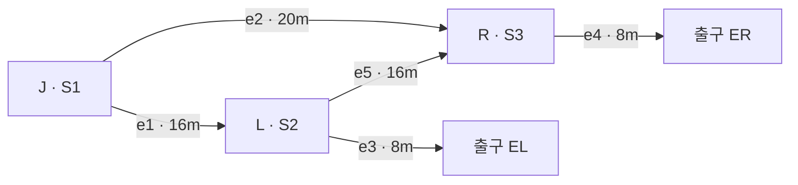
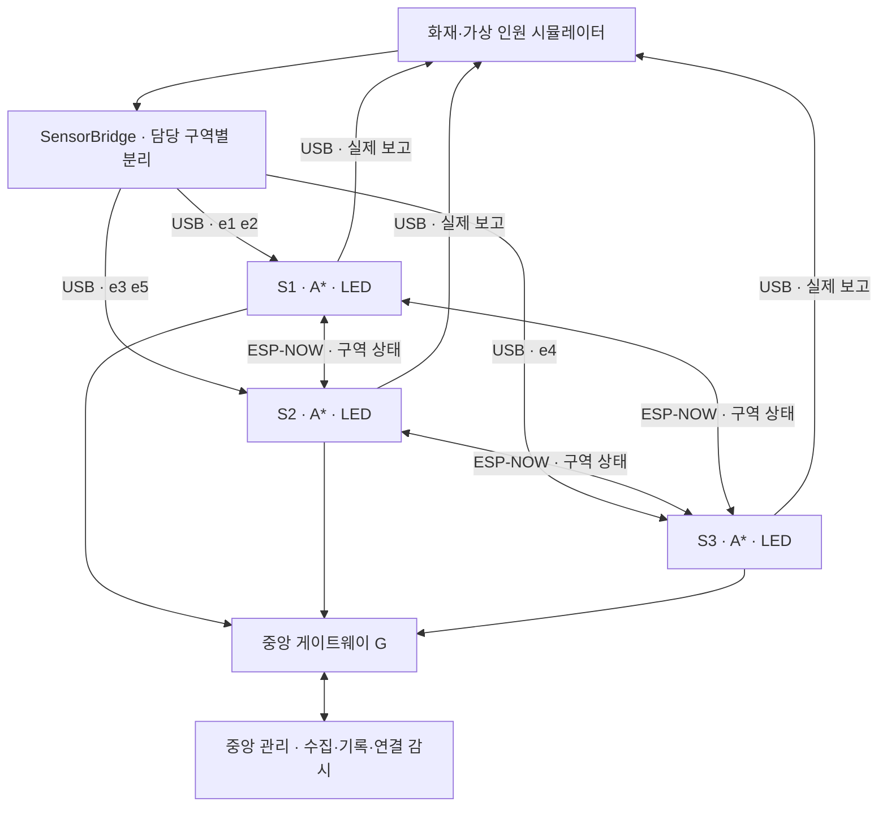

# 위험·혼잡도를 반영한 가변형 스마트 대피 안내 시스템 계획서 v6

작성일: 2026년 10월 6일  
문서 버전: 6.0 · 지하상가 화재 시뮬레이션·센서 대체 입력·A*·실물 지하상가 모형 연동  
과목명: 컴퓨터공학 종합설계  
팀 구성: 4인  
팀명 / 팀원 / 지도교수 / 제출일: 제출 시 기입

**이용객이 모인 지하상가의 점포 화재 상황을 컴퓨터에서 시뮬레이션하고, 실제 ESP32 표지판이 위험·혼잡도를 받아 대피 경로를 계산하여 안내 방향을 바꾸는 시스템**을 개발한다. 표지판 없는 대피, 실물 가변 표지판을 연결한 대피, 중앙 관리 통신이 끊긴 상태의 대피를 차례로 보여준다. 두 번째와 세 번째 시뮬레이션은 지하상가로 재구성한 평면도를 바탕으로 제작하는 실물 모형 및 ESP32 표지판과 연동한다.

표지판별 실제 센서 대신 **시뮬레이터가 담당 구역의 혼잡·화재에 따른 통로 상태를 입력**한다. 경로 계산과 LED 방향 결정은 각 ESP32가 수행한다. 중앙 단절 중에도 담당 구역의 센서 대체 입력은 유지하고, 다른 구역의 정보는 표지판 간 ESP-NOW 통신으로만 공유한다. 본 문서는 구현·시험 계획이며 프로그램이나 하드웨어의 완성을 뜻하지 않는다.

## 0 v6 개정 요약

| 항목 | v5 | v6 |
|---|---|---|
| 기본 상황 | 교육·연구동 화재 | 이용객이 모인 지하상가에서 점포 화재 발생 |
| 공간 구성 | 강의·연구 공간과 다목적 홀 | 판매·음식 점포, 관리·공용시설, 행사·휴게광장 |
| 대피 목적지 | 좌우 외부 출구 | 지상 연결 계단의 지하층 진입부 EL/ER |
| 초기 인원 | 다목적 홀 60명 | 지하상가 행사·휴게광장 WAIT_J의 이용객 60명 |
| 화재 사건 | 추상적인 출구 접근로 차단 | 서측 음식점/동측 생활잡화점 화재로 인접 계단 접근로 차단 |
| 공간 자료 | 제공 교육·연구동 도면 | 기존 복도 치수를 활용한 지하상가 v6 개념 평면도·지도 설정 |
| 기대효과 | 일반 건물의 안내 정책 비교 | 지하상가의 혼잡 분산·우회 안내·중앙 장애 대응 비교 도구 |
| 유지 사항 | 4인·3단계 시뮬레이션·A*·ESP32·ESP-NOW | 동일. 2·3단계는 지하상가 모형과 연동 |

본문은 실행 계획, 별첨 A는 제출용 과제 계획서, 별첨 B는 요구사항명세서, 별첨 C는 상세설계서다. v5의 장치·통신 설계를 계승하고 환경·도면·시나리오를 v6으로 개정한다. 시험 기록에는 사용한 지도와 문서 버전을 함께 남긴다.

## 1 과제 목표와 구현 범위

### 1.1 해결할 문제

본 시연은 지하상가 행사·휴게광장에 이용객이 모인 시간대에 점포 화재가 발생하는 상황을 가정한다. 이용객이 양쪽 지상 연결 계단으로 이동하는 과정에서 점포 앞 통로가 차단되거나 한쪽 계단 접근로에 인원이 집중되면, 사전에 정해진 대피 방향이 현재 상황에 적합하지 않을 수 있다. 중앙 관리 연결에만 의존하는 안내 방식은 연결 장애 시 새 상황의 반영이 어려워질 수 있다. 본 과제는 위험 통로를 제외하고 혼잡 비용을 고려하여 **안내 방향을 가변적으로 표시하는 표지판**과, 그 동작을 반복 비교할 수 있는 **화재 대피 시뮬레이터**를 함께 구현한다.

핵심 질문은 같은 화재 조건에서 안내 유무가 가상 이동에 어떤 차이를 만드는지, 실제 표지판이 입력 변화에 맞춰 경로를 재계산하는지, 중앙 관리 통신이 끊겨도 표지판 간 새 위험·혼잡 공유가 계속되는지다. 결과가 항상 개선된다고 전제하지 않는다.

### 1.2 세 가지 기본 환경

| 단계·모드 | 대피 방향 결정 | 실물 연동 | 중앙 연결 |
|---|---|---|---|
| 1 · SIM_BASELINE | 표지판 없이 사전 거리 경로와 국소 차단 인지 규칙으로 이동 | 없음. 컴퓨터 단독 실행 | 불필요 |
| 2 · HIL_NORMAL | 실제 ESP32의 A* 계산·현재 표시 보고를 따라 이동 | 지하상가 모형·표지판 S1/S2/S3·실제 LED | 중앙 관리 프로그램·게이트웨이 G 연결 |
| 3 · HIL_CENTRAL_OFF | 실제 ESP32가 ESP-NOW로 공유한 최신 상태로 계속 계산 | 2단계와 같은 지하상가 모형·표지판 | G OFF 및 중앙 관리 프로그램 중지 |

HIL은 소프트웨어 시뮬레이션에 실제 하드웨어를 연결하는 시험이다. 3단계에서도 로컬 시뮬레이터와 표지판별 센서 대체 USB는 유지한다. **중앙 단절은 PC 전체 종료나 모든 입력 연결의 제거를 뜻하지 않는다.** 중앙 관리·센서 대체·표지판 간 통신을 구분하여 화면과 배선에 표시한다.

### 1.3 필수 산출물과 선택 확장

| 단계 | 범위 | 완료 근거 |
|---|---|---|
| P0 연결 확인 | 두 표지판에 자기 구역 입력, 상대 표지판으로 ESP-NOW 공유, 각자 A*·LED 출력 | USB 송신 내용·무선 수신 원천·실제 LED 대조 |
| P1 제출 목표 | 세 모드의 최소 이동 시뮬레이터, 모형 1개, 표지판 3대·G 1대, 센서 대체 입력, A*, 기록·단절·복구 시험 | FR01–FR24, T01–T20 및 3단계 영상 |
| P2 선택 확장 | 실제 센서, 점포별 분산 출발·양방향·다층 그래프, 군중 상호작용, 자동 화재 확산 모델, 다양한 행동 모델 | P1 완료 후 별도 구현·검증 |

실제 연기·온도·재실 인원 센서를 P1의 입력 원천으로 사용하지 않는다. 화재는 시뮬레이터에서 지정한 통로 차단 사건으로 모델링한다. 열·연기 유동, 인명 안전성, 실제 시설의 피난 성능, 상용 소방 설비 연동은 평가 범위 밖이다.

## 2 지하상가 공간 구성과 모형 적용

### 2.1 공간 기준과 제공 자료

기본 환경은 **지하상가 지하 1층의 일부 구역, 가로 32m·세로 24m·명목 면적 768㎡**다. 특정 실제 시설을 복제한 도면이 아니라, 기존 평면도의 외곽·복도 치수·표지판 위치를 활용하여 구성한 가상 상가다. 점포와 공용시설 12개 구역, 양쪽 지상 연결 계단 진입부 EL/ER를 배치한다.

| 구역 ID | 지하상가 공간 | 시연에서의 역할 |
|---|---|---|
| 101 | 음식점 | 서측 화재 사건의 발생 점포 |
| 102 | 의류점 | 상가 공간 배경 |
| 103 | 생활잡화점 | 동측 화재 사건의 발생 점포 |
| 104 / 105 | 관리실 / 창고 | 관리·지원시설 |
| 106 / 107 | 카페 / 액세서리점 | 중앙 점포와 우회 통로의 공간 배경 |
| 108 / 109 | 공용 화장실 / 설비실 | 공용·지원시설 |
| 110 | 편의점 | 남측 점포 배경 |
| 111 | 행사·휴게광장 | WAIT_J, 이용객 60명의 공통 출발 구역 |
| 112 | 고객 쉼터 | 공용 휴게 공간 |

- [지하상가 v6 평면도 SVG](대피_건물_구조도/지하상가_평면도_v6.svg)
- [v6 설계용 지도 설정](대피_건물_구조도/building-map-v6.json): 점포·계단 경계·화재 사건·입력 담당·알고리즘 설정
- [원본 지도 JSON](대피_건물_구조도/building-map.json) · [원본 구조도 HTML](대피_건물_구조도/건물_구조도_시연.html): 치수·연결관계를 참고한 원본이며 현재 적용 환경은 아님


그림 1. 지하상가로 재구성한 개념 평면도. 기존 외벽 창 표현을 제거하고 상가 점포·광장·지상 연결 계단을 표시했다. 그림의 화살표는 정적 예시이며 실제 장치의 현재 출력이 아니다. 원본 구조도 HTML의 교육·연구동 명칭·위험 스위치 설명은 v6 시연에 사용하지 않는다. 원본 파일은 보존하며 완성 시뮬레이터의 제작은 별도 구현 범위다.

**EL/ER는 지상 연결 계단의 지하층 진입부를 뜻한다.** P1은 해당 경계까지의 수평 이동과 진입 대기를 계산한다. 계단의 높이·상승 시간·층간 합류·지상 도착은 계산하지 않는다. 문서의 ‘대피 완료·미대피’는 이 모델 경계의 도달·미도달을 뜻하며, 화면·결과표에는 ‘계단 진입 완료/미도달’로 표시한다. 실제 지상 대피 완료로 해석하지 않는다.

### 2.2 공간 표현과 계산 그래프의 구분

도면 전체를 화면과 모형의 공간 배경으로 사용하되, P1의 이동 계산은 제공 JSON의 **5개 노드·5개 방향 간선**을 사용한다. 노드는 J(초기 분기), L(왼쪽 출구·연결 복도 분기), R(오른쪽 출구 접근 지점), EL/ER(출구)다. 세 표지판을 모두 ‘갈림길 3개’로 설명하지 않는다.

| 간선 | 계산 방향 | 중심선 길이 | 명목 폭 | 유효 집계 면적 | v6 입력 담당 |
|---|---|---:|---:|---:|---|
| e1 | J→L | 16m | 3m | 48㎡ | S1 |
| e2 | J→R | 20m | 3m | 60㎡ | S1 |
| e3 | L→EL | 8m | 2.4m | 19.2㎡ | S2 |
| e4 | R→ER | 8m | 2.4m | 19.2㎡ | S3 |
| e5 | L→R | 16m | 2.4m | 38.4㎡ | S2 |

면적은 간선 중심선 길이×명목 폭이며 밀도 계산용이다. 실제 교차부 바닥 면적의 합계로 해석하지 않는다. 원본의 e2·e5 `STATIC_TEST_CLEAR`는 v6에서 폐지하며 다섯 통로 모두 화면에서 화재 차단·해제를 입력할 수 있다.



그림 2. 공간은 연결 복도를 가진 건물이지만, 기본 계산에는 R→L 또는 J로 되돌아가는 역방향 간선이 없다. S3는 현재 지도에서 오른쪽 안내 또는 X/?를 표시한다. 오른쪽 통로 차단 시 왼쪽으로 되돌아가는 안내가 필요하면 역방향 간선·표지판 방향 매핑·순환 방지·이동 규칙을 추가한 새 지도 버전으로 시험한다. A*를 사용한다고 없는 통로가 생성되는 것은 아니다.

기본 60개 가상 ID는 상가 행사에 참여하거나 휴식 중인 이용객으로 설정하고 행사·휴게광장의 WAIT_J에서 시작한다. 60명은 하드웨어 연동과 동일 조건 비교를 위한 설계값이며 상가 전체 수용인원이 아니다. 점포 출입구·진열대·좌석은 공간 표현이고 점포별 분산 출발과 점원·이용객의 행동 차이는 P1에 포함하지 않는다. 화면에 화재 위치를 표시하면 해당 사건이 어느 간선을 차단하는지 함께 명시한다. 점포 안의 화재 아이콘만으로 임의의 복도를 자동 차단하지 않는다.

### 2.3 실물 지하상가 모형과 표지판 배치

1:50 축척의 상가 구역 외곽은 640×480mm이며 약 800×600mm 받침 위에 배치한다. 주복도 폭은 60mm, 연결·출구 복도는 48mm로 표현한다. 낮은 벽과 개방된 상부를 사용하고, 점포·공용시설 이름과 J/L/R·e1–e5·EL/ER를 화면과 동일하게 표기한다. 양쪽 경계에는 지상 연결 계단을 상징하는 부품을 붙이고, 계단 형상은 경계 표시용임을 명시한다.

| 표지판 | 설치 위치·역할 | 실제 표시 |
|---|---|---|
| S1 | J, 행사·휴게광장에서 나온 인원의 좌우 경로 분기 | e1 왼쪽 / e2 오른쪽 / X / ? |
| S2 | L, 왼쪽 출구 진입 또는 e5 연결 복도 우회 | e3 왼쪽 / e5 오른쪽 / X / ? |
| S3 | R, 오른쪽 출구 접근 가능 여부 확인 | e4 오른쪽 / X / ? |

표지판 LED는 가독성을 위해 축척 외 크기로 노드 위 거치대에 설치하고 보드는 받침 아래에 고정한다. 각 화살표는 정해진 관찰 방향에서 물리 복도와 일치하도록 설치·사진 검증한다. G는 모형 바깥에 배치하여 단절 장면이 보이게 한다. 모형 안의 사람은 화면의 가상 인원으로 표현하며 움직이는 로봇·모형 인물 구동은 요구하지 않는다.

2·3단계는 같은 모형과 표지판을 사용한다. 화재·혼잡 입력은 화면에서 하고, 출력은 **ESP32의 실제 LED → 실제 REPORT → 화면의 다음 이동**으로 확인한다. 모형은 단순 전시 배경이 아니라 실제 안내 표지판이 설치되는 시험 공간이다.

## 3 입력·연산·통신·시뮬레이션 연동

### 3.1 센서를 대신하는 입력 경로

시뮬레이터는 가상 인원 위치에서 간선별 인원을 집계하고, 사용자가 지정한 화재 사건에서 통로 상태를 생성한다. SensorBridge는 이 데이터를 담당 구역별로 나눠 S1/S2/S3의 개별 USB 포트로 보낸다. 입력 수신 후 해당 표지판이 자기 원천의 최신 상태로 수용하고 다른 표지판에 ESP-NOW로 공유한다.

| 표지판 | PC→USB로 허용되는 센서 대체 값 | 다른 구역 정보를 얻는 경로 |
|---|---|---|
| S1 | e1·e2 인원, 통로 CLEAR/BLOCKED, 입력 품질 | S2·S3의 ESP-NOW 상태 메시지 |
| S2 | e3·e5 인원, 통로 CLEAR/BLOCKED, 입력 품질 | S1·S3의 ESP-NOW 상태 메시지 |
| S3 | e4 인원, 통로 CLEAR/BLOCKED, 입력 품질 | S1·S2의 ESP-NOW 상태 메시지 |

USB 실시간 입력에 전체 건물의 위험·혼잡 벡터, 추천 경로, 화살표 명령을 넣지 않는다. 지도·알고리즘 설정은 시연 전 정적으로 설치한다. 자기 담당이 아닌 간선 입력이나 방향 명령은 펌웨어가 거부한다. PC는 전체 시뮬레이션 상태를 알지만 이를 각 장치에 전부 배포하여 ESP-NOW를 우회하지 않는다.



그림 3. 표지판 간 ESP-NOW 공유는 2단계부터 항상 동작한다. G와 중앙 관리 프로그램은 상태 수집·중앙 로그·연결 감시를 맡으며 경로 계산이나 센서 대체 입력의 필수 경유지가 아니다. 중앙 관리 패킷은 표지판의 타 구역 상태를 대신 갱신하지 않는다. 3단계는 우회 통신을 새로 만드는 전환이 아니라, 중앙과 독립된 경로가 새 사건에도 계속 작동함을 검증하는 단계다.

### 3.2 중앙 단절의 정확한 범위

중앙 관리 프로그램과 SensorBridge는 별도 프로세스로 실행한다. HIL_CENTRAL_OFF에서는 **G 전원을 끄고 중앙 관리 프로그램을 중지**한다. 시뮬레이터·SensorBridge·표지판별 USB·표지판 전원·ESP-NOW 무선은 유지한다. 정상·단절 모드 간에 입력 데이터 담당이나 경로 알고리즘은 바꾸지 않는다.

| 단절 대상 | 새 위험·혼잡의 반영 | 화면·실물 동작 |
|---|---|---|
| G 및 중앙 관리 | 담당 구역 USB와 ESP-NOW가 정상이면 둘 다 계속 갱신 | 중앙 연결 끊김, 실제 LED·USB 보고·이동 연동 유지 |
| 특정 표지판 센서 대체 입력 | 해당 담당 구역의 새 입력을 잃음 | CLEAR 3초 후 UNKNOWN, BLOCKED 유지, 혼잡 5초 후 만료 |
| 특정 표지판 ESP-NOW 수신 | 타 원천의 새 상태를 잃음 | 원천별 만료 적용, USB로 타 구역 정보를 대체하지 않음 |
| 특정 실제 REPORT 수신 | 다른 정상 장치의 계산은 유지 | 해당 지점 이동은 3초 보고 만료 후 대기 |
| 시뮬레이터·SensorBridge 전체 종료 | 새 센서 대체 입력 자체가 없음 | 입력 만료·정보 부족 표시. 계속 실시간 대응한다고 주장하지 않음 |

v5에서 정한 중앙 관리·입력 분리 원칙을 유지한다. v6에서도 **혼잡 데이터의 실제 입력·공유가 끊겼을 때** 만료된다. 중앙 단절만으로 혼잡을 폐기하지 않는다. 이 시연은 중앙 관리 경로의 장애 내성을 시험하며, 센서가 없는 상태에서 PC 전체 장애까지 극복하는 시험은 아니다.

### 3.3 실제 계산 결과로 움직이는 가상 인원

시뮬레이터는 J/L/R에서 해당 표지판의 최신 REPORT에 있는 `next_edge`와 표시 상태를 읽는다. ESP32가 이미 LED에 적용한 결과를 보고한 뒤 그 결과로 다음 간선을 결정한다. X/?·오프라인·지도/실행 불일치이면 해당 지점에서 대기한다. PC의 예측 경로로 실제 장치 출력을 보충하지 않는다.

보고에는 표지판 ID·부팅 세대·순번·지도 해시·인원 실행 ID·사용한 위험/혼잡 버전·선택 간선·표시·변경 이유를 넣는다. 화면은 입력 생성, 장치 입력 수용, 무선 공유, LED 적용 보고를 구분한다. REPORT는 픽셀 점등 자체의 자동 증명이 아니므로 카메라·육안으로 LED를 함께 확인한다.

## 4 A* 경로 계산과 가변 표시 정책

### 4.1 A*가 필요한가

**현재 5노드·5간선 그래프에서는 A*가 필수는 아니다.** 다익스트라나 모든 경로 열거만으로도 충분히 계산할 수 있다. 화재·혼잡에 따라 비용이 변한다는 사실만으로 A*가 더 빠르거나 더 안전해지는 것은 아니다. 현재 규모에서 성능 우위를 과제의 전제로 삼지 않는다.

다만 개념 지도에 미터 단위 좌표가 있고 향후 점포별 통로·다층 공간으로 확장할 수 있으므로, v6의 실제 경로 엔진은 **A*와 좌표 휴리스틱**으로 구현한다. 정확성은 독립 전수 경로 기준과 대조하고, 다익스트라는 개발 시험에서 비용·확장 노드 수·실행시간을 비교하는 기준으로만 사용한다. 작은 지도에서는 차이가 없거나 A*의 관리 비용이 더 클 수 있다. A*의 핵심은 목표까지의 비용 하한을 탐색 우선순위에 사용하는 것이다.[A1]

이 프로젝트에서 A*를 채택하는 이유는 좌표 기반 탐색 구조와 확장 가능성을 확보하기 위해서이며, 핵심 기여는 **분산 입력 공유·실제 장치의 계산·가변 방향 표시·시뮬레이터 연동**에 있다.

### 4.2 비용과 휴리스틱

```text
rho[e] = confirmed_count[e] / area_m2[e]
q[e] = min(rho[e] / 1.0, 3)
cost[e] = length_m[e] * (1 + alpha * q[e])
alpha = 2                 # 모든 필요한 혼잡 정보가 유효할 때
alpha = 0                 # 혼잡 정보 결측·만료 시 거리 기준
BLOCKED / UNKNOWN 간선은 탐색에서 제외
f(n) = g(n) + h(n)
h(n) = min(직선거리(n, EL), 직선거리(n, ER))
```

화재 위험은 혼잡보다 우선하며 차단 경로는 비용을 높이는 방식이 아니라 탐색 대상에서 제거한다. 1명/㎡는 비용 정규화 기준이며 안전 임계 밀도가 아니다. 비용은 거리와 혼잡을 합성한 비교 점수이지 실제 이동시간 예측값이 아니다.

제공 지도에서는 간선 중심선 길이가 양 끝점의 직선거리 이상이고 혼잡 가중치가 음수가 아니므로, 위 직선거리 휴리스틱은 남은 비용을 과대평가하지 않는 하한으로 사용할 수 있다. 차단 간선을 제거해도 이 하한은 유지된다. 각 장치는 입력 스냅샷을 고정한 뒤 탐색하며, 계산 중 입력이 바뀌면 결과 버전을 검사하여 새 상태로 다시 계산한다. 불일치 스냅샷을 최신 출력으로 채택하지 않는다.

비용은 1,000배 후 올림한 정수, 휴리스틱은 1,000배 후 내림한 정수로 저장한다. 빌드 시 각 간선에 대해 `h(u) <= base_cost(u,v) + h(v)`와 출구의 h=0을 검사한다. 검사에 실패한 지도는 휴리스틱을 0으로 낮추고 사유를 기록하거나 지도를 거부한다. 동률은 출구 ID, 전체 간선 ID 열의 사전순으로 결정한다. 동률 검증을 위해 같은 최저 비용의 후보도 확인한다.

### 4.3 제공 지도 기준의 정적 기대값

| 입력 조건 | 비용·판단 근거 | 안정화 후 S1 / S2 / S3 |
|---|---|---|
| 전 간선 0명·위험 해제, 대기60 | J→L→EL=24, J→R→ER=28 | 왼쪽 / 왼쪽 / 오른쪽 |
| e3 30명·대기30, 위험 해제 | e3 비용33, J 왼쪽49·오른쪽28, L 직행33·우회24 | 오른쪽 / 오른쪽 / 오른쪽 |
| e3 차단·혼잡 없음 | 왼쪽 출구 제외, L에서는 e5→e4로 우회 | 오른쪽 / 오른쪽 / 오른쪽 |
| e3 30명·e4 차단 | 오른쪽 출구 제외, 혼잡한 왼쪽만 허용 | 왼쪽 / 왼쪽 / X |
| e3·e4 차단 | 출구 접근 경로 없음 | X / X / X |

이 표는 고정 분포 규칙 시험용이다. 이동 시연에서는 간선 인원이 바뀌므로 동일한 방향을 강제하지 않는다. 실제 표지판과 시뮬레이터에 이전 지도 길이·면적·해시 또는 프리셋 화살표를 그대로 사용하지 않는다.

### 4.4 방향 안정화와 안내 불가

위험·미확인 상태가 현재 저장 경로에 생기면 즉시 무효화하고 유효 대안을 계산한다. 혼잡만 바뀔 때는 후보 비용이 현재 경로 비용의 85% 이하이며 같은 다음 간선 후보가 5초 지속되고 마지막 방향 변경 후 5초가 지났을 때 바꾼다. 유효 경로가 전혀 없는 상태에서는 유효 대안 발견 즉시 표시한다. 새 위험 대응에는 5초 대기를 적용하지 않는다.

| 표시 | 의미 |
|---|---|
| 초록 화살표 | 현재 수신 정보로 선택한 유효 경로의 다음 방향 |
| 화살표 + 노랑 점 | 위험 정보상 경로는 있으나 혼잡 정보가 부족하여 거리 기준 사용 |
| 빨강 X | 알려진 차단 때문에 출구까지 경로가 없음 |
| 노랑 ? | 초기 확인·지도 오류 또는 필요한 위험 정보가 부족하여 경로를 확정할 수 없음 |

UNKNOWN 간선을 임시 허용한 그래프는 X와 ?의 원인 구분에만 사용한다. 실제 안내에는 UNKNOWN을 쓰지 않는다. 표지판마다 수신 시각·유지 이력이 달라 순간적으로 서로 다른 경로를 선택할 수 있으므로 화면에서 전역 예측 경로와 지점별 현재 안내를 분리한다. P1의 비순환 그래프는 안내 순환을 제한하지만 실제 최적 대피나 개별 인원 분산을 보장하지 않는다.

## 5 최소 화재 대피 시뮬레이션과 비교

### 5.1 공통 이동·화재 모델

| 설정 | P1 기본값·규칙 |
|---|---|
| 초기 인원 | 60개 가상 이용객 ID, 행사·휴게광장 WAIT_J, 난수 없는 동일 조건 |
| 이동 계산 | 논리 시간 간격 0.1초, 기본 속도 1m/s, 간선 points를 따라 이동 |
| 출발·진입 | WAIT_J에서 초당 최대 2명 출발, 나머지 진입은 같은 FIFO 규칙 |
| 계단 진입 처리 | EL·ER 각각 초당 0.5명, 누적 토큰 방식, 출구 앞 대기는 해당 접근 간선의 인원에 포함 |
| 상태 보존 | 간선·노드 대기·계단 진입 완료 인원을 합해 항상 총60명 유지 |
| 화재 사건 | 간선 ID·발생 논리 시각·CLEAR/BLOCKED를 기록한 사건표 또는 화면의 수동 입력 |
| 차단 중 이동 | 차단 간선의 새 진입 금지. 이미 간선 안에 있던 인원은 위치에서 정지·미대피로 기록 |
| 비교 시간 | 같은 조건으로 최대 180초, 미대피가 있으면 완료시간을 산출하지 않고 미완료로 표시 |

모든 값은 **설계용 모델 가정**이며 실측 보행속도·출구 수용능력·화재 확산률이 아니다. 간선 안에서 되돌아가기·추월·회피·연기 흡입은 모델링하지 않는다. 계단 진입 완료 인원은 혼잡 집계에서 제외하고 노드 대기 인원은 별도 지표로 표시한다. 그림의 점포 면적을 임의로 복도 밀도에 더하지 않는다.

### 5.2 표지판 없는 기준 대피의 행동

SIM_BASELINE에서는 스마트 표지판과 동적 안내 화살표를 표시하지 않는다. 가상 인원은 사전에 알고 있는 상가 구역의 연결관계·거리로 가까운 출구 경로를 선택한다. 다음에 진입할 통로의 차단을 해당 노드에서 확인하면 3초 탐색 대기 후, 인지한 차단 간선을 제외한 거리 경로를 다시 선택한다. 원격 화재·전체 혼잡을 미리 알지는 못한다.

이 규칙은 안내가 없으면 사람이 영원히 정지한다는 가정을 피하기 위한 단순 행동 모델이다. 낯선 상가에서의 길 찾기 실패·출입했던 경로 선호·군중 추종은 아직 구현하지 않으며 기준 모드에만 불리하게 추가하지 않는다. 국소 차단 인지·3초 탐색 시간은 실제 사람을 측정한 값이 아니다. 간선 내부에서 차단된 인원의 정지 처리는 세 모드에 똑같이 적용한다. 기준 모드와 연동 모드의 차이는 정보를 얻고 방향을 선택하는 방식이며, 화재·초기 인원·속도·출구 처리율은 동일하게 둔다.

### 5.3 실제 표지판 연동과 중앙 단절

HIL_NORMAL과 HIL_CENTRAL_OFF에서는 노드에 도착한 가상 인원이 해당 실제 표지판의 최신 방향을 따른다. 같은 방향의 유효 보고가 없으면 대기한다. 이동 중 차단된 구간은 시뮬레이터의 공통 통행 규칙으로 정지시키며, 지연된 표지판 보고를 근거로 차단 통로를 통과시키지 않는다. 이 통행 검사와 PC가 대신 경로를 결정하는 것은 구분한다.

SensorBridge는 매 1초 자기 구역의 새 인원·위험 상태를 보낸다. 화재 변경은 다음 주기를 기다리지 않고 즉시 전송한다. 실제 장치 시간은 단조 증가 실시간을 사용하고 HIL 이동도 1배속으로 실행한다. 일시정지는 인원·화재 사건의 논리 시간만 멈추며 입력 heartbeat·장치 만료 검사는 계속된다. 중지된 인원 분포를 새 관측으로 유지 전송하는 정지 모드를 화면에 표시한다. 입력 자체를 멈추는 장애 시험은 별도 조작이다.

### 5.4 비교 실험과 지표

P1은 다음 세 사건표를 같은 초기 조건으로 각각 수행한다. 화재 아이콘은 점포에 표시하고 실제 계산에 반영하는 차단 간선을 별도로 강조한다. 점포 화재와 통로 차단의 연결은 시연용 사건 정의이며 연기 확산을 계산한 결과가 아니다.

| ID | 상황 설정 | 계산에 반영하는 사건 |
|---|---|---|
| F00 | 행사·휴게광장 이용객 60명이 대피하는 비교 기준 | 화재 차단 없음. 이동에 따른 계단 접근로 혼잡 관찰 |
| F01 | 서측 음식점(101)에서 화재가 나 왼쪽 계단 접근로 사용 불가 | t=20초 e3 BLOCKED, 다른 간선은 사건표상 CLEAR |
| F02 | 동측 생활잡화점(103)에서 화재가 나 오른쪽 계단 접근로 사용 불가 | t=20초 e4 BLOCKED, 다른 간선은 사건표상 CLEAR |

F01에서는 S1의 오른쪽 분산과 S2의 연결 통로 우회를, F02에서는 S1/S2의 왼쪽 안내와 S3의 경로 없음 표시를 관찰한다. 이는 위치·입력 유효성에 따라 달라지며, 차단 통로 안에 이미 진입한 인원은 공통 정지 규칙을 따른다. 기존 방향 그래프에 없는 되돌아가기는 제공하지 않는다.

 두 번째와 세 번째 사건표는 연동 모드에서도 동일하게 재실행한다. 중앙 단절 비교에서는 같은 사건표를 유지하고 G OFF·중앙 관리 중지 사건만 t=10초에 추가한다. 수동 시연 사건은 자동 사건표 실험과 별도 기록한다.

완료/미완료, 180초 시점 미대피 인원, 노드·간선별 최대 대기, 개인별 누적 대기, 출구별 도착 인원, 방향 변경 횟수, 위험 생성부터 LED·실제 보고 반영까지의 지연을 기록한다. 완료한 실행만 골라 평균을 내지 않는다. 혼잡 비용이 불필요한 우회나 대기를 만든 경우도 그대로 제시한다.

동일 초기 조건의 결과 비교는 이 단순 모델 안의 차이를 보여준다. 실제 사람을 대상으로 한 피난 시간 단축률이나 안전성 향상 수치로 일반화하지 않는다. 더 현실적인 군중 모델·재현 횟수 확대·행동 가정 민감도 분석은 P2에서 진행한다.

## 6 수행 계획·인력·예산

### 6.1 4인 팀의 작업량

팀 4인·부품 수령 후 8주를 편성 기준으로 한다. 지하상가 공간 재구성·최소 이동·관찰·모형·구역별 입력 분리·A* 검증을 포함해 기본 256–352인시, 예비 25%를 더한 **총 320–440인시**를 계획한다. 견적이 아닌 초기 작업량 추정이며 2주차에 실적을 반영해 갱신한다.

| 작업 | 산출물 | 인시 |
|---|---|---:|
| 지하상가 데이터·요구사항 | 지도 변환·소유 구역·사건표·완료 기준 | 20–28 |
| 모형·하드웨어 | 모형·표지판 3대·G·전원·설치 방향 | 28–36 |
| 경로·상태 정책 | A*·휴리스틱 검사·독립 기준·표시 정책 | 24–32 |
| 무선·최신성 | 구역 발행·ACK·만료·부팅/복구 | 40–56 |
| 시뮬레이터 | 최소 이동·화재·기준 행동·비교 화면 | 44–60 |
| 입력·실물 연동 | 개별 USB·담당 구역 제한·REPORT·중앙 관리 분리 | 36–48 |
| 통합·검증 | 정적·시간 전이·단절·실물 지연·결함 수정 | 40–56 |
| 제출·리허설 | 문서·실행법·영상·반복 시연 | 24–36 |
| **기본 합계** | | **256–352** |
| **예비 25%** | 부품·USB 환경·통신·통합 결함 | **64–88** |
| **총량** | | **320–440** |

4명이 8주에 수행하면 **1인당 주당 약 10–13.8시간**이 필요하다. 4인 모두 주8시간만 가능하면 8주 총256인시이므로 예비 시간을 포함한 본 계획은 약 10–14주가 필요하다. 기간이 고정되어 있으면 모형의 장식·화면 효과·선택 확장을 줄이고 필수 단절·정확성 시험 시간을 확보한다.

### 6.2 역할 분담

| 담당 | 주 책임 | 함께 검토할 상대 |
|---|---|---|
| A · 임베디드 | ESP32·ESP-NOW·A*·상태·실제 표시 | C와 입력/보고 계약, D와 전원·설치 |
| B · 시뮬레이터 | 지하상가 지도·가상 인원·화재·기준 행동·결과 화면 | C와 실제 보고 반영, D와 비교 조건 |
| C · 통합·통신 | SensorBridge·USB 구역 제한·중앙 관리·기록·프로세스 분리 | A/B와 인터페이스·장애 분리 |
| D · 모형·검증 | 지하상가 모형·표지판 배치·독립 기대값·시험·영상·문서 | A와 하드웨어, B와 동일 조건 비교 |

주1회 2시간의 4인 통합 점검을 위 인시에 포함한다. 기대값·시험 결과는 구현 담당자와 다른 사람이 대조한다. 모형 제작과 소프트웨어 개발은 병행한다.

### 6.3 8주 일정과 통과 기준

| 주차 | 핵심 작업 | 통과 기준 |
|---|---|---|
| 1주 | 제공 지도 확정, 담당 구역·메시지, 2대 USB·ESP-NOW, 모형 배치 | 자기 구역 입력만 수용·타 구역 입력 거부 |
| 2주 | A*·두 장치 분산 입력·LED·기준 이동 모델 | P0, 독립 기대값 일치·구역 공유 확인 |
| 3주 | 표지판 3대·G·모형 제작, 시뮬레이터 실제 REPORT 연결 | 실제 LED·보고가 다음 이동에 반영 |
| 4주 | 중앙 관리 분리·G OFF·새 화재/혼잡 입력 | 세 단계 첫 통합 시연·중앙 없는 새 사건 반영 |
| 5주 | 전체 정적 벡터·초기화·만료·재부팅·위조 입력 시험 | T01–T20 1차 결과와 결함 목록 |
| 6주 | 실제 지연·전원·무선 단절·결함 수정·비교 실행 | 필수 실패 해결, 모델·설정 고정 |
| 7주 | 부스·모형 가독성·영상·10회 반복 | 코드 수정 없이 세 단계 반복 |
| 8주 | 회귀 확인·문서/설정 일치·예비 장비 | 제출물·환경 동결 |

4주차까지 실물 3대·세 모드가 연결되지 않으면 P2에 착수하지 않는다. 6주차에 필수 시험이 실패하면 실패 항목·잔여 인시·변경 일정을 제시한다. 부분 구현을 전체 완료로 표기하지 않는다.

### 6.4 계획 예산

아래 금액은 구매가 확인 전 편성한 **배정액**이다. 노트북·모니터·카메라·멀티미터는 보유/대여를 전제로 한다. 실제 센서·위험 토글 구매는 기본 부품에서 제외한다.

| 품목 | 수량·용도 | 배정액 |
|---|---|---:|
| 동일 ESP32 개발보드 | 표지판3·G1·예비1 | 60,000원 |
| 5V 8×8 RGB 패널 | 3개, 거치대 부착 | 75,000원 |
| 패널 전원·잭 | 패널별 정격 확인 후 3세트 | 45,000원 |
| 레벨 변환 부품 | 3세트 | 12,000원 |
| USB 케이블·보드 전원 | 개별 직렬 연결 | 24,000원 |
| 전원형 USB 허브 | 최소 4개 데이터 포트·동시 연결 시험 | 35,000원 |
| 입력 수용 확인 LED·저항 | 지연 측정용, 위험 입력 스위치 아님 | 5,000원 |
| 기판·배선·단자·보호 부품 | 고정 배선 | 25,000원 |
| 지하상가 모형·받침·표지판 거치 | 폼보드 등, 화면과 같은 라벨 | 60,000원 |
| 촬영 거치대·젠더 | 모형·LED 확대 | 20,000원 |
| **소계** | | **361,000원** |
| **배송·교체 예비비** | | **70,000원** |
| **계획 총액** | | **431,000원** |

패널은 보드 GPIO에서 전원을 공급하지 않는다. 패널 전원과 데이터 레벨 변환은 실제 부품 사양에 맞춰 설계하고 +5V 중복 공급을 피한다. G 전원 차단이 표지판·USB 허브 전원을 끊지 않게 배선한다. 입력 단절 시험은 포트 송신 정지로 수행하여 전원 재부팅과 구분한다. 전원 부하·30분 점등·케이블 고정은 별도 시험한다.

## 7 검증 계획과 수용 기준

### 7.1 정확성·실시간 연동·중앙 독립성

| 검증 | 방법·수용 기준 |
|---|---|
| 지도 일치 | v6 좌표·간선·면적·방향·담당 구역·해시를 PC/펌웨어에 동일 적용 |
| A* 정확성 | 차단 2⁵=32조합 × D0/DL/DR 3분포 × J/L/R 3출발점 = **288벡터**, 독립 경로 열거 기준과 경로/비용 일치 |
| 휴리스틱·상태 | 하한·일관성 검사, UNKNOWN·동률·해제·5초 경계는 별도 시간 전이 시험 |
| 위험 우선 | 장치가 새 위험을 처리한 뒤 선택 경로에 BLOCKED/UNKNOWN 간선 사용 0건 |
| 입력 격리 | 각 USB에 자기 구역만 전송. 타 구역·화살표 입력을 주입하면 거부 |
| 중앙 단절 | G OFF·중앙 관리 중지 후 새 e3 혼잡·새 e4 화재를 넣고 타 표지판의 실제 갱신 확인 |
| ESP-NOW 의존 확인 | S1의 S2 무선 수신만 차단 시 e3 새 입력이 S1 USB나 G로 우회하지 않음. 복구 후 동기화 |
| 실제 지연 | 입력 생성→수용→LED→REPORT를 구분. 위험 입력 30회×3대, 장치별 종단 LED 지연 95백분위 1.5초 이하 목표·누락0 |
| 혼잡 반응 | 15% 개선과 5초 조건을 만족하는 입력을 유지하면 종단 방향 변경 7초 이하 목표 |
| 연속 동작 | 30분·세 단계10회, 총 인원 보존·예상 외 재부팅 없음 |

정적 분포는 D0=모든 간선0·WAIT_J60, DL=e3 30·WAIT_J30, DR=e4 30·WAIT_J30이다. 기대값은 A*의 출력을 복사해서 만들지 않고 모든 허용 경로를 열거해 생성한다. 브라우저 참고 계산과 펌웨어는 각각 독립 기준으로 검증한다. 다익스트라 대비 실행시간·확장 노드 수는 보조 측정이며, A*가 더 빨라야만 성공이라고 정하지 않는다.

### 7.2 지연과 증거

한 카메라 프레임에 화면 입력 적용 표시와 세 LED를 함께 담아 입력 생성부터 실제 표시까지 측정한다. 표지판의 입력 수용 확인 LED는 추가 구간 분리에 사용한다. ESP32와 PC의 동기화되지 않은 시계 차를 빼서 무선 지연으로 보고하지 않는다. PC 로그의 입력→REPORT 시간은 별도 지표로 기록한다.

각 장치의 30개 지연을 정렬한 뒤 29번째 값을 최근접 순위 95백분위로 사용한다. 누락이 있으면 성공한 표본만으로 합격시키지 않는다. G 상태·자기 USB 입력·상대 원천의 무선 순번·선택 이유·LED 영상이 같은 사건 ID로 연결되어야 중앙 단절 중 새 정보 전달을 증명할 수 있다.

위험 지연 반복 시험은 DL 조건에서 세 장치가 오른쪽으로 안정된 후 e4를 차단하여 S1/S2 왼쪽·S3 X의 변화를 관측한다. 매 회 명시적으로 차단을 해제하고 안정화한 뒤 반복한다. 이때 e4 입력은 S3 USB에만 보내고 S1/S2의 반응은 ESP-NOW 수신으로 발생해야 한다.

### 7.3 결과 기록

시험 ID·문서/코드 버전·지도 해시·시나리오·실행 모드·사건 시각·입력/수용/공유/보고 버전·중앙 및 센서 대체 연결 상태·기대값·실제값·지연·누락·판정·증거·결함 번호를 남긴다. 미실행·미구현·실패를 구분한다. 현재 실물 수용 시험은 모두 미실행이며 계획서의 수치들은 목표 또는 모델 가정이다.

## 8 발표·부스 시연 계획

### 8.1 단계별 조작

**1단계 — 표지판 없는 화재 대피.** 지하상가 화면에서 60명의 초기 상태와 화재 사건표를 보여준다. 스마트 화살표 없이 가까운 출구 선택, 혼잡, 국소 차단 인지 후 재탐색을 관찰한다. 결과가 나쁘도록 인위적으로 행동을 막지 않는다.

**2단계 — 실제 모형·ESP32 연동.** 지하상가 모형의 S1/S2/S3 위치를 소개하고 같은 사건표·초기 조건으로 다시 시작한다. 화면이 각 표지판에 자기 구역 센서 대체 값을 보내며, 실제 표지판이 계산한 LED 방향과 REPORT가 화면 인원의 이동을 바꾸는 것을 보여준다. 전송한 것은 상황 데이터이고 실제 방향 계산은 보드가 했음을 설명한다.

**3단계 — 중앙 관리 통신 단절.** G 전원을 끄고 중앙 관리 프로그램을 중지한다. 모형·표지판 전원·SensorBridge·개별 USB는 유지한다. 단절 후 화면에서 새 화재나 혼잡을 발생시켜 담당 표지판→ESP-NOW→다른 표지판→LED→가상 인원의 연쇄 반응을 확인한다. 중앙이 끊겼다는 화면 라벨만 바꾸거나 기존 결과를 계속 재생하는 것으로 대체하지 않는다.

### 8.2 중앙 단절의 고정 분포 보조 장면

이 장면은 인원이 계속 움직이는 대피 비교와 분리한 분산 연동 시험이다. 화면에 ‘고정 분포 규칙 시험’으로 표시한다.

1. 모든 위험을 명시적으로 해제하고 D0에서 왼쪽/왼쪽/오른쪽을 확인한다.
2. G OFF·중앙 관리 중지 후에도 담당 구역 입력 heartbeat가 도달하는지 확인한다.
3. e3 인원을30, WAIT_J를30으로 바꾼다. e3 값은 **S2 USB만** 갱신하며 S2가 S1/S3에 공유한다. 5초 안정화 후 세 표지판 오른쪽을 확인한다.
4. 새 e4 화재 차단을 **S3 USB만** 보낸다. ESP-NOW 공유 후 S1/S2 왼쪽·S3 X를 확인한다.
5. S1에서 S2의 ESP-NOW 수신만 시험 차단하고 e3 상태를 변경한다. S1에 해당 새 상태가 우회 도달하지 않고 만료 규칙이 적용되는지 별도 확인한다. 복구 후 새 동기화를 수행한다.

위 과정은 중앙 없는 혼잡 반영과 위험 우선 반영을 모두 보여준다. 실제 이동 장면에서는 그 시점 인원에 따라 방향이 달라질 수 있으므로 정적 기대값을 강제하지 않는다.

### 8.3 기본 4분 발표 시연

| 시간 | 진행 | 핵심 설명 |
|---|---|---|
| 0:00–0:45 | 1단계, 지하상가·이용객·점포 화재·안내 없는 대피 | “표지판 없이 이동하고, 차단을 가까이서 확인하면 다시 길을 찾습니다.” |
| 0:45–1:05 | 모형·표지판·준비 상태 소개 | “센서 값은 화면에서 만들고 방향은 실제 ESP32가 계산합니다.” |
| 1:05–2:00 | 2단계, 같은 화재 사건의 실물 연동 | “실제 LED의 현재 방향이 가상 인원의 다음 이동에 반영됩니다.” |
| 2:00–2:20 | G OFF·중앙 관리 중지, 남은 입력 연결 설명 | “중앙 관리 연결은 끊고, 현장 센서를 대신하는 입력은 유지합니다.” |
| 2:20–3:25 | 3단계, 단절 이후 새 혼잡·화재 | “자기 구역은 입력받고, 다른 구역은 ESP-NOW로 공유받습니다.” |
| 3:25–4:00 | 실제 보고·모형 대조, 결과·복구 | “중앙 장애 대응과 전체 센서/PC 장애는 서로 다른 시험입니다.” |

짧은 발표에서는 세 단계의 대표 사건만 남기고, 고정 분포·무선 차단 증명은 질의응답 또는 영상으로 제시한다. 180초 비교 실험 전체를 4분 라이브 안에 세 번 수행한다고 가정하지 않는다. 정량 결과는 사전 동일 조건 실행의 표·영상으로 보여주며 라이브는 핵심 동작을 시연한다.

### 8.4 준비·복구·실패 대응

시연 전 지도 해시·COM 포트/보드 ID·세 표지판 보고·전원·담당 구역 제한·카메라를 확인한다. 준비 초기화는 운영자가 화재 해제를 명시적으로 요청하고 모든 원천의 적용을 확인한 뒤 가상 인원을 재설정한다. 인원 초기화나 모드 전환 자체가 위험을 해제하지 않는다. 2→3단계에서는 인원·위험·타이머를 유지한다.

G 재연결은 현재 상태 수집만 재개하며 저장된 옛 상태를 표지판에 밀어넣지 않는다. 라이브가 지연되면 해당 모드·실물 촬영 여부를 명시한 예비 영상으로 전환한다. REPORT가 끊기면 화면 이동을 대기시키고 실제 LED는 카메라로 관찰한다. 입력이 끊긴 장면을 정상 실시간 연동으로 설명하지 않는다.

## 9 기대효과·활용방안·산출물

### 9.1 기대효과 및 활용방안

| 산출물 | 기대되는 영향 | 활용 대상·방법 | 확인할 근거 |
|---|---|---|---|
| 화재 대피 시뮬레이터 | 같은 지하상가 구역에서 안내 유무·화재 위치·혼잡·통신 장애를 반복 비교하여 안내 정책의 장단점을 검토할 수 있음 | 지하상가 운영 시나리오 교육, 점포 앞 분기·계단 접근로 안내 정책 검토, 임베디드 연동 시험 | 동일 사건표의 미대피·대기·방향 변화·실패 사례 |
| 가변형 표지판 | 통행 불가 구간을 제외하고 대안이 있을 때 방향을 바꾸며, 안내 불가 상태를 명시적으로 전달할 수 있음 | 지하상가 복도 분기·지상 연결 계단 접근 지점의 안내 장치 시제품 | 차단 후 경로 제외, 우회 선택, X/?·실제 LED 반응 |
| 표지판 간 분산 공유 | 중앙 관리 통신 장애만으로 모든 현장 안내가 멈추는 의존을 줄일 가능성 | 중앙 관리와 현장 안내 기능을 분리하는 구조 검토 | G OFF 후 새 위험·혼잡의 원천별 무선 전달·재계산 |
| 실물 모형 연동 시험 환경 | 실제 센서 설치 전에도 입력·무선·계산·표시의 결함을 반복 재현할 수 있음 | 후속 센서 도입·펌웨어 개선·표지판 배치 검토 | 센서 대체 어댑터 계약·시험 벡터·재현 로그 |

이러한 효과는 산출물이 제공하는 기능과 활용 가능성이다. 실제 시설 적용에는 현장 도면과 양방향 동선 확장, 센서 정확도·통신 범위·전원·가독성·관련 기준 검토가 추가로 필요하다. 본 결과만으로 실제 인명 피해 감소나 피난 시간 단축을 확정하지 않는다.

### 9.2 제출 산출물

P1 제출물은 시뮬레이터와 실행법, 지하상가 모형·ESP32 표지판3대·G1대, 펌웨어·SensorBridge·중앙 관리 소스, v6 지도와 사건표, 배선·부품·방향 매핑, T01–T20 시험표와 원시 로그, 세 단계 영상, 비교 결과표, 계획서·요구사항·상세설계서다. 이번 문서 개정에서는 v6 계획서 MD/HTML·지하상가 개념 평면도 SVG·설계용 지도 설정을 작성하며 실제 프로그램·모형·시험의 완성을 의미하지 않는다.

### 9.3 참고자료

- [D1] 이전 v5 계획서 MD/HTML. 4인 팀·3단계 시연·구역별 입력·장치 연산 설계의 기준.
- [D2] 사용자 제공 `대피_건물_구조도/building-map.json`, 구조도 HTML, 평면도 SVG/PNG. 복도 치수·연결관계·표지판 위치의 원본. v6에서는 지하상가 용도로 재구성.
- [A1] Hart, Nilsson, Raphael, “A Formal Basis for the Heuristic Determination of Minimum Cost Paths,” 1968. [저자 소속 대학 보관 논문](https://ai.stanford.edu/~nilsson/OnlinePubs-Nils/PublishedPapers/astar.pdf). A* 탐색·휴리스틱 개념 참고.
- [R1] [Espressif ESP-NOW, ESP-IDF release-v5.5 공식 문서](https://docs.espressif.com/projects/esp-idf/en/release-v5.5/esp32/api-reference/network/esp_now.html). 연결 없는 Wi-Fi 통신·피어 채널·응용 ACK·콜백 처리 참고.

외부 기술 자료는 v5 작성 시 확인한 2026.10.06 기준 자료를 계승한다. 본 계획의 담당 구역·비용 계수·TTL·지연 목표·인시·예산·행동 모델은 프로젝트 설계값이며 참고자료에서 검증한 효과 수치가 아니다.

<!-- PAGEBREAK -->

# 별첨 A 과제 계획서

과제명: 위험·혼잡도를 반영한 가변형 스마트 대피 안내 시스템  
부제: 지하상가 화재 대피 시뮬레이션과 ESP32 분산 표지판의 실물 모형 연동  
버전: 6.0 · 4인 팀  
팀명 / 팀원 / 지도교수 / 제출일: 제출 시 기입

## A1 과제 목적 및 필요성

행사 시간대 지하상가의 점포에서 화재가 발생하여 이용객이 양쪽 지상 연결 계단으로 대피하는 상황을 설정한다. 점포 앞 접근로가 차단되거나 한쪽 계단에 대기가 집중되면 상황에 맞는 우회·분산 안내가 필요하다. 본 과제는 지하상가 지하 1층의 일부 구역을 모델링하여 위험·혼잡도를 반영해 안내 방향을 바꾸는 ESP32 가변 표지판과 화재 대피 시뮬레이터를 구현한다. 중앙 관리 연결이 끊겨도 표지판들이 직접 상황을 공유하며 판단을 이어가는 구조를 검증한다.

시뮬레이터는 표지판 없는 대피, 실물 표지판의 안내를 따르는 대피, 중앙 단절 상황의 대피를 같은 지하상가 조건에서 보여준다. 실제 센서의 설치·보정 대신 화면의 가상 인원과 화재 조건을 담당 표지판에 입력하되, 상황 공유·경로 탐색·출력 결정은 실제 ESP32에서 수행한다. 두 번째와 세 번째 시뮬레이션을 실물 지하상가 모형과 연결하여 화면의 결과가 실물 하드웨어의 연산에서 나왔음을 확인한다.

## A2 사용기술 및 설계

### A2.1 사용기술

| 기술 | 적용 |
|---|---|
| HTML·CSS·JavaScript·SVG | 제공 평면도의 2D 시각화, 최소 대피 이동, 화재·혼잡 입력, 비교 화면 |
| Python·FastAPI·pyserial·SQLite | 표지판별 센서 대체 USB 입력, 실제 보고 수집, 로그·API, 별도 중앙 관리 |
| ESP32·C/C++ | 자기 담당 구역의 입력 수용, 상태 관리, A* 경로 계산, LED 표시 |
| ESP-NOW | 중앙 관리 연결과 독립된 표지판 간 위험·혼잡 공유 |
| A*·좌표 휴리스틱 | 차단·미확인 통로 제외 후 거리·혼잡 비용 경로 탐색 |
| RGB LED·축척 모형 | 지하상가 모형의 대응 위치에 가변 화살표·X·? 표시, 화면과 실물 대조 |

### A2.2 공간·입력·연동 설계

32×24m의 가상 지하상가 구역을 공간 배경으로 사용한다. 기존 도면의 치수를 활용하되 강의·연구실 대신 점포·관리시설·행사·휴게광장으로 재구성한다. EL/ER는 양쪽 지상 연결 계단 진입부이며 계단 상승·지상 도착은 P1 계산 범위 밖이다. 기본 이동은 행사·휴게광장의 60명 공통 출발과 제공 지도상의 J/L/R·EL/ER, 방향 복도 e1–e5로 구성한다. 표지판 역할은 S1의 좌우 분기, S2의 왼쪽 출구 또는 연결 복도 우회, S3의 오른쪽 출구 확인으로 나눈다. 복도 길이는 16·20·8·8·16m이며 각각 도면의 폭·면적으로 혼잡도를 계산한다.

시뮬레이터는 S1에 e1/e2, S2에 e3/e5, S3에 e4의 가상 센서 값을 개별 USB로 제공한다. 각 보드는 자기 구역 상태를 ESP-NOW로 다른 표지판에 공유하고, 수신한 상태로 각자 경로와 LED 방향을 결정한다. PC가 계산한 경로나 전체 상태를 모든 표지판에 보내지 않는다. 실제 화재 감지 센서나 위험 스위치는 필수 입력 장치가 아니다.

중앙 관리 프로그램과 G는 관찰·수집을 담당한다. 중앙 단절 시 두 요소를 끄되 센서 대체 입력과 표지판 전원·ESP-NOW는 유지한다. 따라서 단절 이후 새 위험뿐 아니라 혼잡 변화도 표지판에 반영할 수 있다. 이 구조는 중앙 관리 장애를 시험하는 것이며 센서 대체 PC 전체 장애의 독립 동작을 입증하는 것은 아니다.

A*는 좌표를 활용하고 향후 지도 확장을 고려해 적용한다. 현재 작은 그래프에서 필수이거나 다익스트라보다 빠르다고 가정하지 않으며, 독립 기대값과 기준 알고리즘으로 정확성·탐색량·실행시간을 확인한다. 위험은 우선 제외하고 혼잡에 따른 방향 변경에는 15% 개선·5초 유지 조건을 둔다.

### A2.3 수행 계획 및 실행 가능성

4인·8주·총320–440인시, 보유/대여 장비를 전제로 한 배정 예산431,000원을 계획한다. A는 임베디드, B는 시뮬레이터, C는 통합·통신, D는 모형·검증을 담당한다. 1–2주 기본 연결·A*, 3–4주 모형·세 단계 연동, 5–6주 검증·결함 수정, 7–8주 시연·제출을 수행한다.

288개 정적 경로 벡터, 중앙 단절 후 새 데이터 전달, 실제 LED 반영 지연, 입력 격리·만료·복구, 인원 보존, 30분 연속·10회 반복을 필수 검증한다. 최소 이동·실물 연동·중앙 단절 시험을 우선하고 실제 센서·다층 동선·정교한 화재/군중 모델은 후속 확장으로 둔다.

## A3 기대효과 및 활용방안

**시뮬레이터는 지하상가의 점포 화재·계단 접근로 혼잡·통신 조건을 바꾸면서 대피 안내 방식의 장단점을 반복 비교하는 도구로 활용할 수 있다.** 같은 사건표에서 안내 유무에 따른 대기·미대피·출구 이용의 차이를 확인하여, 동적 안내가 도움이 되는 조건과 오히려 불필요한 우회를 만드는 조건을 검토할 수 있다. 상가 운영자·관리 인력의 상황별 안내 교육과 지상 연결 계단으로의 이용객 분산 정책 검토 자료로 활용할 수 있다. 점포 화재 위치와 혼잡 위치가 달라질 때 안내 방향이 어떻게 바뀌는지 비교하는 데 초점을 둔다.

**가변형 표지판은 통로 상황에 따라 방향을 바꾸고 안내할 경로가 없을 때 이를 명시하는 현장 안내 장치의 기반이 된다.** 출구 접근로 차단 시 가능한 우회를 제시하고 혼잡 변화에 맞춰 안내를 갱신하는 기능을 실물로 검토할 수 있다. 중앙 관리 통신과 표지판 간 공유를 분리함으로써 중앙 연결 장애가 전체 안내 중단으로 이어지는 의존을 줄이는 설계 대안을 제시한다.

**실물 지하상가 모형과 연결된 시험 환경은 센서 도입 전 단계의 개발·검증 비용을 줄일 수 있는 재사용 가능한 기반이다.** 동일한 위험·혼잡 입력을 반복 생성하여 표지판의 오판·지연·정보 만료를 재현하고, 후속 실제 센서는 같은 구역 입력 계약에 맞춰 교체·검증할 수 있다. 다만 실제 시설 적용 효과는 센서·통신·현장 동선·운영 조건을 추가 검증한 뒤 판단해야 하며, 본 시제품만으로 실제 피난 시간 단축이나 인명 피해 감소를 확정하지 않는다.

<!-- PAGEBREAK -->

# 별첨 B 요구사항명세서

문서명: 화재 시뮬레이션 연동 가변형 대피 안내 시스템 요구사항명세서  
버전: 6.0 · 4인 팀

## B1 목적·운영 환경·용어

대상은 지하상가 v6 지도와 축척 모형, 노트북, 표지판3대·G1대다. 운영자는 세 모드·화재·입력 장애를 선택하고 개발자는 로그·영상으로 검증한다. 사람은 가상 ID로만 표현하며 실제 이용객의 위치·영상 분석은 수집하지 않는다.

| 용어 | 정의 |
|---|---|
| 센서 대체 입력 | PC가 자기 담당 구역에만 보내는 혼잡·통로 상태. 실측 센서 데이터가 아님 |
| 중앙 관리 통신 | 중앙 관리 프로그램↔G↔표지판의 관찰·연결 감시 경로 |
| 표지판 간 통신 | 자기 원천 구역의 상태를 다른 표지판에 전달하는 ESP-NOW 경로 |
| 실제 보고 | LED 적용 후 ESP32가 전송한 방향·사용 상태 버전·이유 |
| 위험 영역 | 인원 실행과 별도로 유지되는 원천별 차단·확인 상태 |
| 인원 실행 | run_id로 구분하는 60개 가상 ID의 위치·밀도·이동 조건 |
| 중앙 단절 | G OFF·중앙 관리 중지, 센서 대체·표지판 간 통신은 유지 |

## B2 기능 요구사항

FR01–FR24는 P1 필수다. 각 번호는 v5의 기술 요구를 계승하되 v6 지도·점포 사건·계단 경계로 검증한다. 이전 지도에서의 결과를 자동 승계하지 않는다.

| ID | 요구사항 | 수용 기준 |
|---|---|---|
| FR01 | 지하상가 v6 지도·설정 사용 | 점포명·EL/ER 계단 경계·길이·면적·좌표·담당·방향 해시 일치, 잘못된 지도 거부 |
| FR02 | 표지판 없는 대피 실행 | 동적 화살표 없음, 거리 경로·국소 차단 인지·재탐색 규칙 공개 |
| FR03 | 화재·혼잡 입력 생성 | e1–e5 모두 차단/해제·인원 입력 가능, 총60 보존 |
| FR04 | 담당 구역별 USB 입력 | S1=e1/e2, S2=e3/e5, S3=e4 외 입력·방향 명령 거부 |
| FR05 | 표지판 간 직접 상태 공유 | 다른 구역 상태는 해당 원천 ESP-NOW에서만 수용 |
| FR06 | 실제 ESP32에서 A* 수행 | 288개 정적 벡터가 독립 경로·비용 기준과 일치 |
| FR07 | 휴리스틱·동률 처리 | 하한/일관성 검사, 출구·간선 순서에 따른 결정적 결과 |
| FR08 | 위험 우선·변경 안정화 | 위험 경로 즉시 무효화, 혼잡15%·5초 규칙 |
| FR09 | 실제 가변 표시 | 화살표·X·?·혼잡 품질 저하의 의미와 물리 방향 일치 |
| FR10 | 모형과 화면 연동 | S1/S2/S3의 실제 LED·REPORT가 해당 지점 이동에 반영 |
| FR11 | 실제 보고와 예측 분리 | 오래된/불일치 보고 거부, 3초 미수신 시 지점 대기 |
| FR12 | 중앙 관찰 기능 분리 | 별도 중앙 관리 프로세스·G, 경로/센서 전달의 필수 경유 아님 |
| FR13 | 중앙 단절 후 새 사건 대응 | G OFF·중앙 중지 후 혼잡·위험 모두 새로 공유·계산 |
| FR14 | 개별 장애 구분 | 중앙·센서 대체·ESP-NOW·REPORT 단절을 별도 표시 |
| FR15 | 원천별 최신성 검증 | 부팅 세대·순번·지도·담당 구역·실행 ID 검사 |
| FR16 | 유효기간·차단 유지 | CLEAR 3초, 혼잡5초, BLOCKED 명시적 해제 전 유지 |
| FR17 | 부팅·재연결 동기화 | 과거 CLEAR/혼잡 재생 거부, 현재 challenge 응답 확인 |
| FR18 | 초기화 영역 분리 | 인원 초기화가 화재·장애 상태를 지우지 않음 |
| FR19 | 단계 전환 준비 확인 | 1→2 명시적 위험 확인·새 실행, 2→3 기존 상태 유지 |
| FR20 | 이동 모델·동일 조건 비교 | 같은 인원·속도·처리율·화재 사건, 미완료 포함 기록 |
| FR21 | 입력·실물 지연 기록 | 사건별 생성/수용/공유/LED/REPORT를 추적 |
| FR22 | 데이터 내보내기 | 모드·지도·사건·버전·누락·시험 결과 CSV/JSON |
| FR23 | 입력·관찰 프로세스 분리 | 중앙 종료로 SensorBridge가 종료되지 않음, 타 구역 우회 전달 없음 |
| FR24 | 컴퓨터 단독·검증 모드 제공 | 기준 시뮬레이션과 별도 알고리즘 시험을 장치 없이 실행 |

## B3 비기능 요구사항

| ID | 요구사항 | 기준 |
|---|---|---|
| NFR01 | 반응성 | 위험30회×3대, 종단 LED p95 1.5초 이하 목표·누락0, 혼잡 조건 지속 시7초 이하 목표 |
| NFR02 | 안정성 | 30분 연속·세 단계10회, 예상 외 재부팅·인원 손실 없음 |
| NFR03 | 전원·설치 | 패널 정격 검토·전원 분리·밝기 제한·고정 배선, G 단절이 타 장치 전원에 영향 없음 |
| NFR04 | 무선 범위 | 같은 실내·고정 채널·등록4대·단일 홉, 자동 메시 중계 없음 |
| NFR05 | 가독성 | 모형 위치·지도 라벨 일치, 부스2m 또는 카메라 확대에서 방향/X/? 식별 |
| NFR06 | 재현성 | 지도·설정·사건표·빌드·부품·독립 기대값·원시 로그 보존 |
| NFR07 | 입력 검증 | 원천/담당 검사·등록 피어·키·범위·프레임 길이·localhost 접근 제한 |
| NFR08 | 로컬 실행 | 외부 인터넷 없이 세 모드 실행, 센서 대체와 실측을 명확히 표시 |
| NFR09 | 결과 해석 | 단순 모델의 차이와 실물 성능을 구분, 실제 대피 안전성/개선율 단정 금지 |

## B4 수용 시험·추적 관계

| ID | 시험 | 대응 요구사항 |
|---|---|---|
| T01 | 제공 좌표·면적·담당 구역·해시·물리 방향 검증, 잘못된 지도 거부 | FR01 FR09 NFR03 |
| T02 | 288벡터 A*·독립 열거 비교, 다익스트라 보조 측정 | FR06 FR07 |
| T03 | 휴리스틱 검사·동률·UNKNOWN·현재 경로 차단·5초 경계 | FR07 FR08 FR09 |
| T04 | 자기 USB 구역 제한·타 구역/방향 주입 거부 | FR03 FR04 NFR07 |
| T05 | 원천 ESP-NOW 수용·중복·역순·옛 세대·원천 위조 | FR05 FR15 NFR07 |
| T06 | CLEAR/혼잡 입력 중단·TTL·BLOCKED 유지 | FR14 FR16 |
| T07 | 표지판 재부팅·USB 재연결·challenge·옛 정상 거부 | FR15 FR17 |
| T08 | 위험 ON 인원 초기화·일부 장치 미응답·옛 실행 거부 | FR18 FR19 |
| T09 | 최신 REPORT로만 이동, X/?·3초 만료·지도 불일치 대기 | FR10 FR11 |
| T10 | 모형 노드·표지판·실제 LED·화면 이동·카메라 대조 | FR09 FR10 NFR05 |
| T11 | G OFF·중앙 종료 후 e3 새 혼잡과 e4 새 차단 반영 | FR12 FR13 FR23 |
| T12 | T11 중 S1의 S2 무선 수신만 차단, USB 우회 없음·만료·복구 | FR04 FR05 FR13 FR14 |
| T13 | 중앙·센서 대체·ESP-NOW·보고 연결을 각각 끊어 기능 구분 | FR14 FR16 FR23 |
| T14 | 입력 생성→수용→LED→REPORT, 위험30회×3대·혼잡 변경 | FR21 NFR01 |
| T15 | 세 모드 동일 사건표·국소 기준 행동·실제 안내·총60·180초 미완료 | FR02 FR20 NFR09 |
| T16 | 1→2 준비·2→3 상태 유지·G 복구 옛 값 역주입 방지 | FR17 FR19 |
| T17 | 인터넷 차단·컴퓨터 단독 기준/알고리즘 시험·실물 모드 라벨 | FR24 NFR08 |
| T18 | 예기치 않은 입력/로그 실패·CSV/JSON·누락·원천별 기록 | FR21 FR22 NFR06 |
| T19 | 30분·3단계10회·전류·G 전원 격리·배선·USB 재열거 | NFR02 NFR03 NFR04 |
| T20 | 독립 채점자가 사건표·정적 기준·영상으로 결과 재현 | FR20 FR22 NFR06 NFR09 |

시험 결과의 초기 상태는 미실행이다. 계획서 내 계산 예시는 실제 펌웨어나 무선 시험의 통과 증거로 사용하지 않는다.

<!-- PAGEBREAK -->

# 별첨 C 상세설계서

문서명: 화재 시뮬레이션·분산 가변 표지판 연동 상세설계서  
버전: 6.0 · 4인 팀

## C1 모듈·프로세스 경계

| 모듈 | 책임·금지사항 |
|---|---|
| SimulationEngine | 가상 인원·화재·구역 집계·기준 행동, HIL에서는 경로를 대신 결정하지 않음 |
| SensorBridge | 장치 ID↔포트 연결, 자기 구역만 입력, 실제 보고 수집·수신 시각 기록 |
| LocalInputAdapter | 허용 담당 구역·범위·세대·순번·현재 입력 확인 |
| ZonePublisher | 자기 입력을 원천 상태로 발행, 입력 중단 시 과거 정상/혼잡을 새 관측으로 재발행하지 않음 |
| PeerTransport | ESP-NOW 등록·송수신·큐·ACK·재전송, USB를 무선 우회 경로로 사용하지 않음 |
| StateStore | 위험·혼잡·원천별 최신성·실행을 분리 관리 |
| RouteEngine | 불변 상태 스냅샷으로 A*·출구 후보·근거 비용 계산 |
| DirectionPolicy | 위험 우선·후보 유지·표시 상태 결정 |
| Renderer/Reporter | 실제 LED 적용 후 REPORT 발행, 입력 수용 확인 신호 |
| CentralManager/G | 중앙 관찰·로그·연결 감시, 방향/타 구역 상태 주입 없음 |
| ScenarioCatalog/Repository | 지도·사건표·버전·실험·영상 연결·CSV/JSON |

ESP32는 동일 모델과 ESP-IDF 5.5 계열로 환경을 고정하고 세부 버전은 구현 시 잠근다. SensorBridge와 CentralManager는 독립 프로세스·포트 설정·종료 수단을 가진다. 중앙 heartbeat는 표지판의 정상 안내 조건이 아니다.

## C2 하드웨어와 배선

| 연결 | 설계 초안 |
|---|---|
| 표지판 데이터 출력 | GPIO18→레벨 변환·보호 저항→패널 DIN, 실제 보드/패널 사양 확인 |
| 입력 수용 확인 | GPIO25→확인 LED·저항, 입력 수용 시 측정 신호 |
| 표지판 USB | S1/S2/S3 각 포트, 가상 센서 입력 수신·실제 보고 송신 |
| G USB | 별도 포트·중앙 관리 연결, 전원 분리 시연 |
| 전원 | 패널별 외부5V, 보드는 안정된 USB 전원, 필요한 공통 GND·+5V 역급전 방지 |
| 모형 설치 | 640×480mm 외곽·800×600mm 받침, 노드 위 표시·보드와 케이블 하부 고정 |

위험 토글이나 실측 센서의 GPIO 수집 코드는 P1 입력 계약에서 제거한다. 센서 대체 연결을 끊는 시험은 기본적으로 PC의 해당 포트 송신만 중지한다. 케이블 제거로 보드가 재부팅되면 입력 장애가 아닌 재부팅 시험으로 분류한다. 표지판의 USB 장치 이름만 믿지 않고 HELLO의 장치 ID·설치 ID로 포트를 검증한다.

## C3 지도 설정과 A* 구현 계약

`building-map-v6.json`은 원본 기하 구조를 유지하고 점포·공용시설 명칭, 지하 1층·계단 진입 경계, 화재 사건을 재정의한 설계 설정이다. `source_map_id`는 원본 식별, `map_id`는 v6 식별이며 지도 해시는 자기 자신을 제외한 정규화된 전체 JSON의 SHA-256으로 생성한다. 해시는 UTF-8·키 사전순·공백 없는 직렬화로 고정한다. 생성 도구가 해시를 포함한 PC/펌웨어 설정을 함께 배포하며 장치가 다른 방식으로 임의 직렬화하여 계산하지 않는다.

nodes·edges·signs·source·cost·algorithm·simulation 변경 시 해시를 갱신한다. 간선의 source는 S1/S2/S3 중 하나이고 모든 간선에 정확히 한 담당을 둔다. 출구·노드·면적·길이·좌표·points·방향 매핑을 검사한다. 제공 지도처럼 기본 계산은 비순환 방향 그래프로 제한한다. 각 점포의 출입구에서 복도까지 자동 연결을 추정하지 않는다.

```text
입력 스냅샷 고정: map_hash, risk_versions, crowd_versions, run_id
BLOCKED/UNKNOWN 간선 제외, 혼잡 유효성에 따라 비용 결정
출발 노드를 OPEN에 삽입, g=0, f=g+h
가장 작은 f 후보 확장, 더 작은 g 발견 시 부모·비용 갱신
출구 후보를 얻어도 같은 최저 비용의 동률 후보는 확인
최저 비용 → 출구 ID → 간선 ID 열 순서로 경로 결정
스냅샷 버전 재확인 → DirectionPolicy → LED 적용 → REPORT
상태가 바뀌었으면 오래된 계산 결과를 폐기하고 새 스냅샷 재탐색
```

화재·혼잡 변화 시 매번 현재 작은 그래프에서 A*를 다시 실행한다. 과거 OPEN/CLOSED를 다른 비용 상태에 그대로 재사용하지 않는다. 미래 화재 예측이나 D* 계열의 증분 재탐색은 구현하지 않는다. 안내 유지 때문에 최단 경로 후보와 현재 방향이 다를 수 있으므로 REPORT에는 둘을 구분한다.

## C4 입력·메시지·최신성

### C4.1 USB와 무선 메시지

USB는 115200bps 줄 단위 JSON·프레임 상한1024바이트로 시작한다. 무선은 정수 폭·바이트 순서·단위를 고정한 최대200바이트 직렬화 프레임을 사용하고 C 구조체 메모리를 그대로 전송하지 않는다. 원천별 담당 최대2간선의 위험·혼잡을 분리 전송하여 상한을 맞춘다.

| 메시지 | 경로 | 주요 내용 |
|---|---|---|
| HELLO / SYNC_CHALLENGE / SYNC_REPLY | PC↔자기 장치, 표지판↔상대 원천 | 설치·지도·장치 ID·부팅 세대·현재 입력 세대·challenge |
| SENSOR_RISK | PC→담당 표지판 USB만 | input_epoch·risk_sample_seq·담당 간선 상태·입력 품질 |
| SENSOR_CROWD | PC→담당 표지판 USB만 | run_id·crowd_snapshot_id·crowd_sample_seq·담당 간선 인원·품질 |
| RISK_STATE | 담당 표지판→다른 표지판·G | 원천·boot_epoch·risk_seq·입력 관측 키·위험 상태 |
| CROWD_STATE | 담당 표지판→다른 표지판·G | 원천·boot_epoch·run_id·crowd_snapshot_id·crowd_seq·입력 관측 키·구역 인원·품질 |
| ACK | USB 수용 응답 또는 무선 수신 응답 | 수용한 관측 키·거부 이유, LED 적용 보고와 별개 |
| REPORT | 각 표지판→자기 USB·G | 표시·next_edge·이유·사용 원천 버전·run_id·report_seq·업타임 |
| CENTRAL_HEARTBEAT | 중앙/G↔표지판 | 중앙 연결 감시용, 센서·위험 TTL 연장 금지 |

USB 관리 명령은 지도/장치 확인·새 인원 실행 준비·시험 시작 등으로 제한한다. `SET_DIRECTION`, 타 원천 `RISK_STATE`/`CROWD_STATE`의 USB 수신, 전체 상태 벡터의 실시간 주입은 허용하지 않는다. 위험 해제는 해당 담당 표지판으로 들어온 새로운 SENSOR_RISK의 명시적 CLEAR와 수용 확인으로 수행한다.

### C4.2 ESP-NOW 운용

등록한 S1/S2/S3/G를 같은 고정 채널의 개별 유니캐스트 피어로 구성한다. 표지판은 자기 구역 상태를 다른 표지판에 직접 보내며 다중 홉 자동 중계는 없다. 중앙이 꺼져도 ESP32의 Wi-Fi 무선 기능은 유지한다. ESP-NOW는 연결 없는 Wi-Fi 통신이며 공유기 접속을 경유하지 않는다.[R1]

송신 성공 콜백만으로 장치 적용 완료를 판정하지 않는다. 응용 ACK·중복 키·수신 보고를 별도로 기록하고, 위험 변경은 미확인 수신자에150/400/800ms 재전송을 계획한다. 콜백에서는 길이 확인·큐 적재만 수행하고 경로 탐색·LED·저장은 별도 처리한다.[R1] 실패한 G에 대한 재시도가 표지판 피어 전송을 막지 않도록 목적지별 큐·제한 재시도를 사용한다.

### C4.3 입력 신선도와 재전송

정상 입력은 1초마다 새 sample_seq로 발행한다. 표지판은 **새 USB 관측을 받았을 때만** 그 관측을 새 원천 상태로 발행한다. 재전송은 같은 관측 키를 유지하며 수신 장치의 최신성 타이머를 연장하지 않는다. REPORT·ACK·중앙 heartbeat는 위험/혼잡의 관측 시각을 갱신하지 않는다.

혼잡은 시뮬레이터가 같은 논리 시점에 부여한 crowd_snapshot_id를 자기 구역 값과 함께 전달한다. 각 표지판은 세 원천의 같은 run_id·snapshot_id가 모인 완성 분포만 비용에 적용한다. 일부만 도착하면 이전 완성 분포를 유효기간 내에서 유지하고, 그 분포의 원천 관측 중 가장 오래된 값이 5초를 넘으면 혼잡을 만료시킨다. 부분 수신으로 이전 분포의 유효기간을 연장하지 않는다. 위험 변경은 완성 혼잡 분포를 기다리지 않고 바로 반영한다.

REPORT는 LED·사용 상태 변경 시 즉시, 변화가 없어도 1초마다 새 report_seq로 발행한다. PC는 새 보고만으로 3초 수신 타이머를 갱신한다. 중앙 연결 heartbeat도 1초 주기·3초 만료로 관찰하되, 중앙 미응답은 표지판의 위험·혼잡 유효기간에 영향을 주지 않는다.

원천과 수신 장치는 각각 마지막 새 관측으로부터 위험 CLEAR는3초, 혼잡은5초에 만료 처리하며 100ms 주기로 검사한다. 이미 알려진 BLOCKED는 입력이 끊겨도 유지한다. 신뢰할 새 관측이 없는 CLEAR는 UNKNOWN이 된다. 어느 간선의 혼잡이든 결측/만료이면 해당 장치의 전체 혼잡 비용을 끄고 거리 기준·품질 저하를 표시한다.

새 원천 부팅 세대를 발견하면 과거 CLEAR를 그대로 수용하지 않고 challenge로 현재 입력을 확인한다. 동기화 실패·지도 불일치는 ? 또는 정보 부족 정책으로 처리한다. 저장된 차단은 명시적으로 확인된 새 해제 이전에 자동 CLEAR로 복구하지 않는다. 원천 재부팅만으로 새로운 센서 관측을 만든 것처럼 처리하지 않는다.

## C5 인원·화재·실행의 분리

가상 인원은 유일한 person_id로 관리하고 간선 이동·WAIT_J/L/R·EVACUATED_EL/ER 중 한 상태에만 둔다. EVACUATED_EL/ER는 내부 상태명이며 의미는 지하층 계단 진입 완료로 제한한다. 출구 앞 간선의 정지/대기 인원은 해당 간선 count에 포함한다. 새로운 SENSOR_CROWD는 현재 실행에만 적용한다. 총 인원60 보존과 잘못된 범위 검사는 시뮬레이터/SensorBridge에서 수행하고, 장치는 자기 구역 count 범위를 별도로 검사한다.

run_id는 PC의 영속 server_epoch와 run_counter로 구성한다. SensorBridge 시작 시 input_epoch를 영속 증가시키고, 새 세대는 장치와 challenge 동기화를 거쳐 수용한다. 위험 메시지는 인원 run_id에 종속시키지 않는다. 인원 초기화는 새 run_id·ID 위치·후보 유지 이력을 갱신하지만 현재 화재 상태와 연결 장애는 유지한다.

시뮬레이터 재시작은 위험 상태를 자동 CLEAR로 만들지 않는다. 마지막 사건 기록을 복구하고 운영자가 현재 상태를 확인한다. 저장 영역 손상이나 원천 세대 불명확 시 초기화 성공을 표시하지 않고 설치·실행을 재확인한다. 명시적 ‘새 실험 준비’는 화재 해제 요청→각 담당 수용 확인→새 인원 실행 준비→세 REPORT 반영 확인 순서다. 모드 변경 버튼과 인원 초기화 버튼은 이 화재 해제 절차를 대신하지 않는다.

2→3단계 전환은 중앙 연결만 끊고 run_id·risk_seq·crowd_seq·후보 타이머를 유지한다. 중앙 복구는 현재 표지판 REPORT 수집부터 시작하며 캐시된 옛 위험·인원을 재배포하지 않는다.

## C6 화면·API·저장

### C6.1 화면 구성

상단에 모드·계산 주체·화재 상황·논리/실제 경과시간을 표시한다. 중앙은 지하상가 v6 지도·가상 인원·화재와 차단 간선·노드 대기, 옆은 S1/S2/S3 실제 방향·수신 경과·근거·모형 카메라, 하단은 인원 보존·계단 진입 완료·대기·사건 로그로 구성한다. 입력은 통로 선택·화재 ON/OFF·인원 조건·초기화·중앙 단절·입력 장애로 구분한다.

중앙 관리 연결, S1/S2/S3 센서 대체 USB, 표지판별 ESP-NOW 원천 최신성, REPORT 수신 상태를 각각 표시한다. 빨강 X·노랑 ?는 문자 설명을 함께 제공한다. 기준 모드에는 실제 표지판 안내나 전역 추천 경로를 표시하지 않는다. 별도 알고리즘 시험 화면은 SIM_REFERENCE로 명시한다.

### C6.2 API와 실행

| API·프로그램 | 역할 |
|---|---|
| GET /api/state | 시뮬레이션·실제 보고·입력 품질·연결 상태 조회 |
| POST /api/scenario | 지도에 맞는 초기 조건·사건표 검증·적용 |
| POST /api/fire | 담당 구역을 결정한 뒤 SENSOR_RISK 생성 |
| POST /api/run/reset | 위험 유지·새 인원 실행 준비·반영 확인 |
| POST /api/test/input-link | 특정 자기 구역 입력 송신 정지·복구 시험 |
| GET /api/export | 사건·버전·실제 보고·지연·판정 CSV/JSON |
| WS /ws/state | 초기 전체 상태와 증가하는 이벤트 번호 |
| CentralManager | 별도 포트·프로세스·G 연결, 종료해도 위 기능 유지 |

기준 시뮬레이션과 알고리즘 시험은 로컬 파일만으로 실행 가능한 패키지로 제공한다. HIL은 로컬 서버·SensorBridge를 실행하며 localhost 바인딩·실행 토큰·Origin 확인을 사용한다. 시뮬레이터 내부 IPC는 CentralManager를 거치지 않는다. 외부 CDN·인터넷 연결이 기본 시연에 필요하지 않게 자원을 포함한다.

### C6.3 저장 자료

| 자료 | 필수 내용 |
|---|---|
| runs | 문서/코드 버전·모드·run_id·scenario_id·map_hash·설정·시작/끝 |
| persons | ID·논리 시각·구역·간선 진행도·대기·도착 |
| sensor_inputs | target_sign·담당 간선·input_epoch·sample_seq·입력 시각·수용 결과 |
| peer_events | 발행/수신 원천·세대·seq·구역·ACK·재전송·거부 |
| reports | 실제 장치·report_seq·LED 상태·next_edge·사용 상태·수신 경과 |
| links | 중앙·USB입력·ESP-NOW원천·보고 연결의 변경 시각 |
| tests | 기대/실제·미대피·지연·누락·판정·증거·결함 |

시뮬레이터 참값, PC 참고 계산, 실제 보드 보고의 source_type을 구분한다. 위험 사건은 인원 실행 종료와 함께 삭제하지 않는다. 기록 실패는 표시하되 ESP32 경로 계산을 중단시키지 않는다. 중앙 로그가 중단되어도 로컬 시험 로그는 계속되며 어느 기록이 남았는지 명시한다.

## C7 구현 순서·추적·확장 경계

```text
config/        v6 지도·담당 구역·방향·비용·TTL·해시
scenarios/     같은 초기 조건·화재 사건·중앙 단절 사건
simulator/     기준 행동·최소 이동·실제 REPORT 반영·화면
bridge/        구역별 USB 입력·장치 확인·실제 보고·로컬 API
central/       별도 중앙 관리·G 관찰·중앙 로그
firmware/      local_input/state/astar/policy/espnow/sign/gateway
tests/         독립 경로 열거·시간 전이·장애·입력 격리
model/         모형 치수·표지판 위치·배선·방향 사진
evidence/      CSV·영상·판정표·설정·결함 기록
docs/          실행·설치·복구·시연·제출 문서
```

| 설계 | 요구사항 | 검증 |
|---|---|---|
| C1·C2 프로세스/하드웨어 | FR10 FR12 FR23 NFR03–NFR05 | T10 T11 T13 T19 |
| C3 지도·A* | FR01 FR06–FR09 | T01–T03 |
| C4 입력·무선·최신성 | FR04 FR05 FR13–FR17 FR21 | T04–T07 T11–T14 |
| C5 실행·인원 | FR03 FR18–FR20 | T08 T15 T16 |
| C6 화면·기록·실행 | FR02 FR11 FR22 FR24 NFR06–NFR09 | T09 T15 T17 T18 T20 |

후속 실제 센서는 LocalInputAdapter의 동일한 담당 구역 계약에 연결한다. 센서별 측정 신뢰도·설치 위치·결측 정책은 별도 검증한다. 양방향·다층 지도는 휴리스틱 적합성뿐 아니라 분산 정보 차이로 생기는 안내 순환과 방향 매핑을 추가 검토한다. 본 v6의 완료 판단은 지하상가 단층 지도·모형·센서 대체 입력의 세 단계 시험으로 한정한다.
